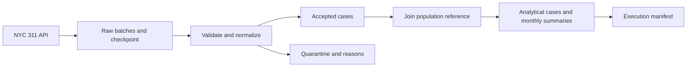

# Data Factory

A Python data-engineering project with two connected workflows:

- **NYC 311 Data Factory:** resumable acquisition, validation, quarantine,
  population enrichment, and reproducible case-level and monthly outputs.
- **Database Performance:** Olist/NYC source preparation and PostgreSQL loading,
  five validated SQL analyses, measured query plans, a bounded indexing trial,
  live views, result snapshots, a percentage Function, and a monthly refresh Procedure.

Use the CLI for the NYC pipeline and offline Olist cleaning. Use the stage
notebooks to review and execute the PostgreSQL work, analytical controls, and
recorded results. The notebooks and database decision report are in Persian;
this guide describes the public setup and execution paths in English.

## Stage deliverables

This repository continues across the linked coursework stages. Shared package
code, configuration, SQL definitions, dependencies, and tests live at the project
root. Each stage has its own notebook and decision report.

| Stage | Deliverables | Status |
|---|---|---|
| 01 - Data Factory | [Notebook](stages/stage_01/solution.ipynb), [report](stages/stage_01/report.docx) | Pipeline implemented; acquisition completeness is reported separately from processing success |
| 02 - Database Performance | [Stage guide](stages/stage_02/README.md), [notebook](stages/stage_02/solution.ipynb), [Persian decision report](stages/stage_02/report.md) | Five analyses, bounded indexing trial, views/snapshots and monthly SQL routines executed; 94 database tests passed |

The 200 ms target remains unmet for the original Q1/Q3/Q4/Q5 executions. The
stored Q5 result has a separately measured fast read path. A complete fresh-kernel
notebook run and empty-database end-to-end acceptance have not been verified.
See [database results and limits](#database-results-and-limits) for the exact scope.

## Contents

- [Stage deliverables](#stage-deliverables)
- [Quick start](#quick-start)
- [Run the pipeline](#run-the-pipeline)
- [Use the notebook](#use-the-notebook)
- [Database workflow (stage 02)](#database-workflow-stage-02)
- [Configuration](#configuration)
- [Outputs](#outputs)
- [Data quality and reproducibility](#data-quality-and-reproducibility)
- [Tests](#tests)
- [Project structure](#project-structure)
- [Troubleshooting](#troubleshooting)
- [Further documentation](#further-documentation)

## Quick start

Use **Python 3.14** to match the environment used to lock `requirements.txt` and
execute the notebook. You also need Git, access to the configured data sources
for initial acquisition, and disk space for raw batches and generated datasets.
Large data files are excluded from Git and must be downloaded on a fresh clone.

```bash
git clone https://github.com/Ehsan-soveyzi/machine_learning_challenge.git
cd machine_learning_challenge
python -m venv .venv
```

Activate the environment using the command for your shell:

| Shell | Command |
|---|---|
| Windows PowerShell | `.venv\Scripts\Activate.ps1` |
| Windows Command Prompt | `.venv\Scripts\activate.bat` |
| macOS / Linux | `source .venv/bin/activate` |

If your system uses `python3.14` instead of `python`, use that executable when
creating the environment. After activation, install the dependencies and package:

```bash
python -m pip install -r requirements.txt
python -m pip install --no-build-isolation -e .
python -m data_factory.testing
```

Run all project commands from the repository root. The package also installs a
`data-factory` command; `data-factory run --stage all` is equivalent to
`python -m data_factory run --stage all`. Choose the NYC workflow below or the
[PostgreSQL workflow](#database-workflow-stage-02) after installation.

## Run the pipeline

The default configuration is [`config/setting.json`](config/setting.json).



### Complete workflow

```bash
python -m data_factory run --stage all
```

This runs **ingestion → validation → population join → finalization**. It resumes
an existing acquisition and downloads until an empty API response confirms
completion. The configured minimum record count does not stop the download.
Inspection and notebook EDA are separate from this command.

### Individual stages

| Stage | Purpose | Network use |
|---|---|---|
| `ingest` | Download remaining raw batches and update the checkpoint | Until acquisition completes |
| `inspect` | Profile selected saved raw batches without cleaning them | None |
| `validate` | Apply the contract and publish accepted/quarantine outputs | None |
| `population` | Enrich accepted cases using the pinned population reference | Only when the reference is not cached |
| `finalize` | Publish case data, a wide monthly table, and an execution manifest | None |

```bash
python -m data_factory run --stage ingest
python -m data_factory run --stage inspect
python -m data_factory run --stage validate
python -m data_factory run --stage population
python -m data_factory run --stage finalize
```

Run downstream stages after their upstream inputs exist and pass validation.
To reprocess saved data offline, run `validate`, `population`, and `finalize`
with the population reference already cached.

### Resume or limit a download

Interrupt ingestion with **Ctrl+C**, then rerun the same command to resume.
Keep raw batches and their checkpoint together.

```bash
python -m data_factory run --stage ingest
python -m data_factory run --stage ingest --max-batches 1
```

`--max-batches` limits newly downloaded batches in that invocation and is only
valid with `ingest`. It does not mark a partial acquisition complete.

### Acquire a new interval

After the base snapshot is complete, acquire newly created requests from the
previous interval's exclusive end to the current time in New York:

```bash
python -m data_factory run --stage all --since-last-run
```

`--since-last-run` works with `ingest` or `all`. Each interval has separate raw
and generated-data directories under `incremental/`. Interrupted intervals
reuse their saved end time. Intervals are not automatically merged, and later
updates to older requests are not refreshed by this mode.

### Select another configuration

```bash
python -m data_factory run --stage all --config config/custom.json
python -m data_factory run --help
```

Copy `config/setting.json` to `config/custom.json` before editing it. Relative
paths are resolved from your working directory, including when using `--config`.

## Use the notebook

### Stage 01: NYC 311 workflow

Open [`stages/stage_01/solution.ipynb`](stages/stage_01/solution.ipynb) in VS Code with Jupyter support or an
existing Jupyter interface. Select the project environment, then choose
**Restart Kernel & Run All**. The notebook includes saved outputs, four EDA
figures, findings, offline tests, and an independent comparison of output hashes.

If your notebook interface needs a registered kernel, run this from the activated
environment and select **Python (Data Factory)**:

```bash
python -m ipykernel install --user --name data-factory --display-name "Python (Data Factory)"
```

With saved cases and a verified population cache available, the notebook
reprocesses the snapshot offline by default. With no cases available, it starts
initial acquisition. To continue a
partial download, run the `ingest` command or set `DOWNLOAD_REMOTE = True` in the
configuration cell. The notebook explicitly reports whether the scope is complete.

## Database workflow (stage 02)

The [database notebook](stages/stage_02/solution.ipynb) contains saved Olist/NYC
loading outputs, full analytical results, SQL displays, correctness checks,
timings, and plans. Its current section numbers are continuous:

| Section | Contents |
|---|---|
| 1 | Shared package, local connection settings and reusable SQLAlchemy Engine |
| 2 | Source inspection, Olist cleaning and NYC 311 output checks |
| 3 | Initial schema creation and PostgreSQL loading |
| 4.1-4.5 | Five SQL questions, independent controls and original baselines |
| 5 | Completed bounded index-only attempt and unmet-budget explanations |
| 6 | Simple/multi-table views and live-view versus snapshot comparison |
| 7 | Percentage Function and monthly snapshot refresh Procedure |
| 8 | Tests and acceptance checks |
| 9 | Decisions, limitations and delivery status |

### Prepare data and PostgreSQL

1. Place the nine original Olist CSVs in `data/stage_02/raw/`. Required filenames
   and columns are listed in [the Olist contract](config/olist_schema.json).
   Run `python -m data_factory clean-olist` to publish validated local outputs;
   this command does not connect to PostgreSQL.
2. For NYC loading, prepare the stage 01 delivery and verified population cache.
   The saved database loading output contains 330,000 NYC cases, 177 population
   areas and 183 ZIP aliases. This is a partial source acquisition, not proof
   of complete coverage of the configured 18-month interval.
3. Start PostgreSQL and create an empty database for the project. The recorded
   work used PostgreSQL 18 and database `ds_learning`. On a fresh clone, copy
   [`.env.example`](.env.example) to `.env` and set `DATABASE_URL` for your own
   database. Use the `postgresql+psycopg://` driver prefix and percent-encode
   special characters in URL credentials. The local `.env` is Git-ignored;
   process environment values override it.
4. Select the installed project environment in the notebook. Run section 1,
   source preparation/checks in section 2, then initial DDL in section 3.1.
   The initial scripts [001_olist.sql](sql/ddl/001_olist.sql) and
   [002_nyc311.sql](sql/ddl/002_nyc311.sql) create nine Olist tables and three NYC
   tables in one transaction. Use section 3.2 to load the curated data in
   foreign-key order.
5. Execute the analytical and derived-object sections as needed. Each query
   section records its own verification and measurement conditions. Section 5
   reads the historical indexing measurements; its apply cell checks/installs
   the retained index. Snapshot rebuilds and comparison measurements in
   sections 6-7 are explicit operations.

Run the database notebook **by section**. The loading cells use append-only
COPY operations; the two Olist loader cells are alternatives, so use one on
empty target tables. Repeating both or running all loading cells against an
already populated database can violate primary keys. There is no database
bootstrap/load CLI, automatic load deduplication, or verified full-notebook
rerun. Older preparation notes describe their original execution snapshots;
the [decision report](stages/stage_02/report.md) summarizes the current results.

### Database results and limits

The original warm baselines use execute plus full result fetch, two warmups and
seven measurements, with EXPLAIN recorded separately:

| Query | Analysis | Original median (ms) | All seven runs below 200 ms |
|---|---|---:|---|
| Q1 | Monthly category merchandise sales | 459.27 | No |
| Q2 | Monthly/state late-delivery rates | 146.25 | Yes |
| Q3 | Review satisfaction by delivery-delay group | 414.49 | No |
| Q4 | Top sellers, preparation time and review proxies | 1033.66 | No |
| Q5 | Payment methods/installments and merchandise order values | 1190.08 | No |

One fixed four-index trial covered Q1/Q3/Q4/Q5 without changing their SQL or
optimizer settings. It did not meet the target. Only
`idx_qbudget_reviews_latest` was retained after three unused candidates were
removed. Q3's trial median improved from 744.75 to 287.40 ms, still above budget.
No new timing trial followed removal, so these historical trial values do not
describe a fresh measurement of the final single-index configuration. Further
tuning was stopped; reasons and plans are in the
[indexing report](stages/stage_02/report.md#index-only-attempt).

The separate Q5 live-view/cache comparison used one warmup and three measured
reads per path. All 58 rows and every field matched the validated Q5 output:

| Path | Median read (ms) | Maximum read (ms) | All three runs below 200 ms |
|---|---:|---:|---|
| Live multi-table view | 1704.00 | 1737.35 | No |
| Snapshot result table | 1.22 | 1.50 | Yes |

Snapshot refresh plus ANALYZE took 1762.97 ms before commit; the full transaction
including validation against original Q5 and commit took 3457.41 ms. The result
table occupied 49,152 bytes including auxiliary storage; metadata and its
primary-key index occupied 32,768 bytes in that measurement. These are recorded
local warm-cache results, with no concurrency load or cold-cache guarantee.

The snapshot moves computation to rebuild time. It stays unchanged after
source updates until explicitly refreshed; timestamp age does not detect
those updates. Refreshes are atomic, can block readers, and have no automatic
trigger or scheduler. See the [view/snapshot report](stages/stage_02/report.md#views-and-snapshot).

### Views and monthly SQL routines

The shared package exposes these operations after the source tables are loaded:

| Module/API | Action |
|---|---|
| [`views.prepare_payment_snapshot`](src/data_factory/database/views.py) | Install the two views and Q5 cache, rebuild it, and validate all results before commit |
| `views.compare_payment_view_snapshot` | Measure live/cache reads once per invocation; does not refresh stale data |
| [`routines.install_routines`](src/data_factory/database/routines.py) | Install the percentage Function, monthly tables and refresh Procedure in the caller's transaction |
| `routines.run_monthly_routines` | Demonstrate two month-scoped CALLs and validate repeatability against Q2 plus independent Python |

`olist.safe_percentage(numeric, numeric)` is usable in SELECT and returns NULL
for a zero denominator or NULL input. `olist.refresh_monthly_delivery_snapshot(date)`
is invoked with CALL and rebuilds only the requested purchase month of Q2.
It preserves other months and updates metadata atomically, with no internal
COMMIT. Same-month calls use an advisory transaction lock; serialization failures
can require a caller retry. Automatic retry and refresh scheduling are not installed.

For the saved January 2017 example, both CALLs produced the same 24 state groups:
750 eligible delivered orders, 22 late, 728 on time, and a weighted late rate of
2.93%. The two calls demonstrate correctness rather than query-budget performance.
To run that demonstration against your populated database:

```python
from datetime import date
from pathlib import Path
from data_factory.database.connection import create_database_engine
from data_factory.database.routines import run_monthly_routines

engine = create_database_engine()
try:
    rows, report = run_monthly_routines(engine, Path.cwd(), date(2017, 1, 1))
finally:
    engine.dispose()
```

### Database outputs

Large raw/curated datasets are excluded from Git. Saved SQL evidence lives under
[`stages/stage_02/evidence/`](stages/stage_02/evidence/README.md):

| Location | Contents |
|---|---|
| `data/stage_02/curated/olist/latest.json` | Pointer to the local validated Olist run |
| `evidence/quality/` | Source checks, exact analytical results and test reports |
| `evidence/benchmarks/` and `evidence/plans/` | Original timings, environment details and actual EXPLAIN plans |
| `evidence/benchmarks/indexing/` | Historical before/after four-index trial |
| `evidence/benchmarks/views/` and `evidence/plans/views/` | Live/cache comparison and plans |
| `evidence/quality/routines/` | Monthly Procedure results, two-call verification, metadata and SQL hashes |

Paths beginning with `evidence/` in this table are relative to `stages/stage_02/`.

## Configuration

| Group | Controls |
|---|---|
| `source` | Endpoint, inclusive start, exclusive end, complaint types, boroughs, minimum volume, and seed |
| `http` | Batch size, timeout, retry count, and bounded retry delays |
| `validation` | Contract path, inspection settings, schema drift detection, and quarantine threshold |
| `population` | Reference endpoint, pinned commit/checksum, geography, and column mapping |
| `delivery` | Population scale, maximum month count, and decimal precision |
| `paths` | Raw data, reference cache, reports, and output directories |

The default scope selects five noise complaint types across all NYC boroughs
from **2024-01-01 inclusive** to **2025-07-01 exclusive**. Batch size is 5,000,
the quarantine limit is 1%, and rates use a scale of 100,000 residents. The
population denominator is a historical 2019 MODZCTA reference.

Use a **different `paths.raw_dir`** when changing the endpoint, date interval,
complaint selection, or borough selection. Existing checkpoints verify their
source scope and refuse incompatible changes. Batch size and retry settings can
change when resuming ordinary ingestion. Changing the population reference
requires a matching source pin and rerunning downstream stages.

## Outputs

Start with `data/curated_data/delivery/latest.json`. Its `report` and `manifest`
values are paths relative to the delivery directory; `run` identifies the
directory containing the latest analytical files.

| File | Contents |
|---|---|
| `data/raw_data/batch_*.json` | Saved raw API responses |
| `data/raw_data/checkpoint.json` | Source scope, cursor, batch checksums, counts, and completion state |
| `data/curated_data/raw_inspection.json` | Observational raw-data profile |
| `validation/<run>/accepted.jsonl` | Normalized records that passed validation |
| `validation/<run>/quarantine.jsonl` | Rejected raw records, locations, and reason codes |
| `validation/<run>/quality_profile.json` | Generated column-level quality statistics |
| `population_join/<run>/enriched_cases.jsonl` | Accepted cases with population and join diagnostics |
| `delivery/<run>/analytical_cases.jsonl` | Final case-level data, including closure duration and analysis area |
| `delivery/<run>/monthly_summary_wide.csv` | Area × complaint type × metric, with months as columns |
| `delivery/<run>/delivery_report.json` | Coverage, counts, metric definitions, and analytical checksums |
| `delivery/executions/<id>/run_manifest.json` | Execution times, code identity, counts, HTTP budget, and output hashes |

Paths beginning with `validation/`, `population_join/`, or `delivery/` are
relative to `data/curated_data/` under the default configuration. Verified
reference files are cached under `data/reference_data/`.

**Check `delivery_complete` before using an output as a complete-period result.**
`status: passed` means processing succeeded; a partial acquisition can still
produce passing outputs. Partial months have blank rates, and unacquired months
have blank counts rather than invented zeros.

## Data quality and reproducibility

- Invalid required fields, negative closure durations, and duplicate/conflicting
  IDs go to quarantine with reasons. Optional repairs remain visible in quality flags.
- Missing closure dates stay null; a valid zero duration is retained. Identifiers
  and ZIP codes remain strings.
- The population join preserves cases, including unmatched ZIPs and borough
  mismatches. Population is counted once per reference area when calculating rates.
- Raw batch checksums and atomic publication protect resume and output integrity.
  Systematic source schema changes stop processing with an explicit error.
- Identical frozen inputs, settings, and code produce identical analytical
  bytes and hashes. Per-execution manifests vary because they record actual
  timestamps and unique execution IDs.
- `--stage all` records actual HTTP attempts for that invocation, including
  retries and reference acquisition. Earlier executions are not reconstructed.

The dataset is live, so a fresh download can differ from a previous snapshot.
Closure duration describes recorded administrative closure, and the historical
population denominator limits interpretation of rates.

## Tests

### Offline checks

Run the offline suite with DNS and outbound socket connections disabled:

```bash
python -m data_factory.testing
```

Standard `unittest` discovery is also supported:

```bash
python -m unittest discover -s tests -v
```

Tests use temporary directories and simulated HTTP responses. They cover HTTP
failures, malformed JSON, resume and interruption recovery, schema drift,
quarantine, duration boundaries, population joins, incremental intervals,
request counting, EDA calculations, and full-pipeline hash reproducibility.

Live PostgreSQL tests skip when no isolated test database URL is supplied.
Use the dedicated runner below for the database integration checks.

### PostgreSQL integration checks

With PostgreSQL running and credentials in `.env`, run from the repository root:

```bash
python tests/database/run_ddl_tests.py
python tests/database/run_ddl_tests.py --pattern test_views.py
python tests/database/run_ddl_tests.py --pattern test_routines.py
```

The recorded full database run passed **94 tests**: 5 live DDL, 48 live
analytical, 7 view/snapshot, 11 Function/Procedure, and 23 offline checks.
Tests cover hand-checked analytical cases, snapshot staleness, repeat refreshes,
preservation of other months, and rollback after failed result/metadata inserts.

The runner creates a `df_ddl_test_*` database, verifies its identity, confines
fixture resets to it, and removes it afterward. The configured analysis database
is not used for fixtures. The local role needs CREATEDB or equivalent rights
through the `postgres` administrative database. Saved reports are
[`ddl_tests.json`](stages/stage_02/evidence/quality/ddl_tests.json),
[`view_tests.json`](stages/stage_02/evidence/quality/view_tests.json), and
[`routine_tests.json`](stages/stage_02/evidence/quality/routine_tests.json).

## Project structure

```text
.
|-- stages/
|   |-- stage_01/                      # Existing notebook, report and data notes
|   `-- stage_02/                      # Executed sections, Persian report and SQL evidence
|-- src/data_factory/                 # Shared factory implementation and CLI
|   |-- sources/                      # Olist CSV source adapter
|   |-- sinks/                        # Reserved for database destination adapters
|   `-- database/                     # Connection, DDL, analytical controls, benchmarks, views and routines
|-- sql/                              # DDL, queries, indexes, views and routines
|-- config/                           # Existing config plus database example
|-- tests/                            # Offline factory and data-quality checks
|   `-- database/                     # Isolated DDL, analytical, view and routine checks
|-- docs/                             # Existing contracts and delivery notes
|-- challenge_details/                # Assignment documents
|-- data/
|   |-- raw_data/                     # Existing raw batches and checkpoint
|   |-- reference_data/               # Existing reference cache
|   |-- curated_data/                 # Existing generated artifacts
|   `-- stage_02/                     # Ignored Olist raw/curated datasets
|-- .env.example                      # Local connection format; placeholder credentials
|-- pyproject.toml                    # Shared package metadata and CLI
`-- requirements.txt                  # Stage 01 pins and stage 02 dependency additions
```

## Troubleshooting

| Symptom | Action |
|---|---|
| `No module named data_factory` | Activate the intended environment and run `python -m pip install --no-build-isolation -e .` from the repository root. |
| PowerShell blocks activation | Run the same commands with `.venv\Scripts\python.exe` instead of `python`; activation is optional. |
| HTTP 403 or another access failure | Check access to the configured source from your environment, then rerun ingestion. Preserve the saved batches and checkpoint. |
| HTTP 429, 5xx, timeout, or malformed JSON | The client retries according to `http` settings. After exhaustion, rerun the stage to resume. |
| Acquisition scope changed | Use a separate raw directory for the new selection. |
| Changed checksum or missing raw file | Restore the original file/checkpoint pair or acquire a fresh snapshot in a new directory. |
| Quarantine threshold exceeded | Inspect the generated rejection reasons, investigate the source/contract mismatch, and rerun validation after resolving it. |
| Missing or stale downstream inputs | Rerun `validate`, then `population`, then `finalize` in that order. |
| `--since-last-run` rejects the base snapshot | Finish the original acquisition before starting a new interval. |
| PostgreSQL connection/authentication fails | Check the local server, database and `.env` settings; use `postgresql+psycopg://` and encode special URL credential characters. |
| COPY raises a duplicate primary-key error | Loading appends rows. Check whether the table is already populated and use only one Olist loader variant on empty targets. |
| Database tests cannot create a temporary database | Give the test role CREATEDB or equivalent rights and access to the `postgres` administrative database. |
| Snapshot differs from updated source data | Rebuild the Q5 snapshot explicitly, or CALL the monthly Procedure for each changed Q2 month. Old cache contents do not update themselves. |
| Query results no longer match frozen evidence | Check source data, scope and metric definitions before interpreting timings; saved comparisons validate the recorded local snapshot. |

CLI exit codes: `0` success, `2` configuration/argument error, `3` network error,
`4` data/state error, `5` file-system error, and `130` interruption.

## Further documentation

- [Data contract](docs/data_contract.md): field types, missing values, and rejection policies.
- [Population join](docs/population_join.md): reference provenance, geography, and denominator rules.
- [Final delivery](docs/final_delivery.md): output metrics, coverage, and determinism policy.
- [Testing and submission checklist](docs/submission_checklist.md): coverage and remaining delivery requirements.
- [Decision report](stages/stage_01/report.docx): rationale, evidence, tradeoffs, and limitations.
- [Data understanding notes](stages/stage_01/data_undrestandation_notes.docx): source fields and interpretation.
- [Database stage guide](stages/stage_02/README.md): dependency/setup detail and executed database sections.
- [Persian database decision report](stages/stage_02/report.md): definitions, choices, measured results and limitations.
- [SQL layout](sql/README.md): versioned schema, queries, retained index, views, Function and Procedure.
- [Database evidence guide](stages/stage_02/evidence/README.md): result, timing, plan and test artifacts.

The notebook, decision report, and some companion documents are written in Persian.


