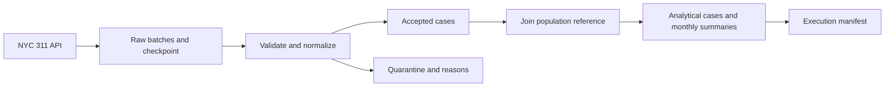

# Data Factory

A Python pipeline that turns NYC 311 service requests into validated case-level
data and monthly population-normalized summaries. It supports resumable
downloads, explicit data contracts, quarantine with rejection reasons, a pinned
population reference, and reproducible analytical outputs.

Use the CLI to build datasets and the [notebook](solution.ipynb) to review the
workflow, quality checks, tests, and exploratory analysis.

## Contents

- [Quick start](#quick-start)
- [Run the pipeline](#run-the-pipeline)
- [Use the notebook](#use-the-notebook)
- [Configuration](#configuration)
- [Outputs](#outputs)
- [Data quality and reproducibility](#data-quality-and-reproducibility)
- [Tests](#tests)
- [Project structure](#project-structure)
- [Troubleshooting](#troubleshooting)
- [Further documentation](#further-documentation)

## Quick start

Use **Python 3.14** to match the environment used to lock `requirements.txt` and
execute the notebook. You also need Git, access to the configured data sources
for initial acquisition, and disk space for raw batches and generated datasets.
Large data files are excluded from Git and must be downloaded on a fresh clone.

```bash
git clone https://github.com/Ehsan-soveyzi/machine_learning_challenge.git
cd machine_learning_challenge
python -m venv .venv
```

Activate the environment using the command for your shell:

| Shell | Command |
|---|---|
| Windows PowerShell | `.venv\Scripts\Activate.ps1` |
| Windows Command Prompt | `.venv\Scripts\activate.bat` |
| macOS / Linux | `source .venv/bin/activate` |

If your system uses `python3.14` instead of `python`, use that executable when
creating the environment. After activation, install the dependencies and package:

```bash
python -m pip install -r requirements.txt
python -m pip install --no-build-isolation -e .
python -m data_factory.testing
python -m data_factory run --stage all
```

Run all project commands from the repository root. The package also installs a
`data-factory` command; `data-factory run --stage all` is equivalent to the last
command above.

## Run the pipeline

The default configuration is [`config/setting.json`](config/setting.json).



### Complete workflow

```bash
python -m data_factory run --stage all
```

This runs **ingestion → validation → population join → finalization**. It resumes
an existing acquisition and downloads until an empty API response confirms
completion. The configured minimum record count does not stop the download.
Inspection and notebook EDA are separate from this command.

### Individual stages

| Stage | Purpose | Network use |
|---|---|---|
| `ingest` | Download remaining raw batches and update the checkpoint | Until acquisition completes |
| `inspect` | Profile selected saved raw batches without cleaning them | None |
| `validate` | Apply the contract and publish accepted/quarantine outputs | None |
| `population` | Enrich accepted cases using the pinned population reference | Only when the reference is not cached |
| `finalize` | Publish case data, a wide monthly table, and an execution manifest | None |

```bash
python -m data_factory run --stage ingest
python -m data_factory run --stage inspect
python -m data_factory run --stage validate
python -m data_factory run --stage population
python -m data_factory run --stage finalize
```

Run downstream stages after their upstream inputs exist and pass validation.
To reprocess saved data offline, run `validate`, `population`, and `finalize`
with the population reference already cached.

### Resume or limit a download

Interrupt ingestion with **Ctrl+C**, then rerun the same command to resume.
Keep raw batches and their checkpoint together.

```bash
python -m data_factory run --stage ingest
python -m data_factory run --stage ingest --max-batches 1
```

`--max-batches` limits newly downloaded batches in that invocation and is only
valid with `ingest`. It does not mark a partial acquisition complete.

### Acquire a new interval

After the base snapshot is complete, acquire newly created requests from the
previous interval's exclusive end to the current time in New York:

```bash
python -m data_factory run --stage all --since-last-run
```

`--since-last-run` works with `ingest` or `all`. Each interval has separate raw
and generated-data directories under `incremental/`. Interrupted intervals
reuse their saved end time. Intervals are not automatically merged, and later
updates to older requests are not refreshed by this mode.

### Select another configuration

```bash
python -m data_factory run --stage all --config config/custom.json
python -m data_factory run --help
```

Copy `config/setting.json` to `config/custom.json` before editing it. Relative
paths are resolved from your working directory, including when using `--config`.

## Use the notebook

Open [`solution.ipynb`](solution.ipynb) in VS Code with Jupyter support or an
existing Jupyter interface. Select the project environment, then choose
**Restart Kernel & Run All**. The notebook includes saved outputs, four EDA
figures, findings, offline tests, and an independent comparison of output hashes.

If your notebook interface needs a registered kernel, run this from the activated
environment and select **Python (Data Factory)**:

```bash
python -m ipykernel install --user --name data-factory --display-name "Python (Data Factory)"
```

With saved cases and a verified population cache available, the notebook
reprocesses the snapshot offline by default. With no cases available, it starts
initial acquisition. To continue a
partial download, run the `ingest` command or set `DOWNLOAD_REMOTE = True` in the
configuration cell. The notebook explicitly reports whether the scope is complete.

## Configuration

| Group | Controls |
|---|---|
| `source` | Endpoint, inclusive start, exclusive end, complaint types, boroughs, minimum volume, and seed |
| `http` | Batch size, timeout, retry count, and bounded retry delays |
| `validation` | Contract path, inspection settings, schema drift detection, and quarantine threshold |
| `population` | Reference endpoint, pinned commit/checksum, geography, and column mapping |
| `delivery` | Population scale, maximum month count, and decimal precision |
| `paths` | Raw data, reference cache, reports, and output directories |

The default scope selects five noise complaint types across all NYC boroughs
from **2024-01-01 inclusive** to **2025-07-01 exclusive**. Batch size is 5,000,
the quarantine limit is 1%, and rates use a scale of 100,000 residents. The
population denominator is a historical 2019 MODZCTA reference.

Use a **different `paths.raw_dir`** when changing the endpoint, date interval,
complaint selection, or borough selection. Existing checkpoints verify their
source scope and refuse incompatible changes. Batch size and retry settings can
change when resuming ordinary ingestion. Changing the population reference
requires a matching source pin and rerunning downstream stages.

## Outputs

Start with `data/created_data/delivery/latest.json`. Its `report` and `manifest`
values are paths relative to the delivery directory; `run` identifies the
directory containing the latest analytical files.

| File | Contents |
|---|---|
| `data/raw_data/batch_*.json` | Saved raw API responses |
| `data/raw_data/checkpoint.json` | Source scope, cursor, batch checksums, counts, and completion state |
| `data/created_data/raw_inspection.json` | Observational raw-data profile |
| `validation/<run>/accepted.jsonl` | Normalized records that passed validation |
| `validation/<run>/quarantine.jsonl` | Rejected raw records, locations, and reason codes |
| `validation/<run>/quality_profile.json` | Generated column-level quality statistics |
| `population_join/<run>/enriched_cases.jsonl` | Accepted cases with population and join diagnostics |
| `delivery/<run>/analytical_cases.jsonl` | Final case-level data, including closure duration and analysis area |
| `delivery/<run>/monthly_summary_wide.csv` | Area × complaint type × metric, with months as columns |
| `delivery/<run>/delivery_report.json` | Coverage, counts, metric definitions, and analytical checksums |
| `delivery/executions/<id>/run_manifest.json` | Execution times, code identity, counts, HTTP budget, and output hashes |

Paths beginning with `validation/`, `population_join/`, or `delivery/` are
relative to `data/created_data/` under the default configuration. Verified
reference files are cached under `data/reference_data/`.

**Check `delivery_complete` before using an output as a complete-period result.**
`status: passed` means processing succeeded; a partial acquisition can still
produce passing outputs. Partial months have blank rates, and unacquired months
have blank counts rather than invented zeros.

## Data quality and reproducibility

- Invalid required fields, negative closure durations, and duplicate/conflicting
  IDs go to quarantine with reasons. Optional repairs remain visible in quality flags.
- Missing closure dates stay null; a valid zero duration is retained. Identifiers
  and ZIP codes remain strings.
- The population join preserves cases, including unmatched ZIPs and borough
  mismatches. Population is counted once per reference area when calculating rates.
- Raw batch checksums and atomic publication protect resume and output integrity.
  Systematic source schema changes stop processing with an explicit error.
- Identical frozen inputs, settings, and code produce identical analytical
  bytes and hashes. Per-execution manifests vary because they record actual
  timestamps and unique execution IDs.
- `--stage all` records actual HTTP attempts for that invocation, including
  retries and reference acquisition. Earlier executions are not reconstructed.

The dataset is live, so a fresh download can differ from a previous snapshot.
Closure duration describes recorded administrative closure, and the historical
population denominator limits interpretation of rates.

## Tests

Run the complete suite with DNS and outbound socket connections disabled:

```bash
python -m data_factory.testing
```

Standard `unittest` discovery is also supported:

```bash
python -m unittest discover -s tests -v
```

Tests use temporary directories and simulated HTTP responses. They cover HTTP
failures, malformed JSON, resume and interruption recovery, schema drift,
quarantine, duration boundaries, population joins, incremental intervals,
request counting, EDA calculations, and full-pipeline hash reproducibility.

## Project structure

```text
.
├── solution.ipynb                     # Executable workflow and EDA
├── report.docx                        # Key decisions and limitations
├── config/                           # Pipeline settings and record contract
├── src/data_factory/                  # Pipeline implementation and CLI
├── tests/                            # Offline unittest suite
├── docs/                             # Contracts and delivery notes
├── data/
│   ├── raw_data/                      # Raw batches and checkpoint; ignored by Git
│   ├── reference_data/                # Verified reference cache; ignored by Git
│   └── created_data/                  # Generated reports and datasets
├── pyproject.toml                     # Package metadata and CLI entry point
└── requirements.txt                  # Locked execution dependencies
```

## Troubleshooting

| Symptom | Action |
|---|---|
| `No module named data_factory` | Activate the intended environment and run `python -m pip install --no-build-isolation -e .` from the repository root. |
| PowerShell blocks activation | Run the same commands with `.venv\Scripts\python.exe` instead of `python`; activation is optional. |
| HTTP 403 or another access failure | Check access to the configured source from your environment, then rerun ingestion. Preserve the saved batches and checkpoint. |
| HTTP 429, 5xx, timeout, or malformed JSON | The client retries according to `http` settings. After exhaustion, rerun the stage to resume. |
| Acquisition scope changed | Use a separate raw directory for the new selection. |
| Changed checksum or missing raw file | Restore the original file/checkpoint pair or acquire a fresh snapshot in a new directory. |
| Quarantine threshold exceeded | Inspect the generated rejection reasons, investigate the source/contract mismatch, and rerun validation after resolving it. |
| Missing or stale downstream inputs | Rerun `validate`, then `population`, then `finalize` in that order. |
| `--since-last-run` rejects the base snapshot | Finish the original acquisition before starting a new interval. |

CLI exit codes: `0` success, `2` configuration/argument error, `3` network error,
`4` data/state error, `5` file-system error, and `130` interruption.

## Further documentation

- [Data contract](docs/data_contract.md): field types, missing values, and rejection policies.
- [Population join](docs/population_join.md): reference provenance, geography, and denominator rules.
- [Final delivery](docs/final_delivery.md): output metrics, coverage, and determinism policy.
- [Testing and submission checklist](docs/submission_checklist.md): coverage and remaining delivery requirements.
- [Decision report](report.docx): rationale, evidence, tradeoffs, and limitations.
- [Data understanding notes](data_undrestandation_notes.docx): source fields and interpretation.

The notebook, decision report, and some companion documents are written in Persian.
