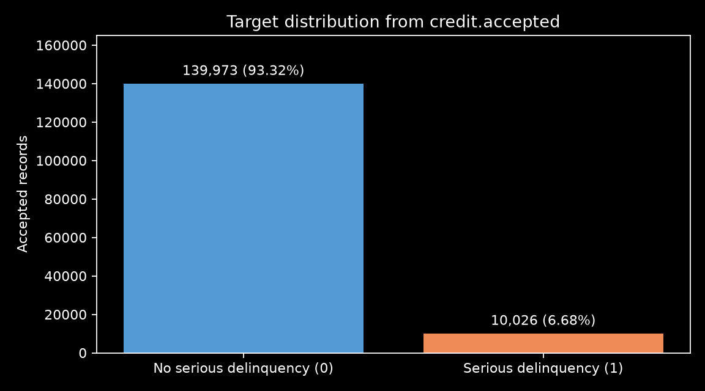
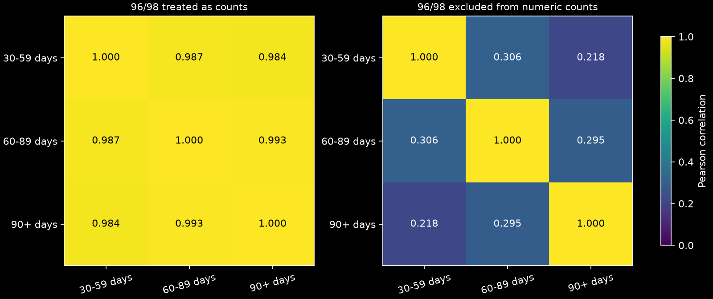
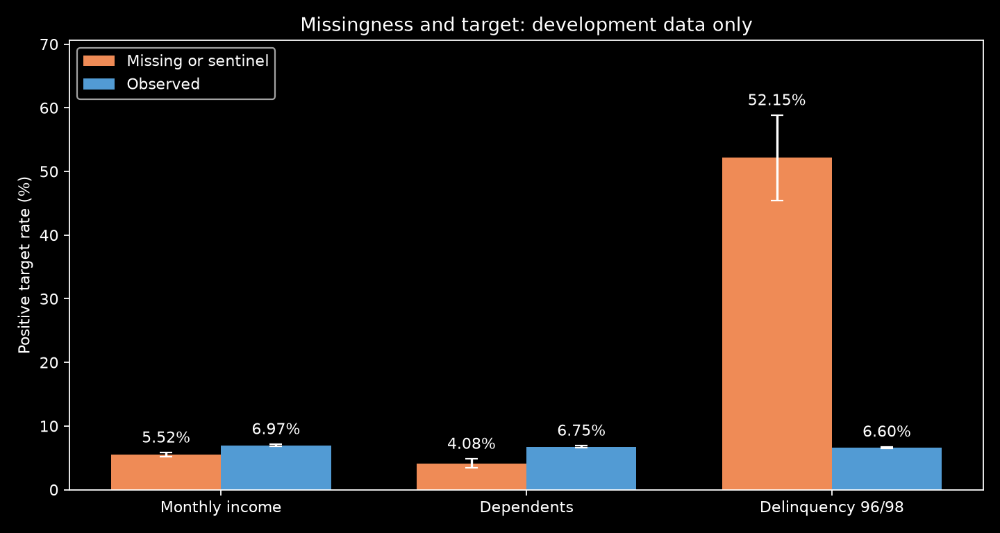
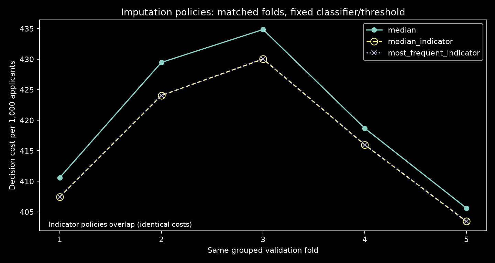
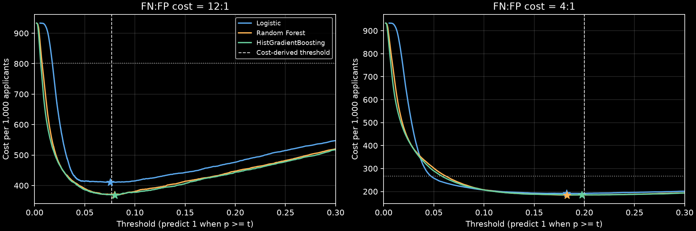
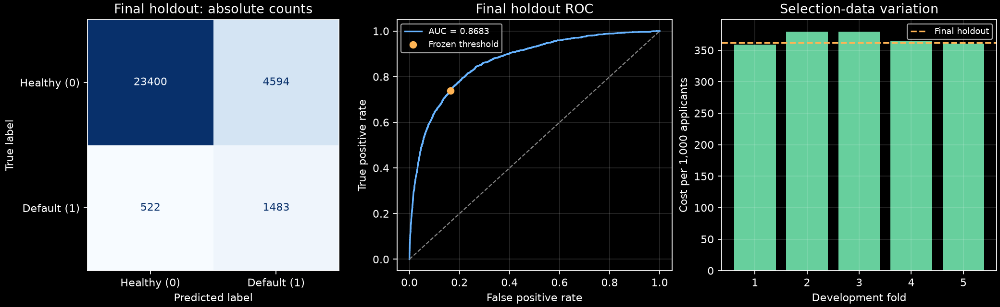
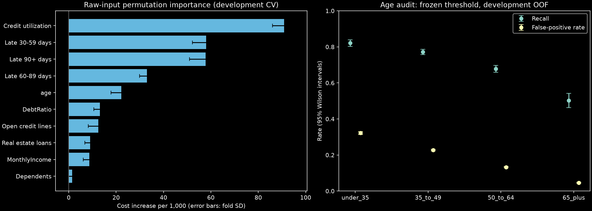

<h1 dir="rtl" style="text-align:right;color:#173f5f;">گزارش مرحله سوم: مدل‌سازی، ارزیابی و تفسیر</h1>

این گزارش بخش‌های یک تا هشت چالش سوم را پوشش می‌دهد. نتایج از اجرای بخش‌های ۴ تا ۱۱ نوت‌بوک به دست آمده‌اند؛ داده پایه از پایگاه داده و ورودی انتخاب آستانه از احتمال‌های OOF بخش پنج است. بخش سه، آماده‌سازی قابل استفاده مجدد و مرز آموزش/ارزیابی را به‌صورت اجرایی بررسی می‌کند. بخش یک توصیفی است؛ در بخش دو، یک طبقه‌بند مرجع برای مقایسه سیاست‌های گمشده به کار رفته است. مدل و آستانه روی توسعه انتخاب و ثابت شدند؛ ارزیابی نهایی، تفسیر توسعه، ممیزی سنی و شناسنامه مدل ثبت شده‌اند.

<h2 id="structure" dir="rtl" style="text-align:right;color:#173f5f;margin-top:32px;">۱. منبع، واحد مشاهده و ساختار داده</h2>

داده تحلیلی از جدول <code dir="ltr" style="unicode-bidi:isolate;overflow-wrap:anywhere;white-space:normal;">credit.accepted</code> در پایگاه داده <code dir="ltr" style="unicode-bidi:isolate;overflow-wrap:anywhere;white-space:normal;">ds_learning</code> و با اتصال SQLAlchemy خوانده شد. فایل CSV ورودی تحلیل این بخش نیست. هر سطر، یک رکورد اعتباری ناشناس از متقاضی است؛ شناسه ردیف، هویت یکتای شخص را تضمین نمی‌کند.

<table dir="rtl" style="border-collapse:collapse;width:100%;font-size:14px;">
<thead><tr><th style="border:1px solid #b8c8d5;background:#e8f0f6;padding:9px;text-align:right;">مؤلفه</th><th style="border:1px solid #b8c8d5;background:#e8f0f6;padding:9px;text-align:right;">نتیجه واقعی</th></tr></thead>
<tbody><tr><td style="border:1px solid #cbd5df;background:#ffffff;padding:8px;vertical-align:top;text-align:right;">تعداد رکوردهای پذیرفته‌شده</td><td style="border:1px solid #cbd5df;background:#ffffff;padding:8px;vertical-align:top;text-align:right;">149,999</td></tr>
<tr><td style="border:1px solid #cbd5df;background:#f5f8fb;padding:8px;vertical-align:top;text-align:right;">ستون‌های ذخیره‌شده</td><td style="border:1px solid #cbd5df;background:#f5f8fb;padding:8px;vertical-align:top;text-align:right;">۱۲ = یک شناسه + یک هدف + ۱۰ ویژگی ورودی</td></tr>
<tr><td style="border:1px solid #cbd5df;background:#ffffff;padding:8px;vertical-align:top;text-align:right;">شکل ماتریس ورودی</td><td style="border:1px solid #cbd5df;background:#ffffff;padding:8px;vertical-align:top;text-align:right;"><code dir="ltr" style="unicode-bidi:isolate;overflow-wrap:anywhere;white-space:normal;">(149999, 10)</code></td></tr>
<tr><td style="border:1px solid #cbd5df;background:#f5f8fb;padding:8px;vertical-align:top;text-align:right;">شکل بردار هدف</td><td style="border:1px solid #cbd5df;background:#f5f8fb;padding:8px;vertical-align:top;text-align:right;"><code dir="ltr" style="unicode-bidi:isolate;overflow-wrap:anywhere;white-space:normal;">(149999,)</code></td></tr>
<tr><td style="border:1px solid #cbd5df;background:#ffffff;padding:8px;vertical-align:top;text-align:right;">واحد نمونه</td><td style="border:1px solid #cbd5df;background:#ffffff;padding:8px;vertical-align:top;text-align:right;">رکورد متقاضی؛ بدون تاریخ مشاهده یا شناسه معتبر شخص در ستون‌های موجود</td></tr>
<tr><td style="border:1px solid #cbd5df;background:#f5f8fb;padding:8px;vertical-align:top;text-align:right;">شناسه ردیف</td><td style="border:1px solid #cbd5df;background:#f5f8fb;padding:8px;vertical-align:top;text-align:right;"><code dir="ltr" style="unicode-bidi:isolate;overflow-wrap:anywhere;white-space:normal;">row_id</code>؛ خارج از ورودی مدل</td></tr>
<tr><td style="border:1px solid #cbd5df;background:#ffffff;padding:8px;vertical-align:top;text-align:right;">ردیف‌های تکراری پس از کنارگذاشتن شناسه</td><td style="border:1px solid #cbd5df;background:#ffffff;padding:8px;vertical-align:top;text-align:right;">609؛ نگهداری شدند</td></tr>
</tbody></table>

در شواهد اعتبارسنجی اولیه، 150,000 ردیف خام و 1 ردیف قرنطینه‌شده با سن صفر ثبت شده‌اند. شمار فعلی دیتابیس 149,999 است. این اعدادِ منبع و قرنطینه از فراداده قبلی نقل می‌شوند؛ تمام توصیف‌های آماری این گزارش از رکوردهای فعلی دیتابیس محاسبه شده‌اند.

وجود ۶۰۹ ردیف یکسان در همه ستون‌های غیرشناسه، به‌تنهایی اثبات نمی‌کند که رکورد یک شخص تکرار شده است. چند متقاضی می‌توانند مقادیر اعتباری یکسان داشته باشند؛ بنابراین حذف خودکار این ردیف‌ها توجیه کافی ندارد.

<h2 id="dictionary" dir="rtl" style="text-align:right;color:#173f5f;margin-top:32px;">۲. دیکشنری داده و نوع واقعی متغیرها</h2>

تمام یازده تعریف اصلی دیکشنری اکسل، در شیت اول خوانده شده‌اند. ستون شناسه در آن تعریف نشده و از قرارداد داده و ساختار منبع شناخته می‌شود. جدول زیر ترجمه توضیح‌ها همراه با نقش، نوع معنایی و نشانی دقیق سلول منبع است.

<table dir="rtl" style="border-collapse:collapse;width:100%;font-size:14px;">
<thead><tr><th style="border:1px solid #b8c8d5;background:#e8f0f6;padding:9px;text-align:right;">ستون</th><th style="border:1px solid #b8c8d5;background:#e8f0f6;padding:9px;text-align:right;">نقش</th><th style="border:1px solid #b8c8d5;background:#e8f0f6;padding:9px;text-align:right;">نوع واقعی</th><th style="border:1px solid #b8c8d5;background:#e8f0f6;padding:9px;text-align:right;">معنی و تفسیر</th><th style="border:1px solid #b8c8d5;background:#e8f0f6;padding:9px;text-align:right;">مرجع</th></tr></thead>
<tbody><tr><td style="border:1px solid #cbd5df;background:#ffffff;padding:8px;vertical-align:top;text-align:right;"><code dir="ltr" style="unicode-bidi:isolate;overflow-wrap:anywhere;white-space:normal;">row_id</code></td><td style="border:1px solid #cbd5df;background:#ffffff;padding:8px;vertical-align:top;text-align:right;">شناسه، خارج از مدل</td><td style="border:1px solid #cbd5df;background:#ffffff;padding:8px;vertical-align:top;text-align:right;">اسمی / شناسه</td><td style="border:1px solid #cbd5df;background:#ffffff;padding:8px;vertical-align:top;text-align:right;">شناسه ردیف منبع؛ ویژگی توضیح‌دهنده وضعیت اعتباری نیست.</td><td style="border:1px solid #cbd5df;background:#ffffff;padding:8px;vertical-align:top;text-align:right;"><code dir="ltr" style="unicode-bidi:isolate;overflow-wrap:anywhere;white-space:normal;">Source row identifier (not in dictionary)</code></td></tr>
<tr><td style="border:1px solid #cbd5df;background:#f5f8fb;padding:8px;vertical-align:top;text-align:right;"><code dir="ltr" style="unicode-bidi:isolate;overflow-wrap:anywhere;white-space:normal;">SeriousDlqin2yrs</code></td><td style="border:1px solid #cbd5df;background:#f5f8fb;padding:8px;vertical-align:top;text-align:right;">هدف</td><td style="border:1px solid #cbd5df;background:#f5f8fb;padding:8px;vertical-align:top;text-align:right;">دسته‌ای دودویی</td><td style="border:1px solid #cbd5df;background:#f5f8fb;padding:8px;vertical-align:top;text-align:right;">وقوع دیرکرد ۹۰ روزه یا شدیدتر؛ برچسب پیامد دوساله طبق صورت‌مسئله.</td><td style="border:1px solid #cbd5df;background:#f5f8fb;padding:8px;vertical-align:top;text-align:right;"><code dir="ltr" style="unicode-bidi:isolate;overflow-wrap:anywhere;white-space:normal;">Sheet1!A2:C2</code></td></tr>
<tr><td style="border:1px solid #cbd5df;background:#ffffff;padding:8px;vertical-align:top;text-align:right;"><code dir="ltr" style="unicode-bidi:isolate;overflow-wrap:anywhere;white-space:normal;">RevolvingUtilizationOfUnsecuredLines</code></td><td style="border:1px solid #cbd5df;background:#ffffff;padding:8px;vertical-align:top;text-align:right;">ورودی مدل</td><td style="border:1px solid #cbd5df;background:#ffffff;padding:8px;vertical-align:top;text-align:right;">عددی پیوسته / نسبت</td><td style="border:1px solid #cbd5df;background:#ffffff;padding:8px;vertical-align:top;text-align:right;">مانده کارت‌ها و خطوط اعتبار شخصی، به‌جز املاک و بدهی اقساطی، تقسیم بر مجموع سقف اعتبار.</td><td style="border:1px solid #cbd5df;background:#ffffff;padding:8px;vertical-align:top;text-align:right;"><code dir="ltr" style="unicode-bidi:isolate;overflow-wrap:anywhere;white-space:normal;">Sheet1!A3:C3</code></td></tr>
<tr><td style="border:1px solid #cbd5df;background:#f5f8fb;padding:8px;vertical-align:top;text-align:right;"><code dir="ltr" style="unicode-bidi:isolate;overflow-wrap:anywhere;white-space:normal;">age</code></td><td style="border:1px solid #cbd5df;background:#f5f8fb;padding:8px;vertical-align:top;text-align:right;">ورودی مدل</td><td style="border:1px solid #cbd5df;background:#f5f8fb;padding:8px;vertical-align:top;text-align:right;">عددی گسسته / سن ثبت‌شده</td><td style="border:1px solid #cbd5df;background:#f5f8fb;padding:8px;vertical-align:top;text-align:right;">سن وام‌گیرنده بر حسب سال.</td><td style="border:1px solid #cbd5df;background:#f5f8fb;padding:8px;vertical-align:top;text-align:right;"><code dir="ltr" style="unicode-bidi:isolate;overflow-wrap:anywhere;white-space:normal;">Sheet1!A4:C4</code></td></tr>
<tr><td style="border:1px solid #cbd5df;background:#ffffff;padding:8px;vertical-align:top;text-align:right;"><code dir="ltr" style="unicode-bidi:isolate;overflow-wrap:anywhere;white-space:normal;">NumberOfTime30-59DaysPastDueNotWorse</code></td><td style="border:1px solid #cbd5df;background:#ffffff;padding:8px;vertical-align:top;text-align:right;">ورودی مدل</td><td style="border:1px solid #cbd5df;background:#ffffff;padding:8px;vertical-align:top;text-align:right;">عددی گسسته / شمارش با کد ویژه</td><td style="border:1px solid #cbd5df;background:#ffffff;padding:8px;vertical-align:top;text-align:right;">تعداد دفعات دیرکرد ۳۰ تا ۵۹ روزه و نه شدیدتر در دو سال گذشته.</td><td style="border:1px solid #cbd5df;background:#ffffff;padding:8px;vertical-align:top;text-align:right;"><code dir="ltr" style="unicode-bidi:isolate;overflow-wrap:anywhere;white-space:normal;">Sheet1!A5:C5</code></td></tr>
<tr><td style="border:1px solid #cbd5df;background:#f5f8fb;padding:8px;vertical-align:top;text-align:right;"><code dir="ltr" style="unicode-bidi:isolate;overflow-wrap:anywhere;white-space:normal;">DebtRatio</code></td><td style="border:1px solid #cbd5df;background:#f5f8fb;padding:8px;vertical-align:top;text-align:right;">ورودی مدل</td><td style="border:1px solid #cbd5df;background:#f5f8fb;padding:8px;vertical-align:top;text-align:right;">عددی پیوسته / نسبت</td><td style="border:1px solid #cbd5df;background:#f5f8fb;padding:8px;vertical-align:top;text-align:right;">پرداخت ماهانه بدهی، نفقه و هزینه زندگی تقسیم بر درآمد ناخالص ماهانه؛ نسبت بدهی کل به دارایی نیست.</td><td style="border:1px solid #cbd5df;background:#f5f8fb;padding:8px;vertical-align:top;text-align:right;"><code dir="ltr" style="unicode-bidi:isolate;overflow-wrap:anywhere;white-space:normal;">Sheet1!A6:C6</code></td></tr>
<tr><td style="border:1px solid #cbd5df;background:#ffffff;padding:8px;vertical-align:top;text-align:right;"><code dir="ltr" style="unicode-bidi:isolate;overflow-wrap:anywhere;white-space:normal;">MonthlyIncome</code></td><td style="border:1px solid #cbd5df;background:#ffffff;padding:8px;vertical-align:top;text-align:right;">ورودی مدل</td><td style="border:1px solid #cbd5df;background:#ffffff;padding:8px;vertical-align:top;text-align:right;">عددی پیوسته / مبلغ</td><td style="border:1px solid #cbd5df;background:#ffffff;padding:8px;vertical-align:top;text-align:right;">درآمد ماهانه؛ دیکشنری واحد پول و تعدیل تورمی را مشخص نمی‌کند.</td><td style="border:1px solid #cbd5df;background:#ffffff;padding:8px;vertical-align:top;text-align:right;"><code dir="ltr" style="unicode-bidi:isolate;overflow-wrap:anywhere;white-space:normal;">Sheet1!A7:C7</code></td></tr>
<tr><td style="border:1px solid #cbd5df;background:#f5f8fb;padding:8px;vertical-align:top;text-align:right;"><code dir="ltr" style="unicode-bidi:isolate;overflow-wrap:anywhere;white-space:normal;">NumberOfOpenCreditLinesAndLoans</code></td><td style="border:1px solid #cbd5df;background:#f5f8fb;padding:8px;vertical-align:top;text-align:right;">ورودی مدل</td><td style="border:1px solid #cbd5df;background:#f5f8fb;padding:8px;vertical-align:top;text-align:right;">عددی گسسته / شمارش</td><td style="border:1px solid #cbd5df;background:#f5f8fb;padding:8px;vertical-align:top;text-align:right;">تعداد وام‌های باز از جمله وام خودرو یا مسکن و خطوط اعتبار مانند کارت اعتباری.</td><td style="border:1px solid #cbd5df;background:#f5f8fb;padding:8px;vertical-align:top;text-align:right;"><code dir="ltr" style="unicode-bidi:isolate;overflow-wrap:anywhere;white-space:normal;">Sheet1!A8:C8</code></td></tr>
<tr><td style="border:1px solid #cbd5df;background:#ffffff;padding:8px;vertical-align:top;text-align:right;"><code dir="ltr" style="unicode-bidi:isolate;overflow-wrap:anywhere;white-space:normal;">NumberOfTimes90DaysLate</code></td><td style="border:1px solid #cbd5df;background:#ffffff;padding:8px;vertical-align:top;text-align:right;">ورودی مدل</td><td style="border:1px solid #cbd5df;background:#ffffff;padding:8px;vertical-align:top;text-align:right;">عددی گسسته / شمارش با کد ویژه</td><td style="border:1px solid #cbd5df;background:#ffffff;padding:8px;vertical-align:top;text-align:right;">تعداد دفعات دیرکرد ۹۰ روزه یا بیشتر؛ دیکشنری برای این ستون بازه تاریخی صریح تعیین نکرده است.</td><td style="border:1px solid #cbd5df;background:#ffffff;padding:8px;vertical-align:top;text-align:right;"><code dir="ltr" style="unicode-bidi:isolate;overflow-wrap:anywhere;white-space:normal;">Sheet1!A9:C9</code></td></tr>
<tr><td style="border:1px solid #cbd5df;background:#f5f8fb;padding:8px;vertical-align:top;text-align:right;"><code dir="ltr" style="unicode-bidi:isolate;overflow-wrap:anywhere;white-space:normal;">NumberRealEstateLoansOrLines</code></td><td style="border:1px solid #cbd5df;background:#f5f8fb;padding:8px;vertical-align:top;text-align:right;">ورودی مدل</td><td style="border:1px solid #cbd5df;background:#f5f8fb;padding:8px;vertical-align:top;text-align:right;">عددی گسسته / شمارش</td><td style="border:1px solid #cbd5df;background:#f5f8fb;padding:8px;vertical-align:top;text-align:right;">تعداد وام‌های مسکن و املاک، شامل خطوط اعتباری مبتنی بر ارزش ملک.</td><td style="border:1px solid #cbd5df;background:#f5f8fb;padding:8px;vertical-align:top;text-align:right;"><code dir="ltr" style="unicode-bidi:isolate;overflow-wrap:anywhere;white-space:normal;">Sheet1!A10:C10</code></td></tr>
<tr><td style="border:1px solid #cbd5df;background:#ffffff;padding:8px;vertical-align:top;text-align:right;"><code dir="ltr" style="unicode-bidi:isolate;overflow-wrap:anywhere;white-space:normal;">NumberOfTime60-89DaysPastDueNotWorse</code></td><td style="border:1px solid #cbd5df;background:#ffffff;padding:8px;vertical-align:top;text-align:right;">ورودی مدل</td><td style="border:1px solid #cbd5df;background:#ffffff;padding:8px;vertical-align:top;text-align:right;">عددی گسسته / شمارش با کد ویژه</td><td style="border:1px solid #cbd5df;background:#ffffff;padding:8px;vertical-align:top;text-align:right;">تعداد دفعات دیرکرد ۶۰ تا ۸۹ روزه و نه شدیدتر در دو سال گذشته.</td><td style="border:1px solid #cbd5df;background:#ffffff;padding:8px;vertical-align:top;text-align:right;"><code dir="ltr" style="unicode-bidi:isolate;overflow-wrap:anywhere;white-space:normal;">Sheet1!A11:C11</code></td></tr>
<tr><td style="border:1px solid #cbd5df;background:#f5f8fb;padding:8px;vertical-align:top;text-align:right;"><code dir="ltr" style="unicode-bidi:isolate;overflow-wrap:anywhere;white-space:normal;">NumberOfDependents</code></td><td style="border:1px solid #cbd5df;background:#f5f8fb;padding:8px;vertical-align:top;text-align:right;">ورودی مدل</td><td style="border:1px solid #cbd5df;background:#f5f8fb;padding:8px;vertical-align:top;text-align:right;">عددی گسسته / شمارش</td><td style="border:1px solid #cbd5df;background:#f5f8fb;padding:8px;vertical-align:top;text-align:right;">تعداد افراد تحت تکفل به‌جز خود وام‌گیرنده؛ همسر و فرزندان نیز می‌توانند در آن باشند.</td><td style="border:1px solid #cbd5df;background:#f5f8fb;padding:8px;vertical-align:top;text-align:right;"><code dir="ltr" style="unicode-bidi:isolate;overflow-wrap:anywhere;white-space:normal;">Sheet1!A12:C12</code></td></tr>
</tbody></table>

از ده ورودی، سه متغیر پیوسته‌اند: نسبت استفاده از اعتبار، نسبت بدهی و درآمد ماهانه. هفت ورودی دیگر سن ثبت‌شده یا شمارش‌اند. تعداد خطوط اعتبار، تعداد افراد تحت تکفل و دفعات دیرکرد، شمارش کمی هستند؛ کم بودن تعداد مقادیر یا ذخیره شدن با نوع صحیح، دلیل تبدیل خودکار آن‌ها به دسته اسمی نیست.

دو ستون عددنما که تفسیر دسته‌ای دارند، <code dir="ltr" style="unicode-bidi:isolate;overflow-wrap:anywhere;white-space:normal;">row_id</code> به‌عنوان شناسه اسمی و <code dir="ltr" style="unicode-bidi:isolate;overflow-wrap:anywhere;white-space:normal;">SeriousDlqin2yrs</code> به‌عنوان هدف دودویی‌اند. علاوه بر آن‌ها، ۹۶ و ۹۸ در ستون‌های دیرکرد به‌صورت کد ویژه بررسی می‌شوند، نه تعداد معمولی. برای هیچ‌یک از ده ورودی، یک دسته اسمی پنهان دیگر بدون شاهد فرض نشده است.

نکات معنایی مهم: نسبت بدهی، جریان پرداخت‌های ماهانه و هزینه‌ها نسبت به درآمد ناخالص است؛ بدهی کل تقسیم بر دارایی نیست. نسبت‌های دیکشنری با عنوان درصد معرفی شده‌اند، اما فرمول نسبت دارند و مقدار ۱ معادل ۱۰۰ درصد است؛ ۰٫۲۵ یعنی ۲۵ درصد. واحد پول درآمد در منبع مشخص نشده و به آن واحدی مانند ریال یا دلار نسبت نمی‌دهیم. افراد تحت تکفل فقط فرزندان نیستند و می‌توانند همسر را نیز شامل شوند.

دیکشنری برای دیرکردهای ۳۰ تا ۵۹ و ۶۰ تا ۸۹ روزه، «دو سال گذشته» را صریح بیان می‌کند؛ برای تعداد دیرکردهای ۹۰ روزه، افق گذشته تصریح نشده است. افق دوساله پیامد هدف از صورت‌مسئله می‌آید. در داده، تاریخ‌های لازم برای ممیزی قطعی زمان دسترسی به ویژگی‌ها وجود ندارند و نباید پنجره تاریخی نامستند ساخت.

<h2 id="target" dir="rtl" style="text-align:right;color:#173f5f;margin-top:32px;">۳. شناخت برچسب و توزیع ویژگی‌ها</h2>

هدف <code dir="ltr" style="unicode-bidi:isolate;overflow-wrap:anywhere;white-space:normal;">SeriousDlqin2yrs</code> است. مقدار ۱ نشان‌دهنده دیرکرد ۹۰ روزه یا شدیدتر در افق دوساله مسئله است. مقدار ۰ یعنی این پیامد جدی ثبت نشده است؛ صفر به معنی نداشتن بدهی یا نداشتن هرگونه تأخیر نیست. سابقه دیرکردِ ورودی با پیامد آینده هدف تفاوت دارد.

<table dir="rtl" style="border-collapse:collapse;width:100%;font-size:14px;">
<thead><tr><th style="border:1px solid #b8c8d5;background:#e8f0f6;padding:9px;text-align:right;">برچسب</th><th style="border:1px solid #b8c8d5;background:#e8f0f6;padding:9px;text-align:right;">معنی</th><th style="border:1px solid #b8c8d5;background:#e8f0f6;padding:9px;text-align:right;">تعداد</th><th style="border:1px solid #b8c8d5;background:#e8f0f6;padding:9px;text-align:right;">درصد</th></tr></thead>
<tbody><tr><td style="border:1px solid #cbd5df;background:#ffffff;padding:8px;vertical-align:top;text-align:right;"><code dir="ltr" style="unicode-bidi:isolate;overflow-wrap:anywhere;white-space:normal;">0</code></td><td style="border:1px solid #cbd5df;background:#ffffff;padding:8px;vertical-align:top;text-align:right;">بدون پیامد جدی تعریف‌شده</td><td style="border:1px solid #cbd5df;background:#ffffff;padding:8px;vertical-align:top;text-align:right;">139,973</td><td style="border:1px solid #cbd5df;background:#ffffff;padding:8px;vertical-align:top;text-align:right;">93.316٪</td></tr>
<tr><td style="border:1px solid #cbd5df;background:#f5f8fb;padding:8px;vertical-align:top;text-align:right;"><code dir="ltr" style="unicode-bidi:isolate;overflow-wrap:anywhere;white-space:normal;">1</code></td><td style="border:1px solid #cbd5df;background:#f5f8fb;padding:8px;vertical-align:top;text-align:right;">دارای پیامد جدی تعریف‌شده</td><td style="border:1px solid #cbd5df;background:#f5f8fb;padding:8px;vertical-align:top;text-align:right;">10,026</td><td style="border:1px solid #cbd5df;background:#f5f8fb;padding:8px;vertical-align:top;text-align:right;">6.684٪</td></tr>
</tbody></table>

سهم کلاس مثبت 6.6840٪ است. پیش‌بینی ثابت کلاس صفر، صرفاً به دلیل فراوانی آن، دقت ظاهری 93.3160٪ خواهد داشت. این مشاهده، توضیح نامتوازنی است و ارزیابی مدل یا خط مبنای هزینه‌ای بخش پنج محسوب نمی‌شود. در انتخاب مدل آینده باید هزینه نامتقارن خطاها لحاظ شود.

<figure style="margin:20px 0;"><figcaption style="text-align:right;margin-top:8px;line-height:1.8;">شکل ۱. توزیع واقعی برچسب در داده پذیرفته‌شده دیتابیس.</figcaption></figure>

خلاصه زیر به مقادیر ذخیره‌شده در دیتابیس مربوط است؛ کدهای ۹۶ و ۹۸ هنوز در بیشینه ستون‌های دیرکرد دیده می‌شوند. درصد گمشدگی درآمد و افراد تحت تکفل در این بخش فقط توصیف می‌شود و ادعایی درباره تصادفی بودن گمشدگی ندارد.

<table dir="rtl" style="border-collapse:collapse;width:100%;font-size:14px;">
<thead><tr><th style="border:1px solid #b8c8d5;background:#e8f0f6;padding:9px;text-align:right;">ویژگی</th><th style="border:1px solid #b8c8d5;background:#e8f0f6;padding:9px;text-align:right;">گمشده</th><th style="border:1px solid #b8c8d5;background:#e8f0f6;padding:9px;text-align:right;">درصد گمشده</th><th style="border:1px solid #b8c8d5;background:#e8f0f6;padding:9px;text-align:right;">کمینه</th><th style="border:1px solid #b8c8d5;background:#e8f0f6;padding:9px;text-align:right;">میانه</th><th style="border:1px solid #b8c8d5;background:#e8f0f6;padding:9px;text-align:right;">صدک ۹۹</th><th style="border:1px solid #b8c8d5;background:#e8f0f6;padding:9px;text-align:right;">بیشینه</th></tr></thead>
<tbody><tr><td style="border:1px solid #cbd5df;background:#ffffff;padding:8px;vertical-align:top;text-align:right;"><code dir="ltr" style="unicode-bidi:isolate;overflow-wrap:anywhere;white-space:normal;">RevolvingUtilizationOfUnsecuredLines</code></td><td style="border:1px solid #cbd5df;background:#ffffff;padding:8px;vertical-align:top;text-align:right;">0</td><td style="border:1px solid #cbd5df;background:#ffffff;padding:8px;vertical-align:top;text-align:right;">0٪</td><td style="border:1px solid #cbd5df;background:#ffffff;padding:8px;vertical-align:top;text-align:right;">0</td><td style="border:1px solid #cbd5df;background:#ffffff;padding:8px;vertical-align:top;text-align:right;">0.154</td><td style="border:1px solid #cbd5df;background:#ffffff;padding:8px;vertical-align:top;text-align:right;">1.093</td><td style="border:1px solid #cbd5df;background:#ffffff;padding:8px;vertical-align:top;text-align:right;">50,708</td></tr>
<tr><td style="border:1px solid #cbd5df;background:#f5f8fb;padding:8px;vertical-align:top;text-align:right;"><code dir="ltr" style="unicode-bidi:isolate;overflow-wrap:anywhere;white-space:normal;">age</code></td><td style="border:1px solid #cbd5df;background:#f5f8fb;padding:8px;vertical-align:top;text-align:right;">0</td><td style="border:1px solid #cbd5df;background:#f5f8fb;padding:8px;vertical-align:top;text-align:right;">0٪</td><td style="border:1px solid #cbd5df;background:#f5f8fb;padding:8px;vertical-align:top;text-align:right;">21</td><td style="border:1px solid #cbd5df;background:#f5f8fb;padding:8px;vertical-align:top;text-align:right;">52</td><td style="border:1px solid #cbd5df;background:#f5f8fb;padding:8px;vertical-align:top;text-align:right;">87</td><td style="border:1px solid #cbd5df;background:#f5f8fb;padding:8px;vertical-align:top;text-align:right;">109</td></tr>
<tr><td style="border:1px solid #cbd5df;background:#ffffff;padding:8px;vertical-align:top;text-align:right;"><code dir="ltr" style="unicode-bidi:isolate;overflow-wrap:anywhere;white-space:normal;">NumberOfTime30-59DaysPastDueNotWorse</code></td><td style="border:1px solid #cbd5df;background:#ffffff;padding:8px;vertical-align:top;text-align:right;">0</td><td style="border:1px solid #cbd5df;background:#ffffff;padding:8px;vertical-align:top;text-align:right;">0٪</td><td style="border:1px solid #cbd5df;background:#ffffff;padding:8px;vertical-align:top;text-align:right;">0</td><td style="border:1px solid #cbd5df;background:#ffffff;padding:8px;vertical-align:top;text-align:right;">0</td><td style="border:1px solid #cbd5df;background:#ffffff;padding:8px;vertical-align:top;text-align:right;">4</td><td style="border:1px solid #cbd5df;background:#ffffff;padding:8px;vertical-align:top;text-align:right;">98</td></tr>
<tr><td style="border:1px solid #cbd5df;background:#f5f8fb;padding:8px;vertical-align:top;text-align:right;"><code dir="ltr" style="unicode-bidi:isolate;overflow-wrap:anywhere;white-space:normal;">DebtRatio</code></td><td style="border:1px solid #cbd5df;background:#f5f8fb;padding:8px;vertical-align:top;text-align:right;">0</td><td style="border:1px solid #cbd5df;background:#f5f8fb;padding:8px;vertical-align:top;text-align:right;">0٪</td><td style="border:1px solid #cbd5df;background:#f5f8fb;padding:8px;vertical-align:top;text-align:right;">0</td><td style="border:1px solid #cbd5df;background:#f5f8fb;padding:8px;vertical-align:top;text-align:right;">0.367</td><td style="border:1px solid #cbd5df;background:#f5f8fb;padding:8px;vertical-align:top;text-align:right;">4,979.080</td><td style="border:1px solid #cbd5df;background:#f5f8fb;padding:8px;vertical-align:top;text-align:right;">329,664</td></tr>
<tr><td style="border:1px solid #cbd5df;background:#ffffff;padding:8px;vertical-align:top;text-align:right;"><code dir="ltr" style="unicode-bidi:isolate;overflow-wrap:anywhere;white-space:normal;">MonthlyIncome</code></td><td style="border:1px solid #cbd5df;background:#ffffff;padding:8px;vertical-align:top;text-align:right;">29,731</td><td style="border:1px solid #cbd5df;background:#ffffff;padding:8px;vertical-align:top;text-align:right;">19.821٪</td><td style="border:1px solid #cbd5df;background:#ffffff;padding:8px;vertical-align:top;text-align:right;">0</td><td style="border:1px solid #cbd5df;background:#ffffff;padding:8px;vertical-align:top;text-align:right;">5,400</td><td style="border:1px solid #cbd5df;background:#ffffff;padding:8px;vertical-align:top;text-align:right;">25,000</td><td style="border:1px solid #cbd5df;background:#ffffff;padding:8px;vertical-align:top;text-align:right;">3,008,750</td></tr>
<tr><td style="border:1px solid #cbd5df;background:#f5f8fb;padding:8px;vertical-align:top;text-align:right;"><code dir="ltr" style="unicode-bidi:isolate;overflow-wrap:anywhere;white-space:normal;">NumberOfOpenCreditLinesAndLoans</code></td><td style="border:1px solid #cbd5df;background:#f5f8fb;padding:8px;vertical-align:top;text-align:right;">0</td><td style="border:1px solid #cbd5df;background:#f5f8fb;padding:8px;vertical-align:top;text-align:right;">0٪</td><td style="border:1px solid #cbd5df;background:#f5f8fb;padding:8px;vertical-align:top;text-align:right;">0</td><td style="border:1px solid #cbd5df;background:#f5f8fb;padding:8px;vertical-align:top;text-align:right;">8</td><td style="border:1px solid #cbd5df;background:#f5f8fb;padding:8px;vertical-align:top;text-align:right;">24</td><td style="border:1px solid #cbd5df;background:#f5f8fb;padding:8px;vertical-align:top;text-align:right;">58</td></tr>
<tr><td style="border:1px solid #cbd5df;background:#ffffff;padding:8px;vertical-align:top;text-align:right;"><code dir="ltr" style="unicode-bidi:isolate;overflow-wrap:anywhere;white-space:normal;">NumberOfTimes90DaysLate</code></td><td style="border:1px solid #cbd5df;background:#ffffff;padding:8px;vertical-align:top;text-align:right;">0</td><td style="border:1px solid #cbd5df;background:#ffffff;padding:8px;vertical-align:top;text-align:right;">0٪</td><td style="border:1px solid #cbd5df;background:#ffffff;padding:8px;vertical-align:top;text-align:right;">0</td><td style="border:1px solid #cbd5df;background:#ffffff;padding:8px;vertical-align:top;text-align:right;">0</td><td style="border:1px solid #cbd5df;background:#ffffff;padding:8px;vertical-align:top;text-align:right;">3</td><td style="border:1px solid #cbd5df;background:#ffffff;padding:8px;vertical-align:top;text-align:right;">98</td></tr>
<tr><td style="border:1px solid #cbd5df;background:#f5f8fb;padding:8px;vertical-align:top;text-align:right;"><code dir="ltr" style="unicode-bidi:isolate;overflow-wrap:anywhere;white-space:normal;">NumberRealEstateLoansOrLines</code></td><td style="border:1px solid #cbd5df;background:#f5f8fb;padding:8px;vertical-align:top;text-align:right;">0</td><td style="border:1px solid #cbd5df;background:#f5f8fb;padding:8px;vertical-align:top;text-align:right;">0٪</td><td style="border:1px solid #cbd5df;background:#f5f8fb;padding:8px;vertical-align:top;text-align:right;">0</td><td style="border:1px solid #cbd5df;background:#f5f8fb;padding:8px;vertical-align:top;text-align:right;">1</td><td style="border:1px solid #cbd5df;background:#f5f8fb;padding:8px;vertical-align:top;text-align:right;">4</td><td style="border:1px solid #cbd5df;background:#f5f8fb;padding:8px;vertical-align:top;text-align:right;">54</td></tr>
<tr><td style="border:1px solid #cbd5df;background:#ffffff;padding:8px;vertical-align:top;text-align:right;"><code dir="ltr" style="unicode-bidi:isolate;overflow-wrap:anywhere;white-space:normal;">NumberOfTime60-89DaysPastDueNotWorse</code></td><td style="border:1px solid #cbd5df;background:#ffffff;padding:8px;vertical-align:top;text-align:right;">0</td><td style="border:1px solid #cbd5df;background:#ffffff;padding:8px;vertical-align:top;text-align:right;">0٪</td><td style="border:1px solid #cbd5df;background:#ffffff;padding:8px;vertical-align:top;text-align:right;">0</td><td style="border:1px solid #cbd5df;background:#ffffff;padding:8px;vertical-align:top;text-align:right;">0</td><td style="border:1px solid #cbd5df;background:#ffffff;padding:8px;vertical-align:top;text-align:right;">2</td><td style="border:1px solid #cbd5df;background:#ffffff;padding:8px;vertical-align:top;text-align:right;">98</td></tr>
<tr><td style="border:1px solid #cbd5df;background:#f5f8fb;padding:8px;vertical-align:top;text-align:right;"><code dir="ltr" style="unicode-bidi:isolate;overflow-wrap:anywhere;white-space:normal;">NumberOfDependents</code></td><td style="border:1px solid #cbd5df;background:#f5f8fb;padding:8px;vertical-align:top;text-align:right;">3,924</td><td style="border:1px solid #cbd5df;background:#f5f8fb;padding:8px;vertical-align:top;text-align:right;">2.616٪</td><td style="border:1px solid #cbd5df;background:#f5f8fb;padding:8px;vertical-align:top;text-align:right;">0</td><td style="border:1px solid #cbd5df;background:#f5f8fb;padding:8px;vertical-align:top;text-align:right;">0</td><td style="border:1px solid #cbd5df;background:#f5f8fb;padding:8px;vertical-align:top;text-align:right;">4</td><td style="border:1px solid #cbd5df;background:#f5f8fb;padding:8px;vertical-align:top;text-align:right;">20</td></tr>
</tbody></table>

این صدک‌ها ابزار توصیف‌اند و برای بریدن دنباله یا مقیاس‌بندی مدل استفاده نشده‌اند. هر آستانه آماری که بعداً انتخاب شود باید در بخش آموزش و بدون استفاده از داده ارزیابی آموخته شود.

<h2 id="sentinels" dir="rtl" style="text-align:right;color:#173f5f;margin-top:32px;">۴. مقادیر نگهبان ۹۶ و ۹۸: شواهد و تصمیم</h2>

در سه ستون دفعات دیرکرد، مقادیر عادی در یک بازه کوچک‌اند و سپس یک شکاف بزرگ تا ۹۶ و ۹۸ دیده می‌شود. مهم‌تر اینکه کدهای ویژه در همان رکوردها و با مقدار یکسان در هر سه ستون تکرار شده‌اند.

<table dir="rtl" style="border-collapse:collapse;width:100%;font-size:14px;">
<thead><tr><th style="border:1px solid #b8c8d5;background:#e8f0f6;padding:9px;text-align:right;">ستون دیرکرد</th><th style="border:1px solid #b8c8d5;background:#e8f0f6;padding:9px;text-align:right;">تعداد ۹۶</th><th style="border:1px solid #b8c8d5;background:#e8f0f6;padding:9px;text-align:right;">تعداد ۹۸</th><th style="border:1px solid #b8c8d5;background:#e8f0f6;padding:9px;text-align:right;">بیشینه پس از کنار گذاشتن کدها</th><th style="border:1px solid #b8c8d5;background:#e8f0f6;padding:9px;text-align:right;">تعداد مقادیر ۱۸ تا ۹۵</th></tr></thead>
<tbody><tr><td style="border:1px solid #cbd5df;background:#ffffff;padding:8px;vertical-align:top;text-align:right;">۳۰ تا ۵۹ روز</td><td style="border:1px solid #cbd5df;background:#ffffff;padding:8px;vertical-align:top;text-align:right;">5</td><td style="border:1px solid #cbd5df;background:#ffffff;padding:8px;vertical-align:top;text-align:right;">264</td><td style="border:1px solid #cbd5df;background:#ffffff;padding:8px;vertical-align:top;text-align:right;">13</td><td style="border:1px solid #cbd5df;background:#ffffff;padding:8px;vertical-align:top;text-align:right;">0</td></tr>
<tr><td style="border:1px solid #cbd5df;background:#f5f8fb;padding:8px;vertical-align:top;text-align:right;">۶۰ تا ۸۹ روز</td><td style="border:1px solid #cbd5df;background:#f5f8fb;padding:8px;vertical-align:top;text-align:right;">5</td><td style="border:1px solid #cbd5df;background:#f5f8fb;padding:8px;vertical-align:top;text-align:right;">264</td><td style="border:1px solid #cbd5df;background:#f5f8fb;padding:8px;vertical-align:top;text-align:right;">11</td><td style="border:1px solid #cbd5df;background:#f5f8fb;padding:8px;vertical-align:top;text-align:right;">0</td></tr>
<tr><td style="border:1px solid #cbd5df;background:#ffffff;padding:8px;vertical-align:top;text-align:right;">۹۰ روز یا بیشتر</td><td style="border:1px solid #cbd5df;background:#ffffff;padding:8px;vertical-align:top;text-align:right;">5</td><td style="border:1px solid #cbd5df;background:#ffffff;padding:8px;vertical-align:top;text-align:right;">264</td><td style="border:1px solid #cbd5df;background:#ffffff;padding:8px;vertical-align:top;text-align:right;">17</td><td style="border:1px solid #cbd5df;background:#ffffff;padding:8px;vertical-align:top;text-align:right;">0</td></tr>
</tbody></table>

<table dir="rtl" style="border-collapse:collapse;width:100%;font-size:14px;">
<thead><tr><th style="border:1px solid #b8c8d5;background:#e8f0f6;padding:9px;text-align:right;">الگوی هم‌زمان در سه ستون</th><th style="border:1px solid #b8c8d5;background:#e8f0f6;padding:9px;text-align:right;">تعداد رکورد</th></tr></thead>
<tbody><tr><td style="border:1px solid #cbd5df;background:#ffffff;padding:8px;vertical-align:top;text-align:right;">۹۶، ۹۶، ۹۶</td><td style="border:1px solid #cbd5df;background:#ffffff;padding:8px;vertical-align:top;text-align:right;">5</td></tr>
<tr><td style="border:1px solid #cbd5df;background:#f5f8fb;padding:8px;vertical-align:top;text-align:right;">۹۸، ۹۸، ۹۸</td><td style="border:1px solid #cbd5df;background:#f5f8fb;padding:8px;vertical-align:top;text-align:right;">264</td></tr>
</tbody></table>

در مجموع 269 رکورد، معادل 0.1793٪ داده، و 807 سلول درگیرند. از این رکوردها، 267 رکورد هیچ خط اعتبار بازی ندارند و دو رکورد یک خط دارند. این الگو نیز با فرض سه شمارش مستقل عادی سازگار نیست، اما معنی اختصاصی هر کد را ثابت نمی‌کند.

دیکشنری اصلی هیچ تعریف صریحی برای معنای ۹۶ و ۹۸ ارائه نمی‌کند. بنابراین این گزارش آن‌ها را «کد ویژه با معنای دقیق نامستند» می‌داند و از نسبت دادن عنوان قطعی مانند بدون وام، عدم پاسخ یا اشتباه تایپی به هر کد پرهیز می‌کند. شواهد ساختاری برای خارج کردن آن‌ها از محور عددی شمارش کافی است، اما برای بازیابی تعداد واقعی دیرکرد کافی نیست.

<table dir="rtl" style="border-collapse:collapse;width:100%;font-size:14px;">
<thead><tr><th style="border:1px solid #b8c8d5;background:#e8f0f6;padding:9px;text-align:right;">جفت ستون</th><th style="border:1px solid #b8c8d5;background:#e8f0f6;padding:9px;text-align:right;">همبستگی با کد به‌عنوان عدد</th><th style="border:1px solid #b8c8d5;background:#e8f0f6;padding:9px;text-align:right;">همبستگی پس از ماسک کردن کد</th></tr></thead>
<tbody><tr><td style="border:1px solid #cbd5df;background:#ffffff;padding:8px;vertical-align:top;text-align:right;">۳۰ تا ۵۹ روز / ۶۰ تا ۸۹ روز</td><td style="border:1px solid #cbd5df;background:#ffffff;padding:8px;vertical-align:top;text-align:right;">0.9870</td><td style="border:1px solid #cbd5df;background:#ffffff;padding:8px;vertical-align:top;text-align:right;">0.3059</td></tr>
<tr><td style="border:1px solid #cbd5df;background:#f5f8fb;padding:8px;vertical-align:top;text-align:right;">۳۰ تا ۵۹ روز / ۹۰ روز یا بیشتر</td><td style="border:1px solid #cbd5df;background:#f5f8fb;padding:8px;vertical-align:top;text-align:right;">0.9836</td><td style="border:1px solid #cbd5df;background:#f5f8fb;padding:8px;vertical-align:top;text-align:right;">0.2181</td></tr>
<tr><td style="border:1px solid #cbd5df;background:#ffffff;padding:8px;vertical-align:top;text-align:right;">۶۰ تا ۸۹ روز / ۹۰ روز یا بیشتر</td><td style="border:1px solid #cbd5df;background:#ffffff;padding:8px;vertical-align:top;text-align:right;">0.9928</td><td style="border:1px solid #cbd5df;background:#ffffff;padding:8px;vertical-align:top;text-align:right;">0.2946</td></tr>
</tbody></table>

<figure style="margin:20px 0;"><figcaption style="text-align:right;margin-top:8px;line-height:1.8;">شکل ۲. اثر کدهای مشترک ۹۶ و ۹۸ بر همبستگی پیرسون؛ سمت راست تنها شمارش‌های غیرکد را مقایسه می‌کند.</figcaption></figure>

همبستگی‌های نزدیک ۰٫۹۹ پس از کنار گذاشتن این کدها به حدود ۰٫۲۲ تا ۰٫۳۱ می‌رسند. پس حذف یک ستون با استناد به همبستگی شدید اولیه می‌تواند تصمیمی مبتنی بر کدگذاری منبع باشد. این مقایسه هیچ رابطه علّی یا بهبود امتیاز مدل را اثبات نمی‌کند.

سیاست اجراشده: در نسخه تحلیلی <code dir="ltr" style="unicode-bidi:isolate;overflow-wrap:anywhere;white-space:normal;">X_section1</code>، فقط سلول‌های ۹۶ و ۹۸ به مقدار گمشده تبدیل شده‌اند. مکان کدها در <code dir="ltr" style="unicode-bidi:isolate;overflow-wrap:anywhere;white-space:normal;">section1_sentinel_flags</code> و کد اصلی ۹۶ یا ۹۸ در <code dir="ltr" style="unicode-bidi:isolate;overflow-wrap:anywhere;white-space:normal;">section1_sentinel_original_codes</code> جدا حفظ شده است. ستون‌های جدید به CSV یا دیتابیس اضافه نشده‌اند. ابعاد ورودی همچنان ده ستون است. داده اصلی <code dir="ltr" style="unicode-bidi:isolate;overflow-wrap:anywhere;white-space:normal;">df_section1</code> و جدول دیتابیس دست‌نخورده‌اند.

هیچ کد ویژه‌ای صفر، میانه یا بیشینه عادی فرض نشده است و رکوردهای درگیر حذف نشده‌اند. انتخاب شیوه جایگزینی مقدار گمشده و وارد کردن نشانگر کد به مدل، در Pipeline و پس از تعیین مرز آموزش و ارزیابی انجام خواهد شد.

<h2 id="outliers" dir="rtl" style="text-align:right;color:#173f5f;margin-top:32px;">۵. مقادیر غیرممکن و سیاست برخورد با دورافتاده‌ها</h2>

این بخش میان خطای قطعی دامنه، کد ویژه و مقدار نادر تفاوت می‌گذارد. قاعده قطعی باید از تعریف یا قرارداد داده بیاید، نه صرفاً از بزرگی فاصله یک مقدار از میانگین.

<table dir="rtl" style="border-collapse:collapse;width:100%;font-size:14px;">
<thead><tr><th style="border:1px solid #b8c8d5;background:#e8f0f6;padding:9px;text-align:right;">قاعده دامنه در داده پذیرفته‌شده</th><th style="border:1px solid #b8c8d5;background:#e8f0f6;padding:9px;text-align:right;">تعداد رکورد درگیر</th></tr></thead>
<tbody><tr><td style="border:1px solid #cbd5df;background:#ffffff;padding:8px;vertical-align:top;text-align:right;">هدف گمشده یا خارج از ۰ و ۱</td><td style="border:1px solid #cbd5df;background:#ffffff;padding:8px;vertical-align:top;text-align:right;">0</td></tr>
<tr><td style="border:1px solid #cbd5df;background:#f5f8fb;padding:8px;vertical-align:top;text-align:right;">شناسه گمشده یا نامثبت</td><td style="border:1px solid #cbd5df;background:#f5f8fb;padding:8px;vertical-align:top;text-align:right;">0</td></tr>
<tr><td style="border:1px solid #cbd5df;background:#ffffff;padding:8px;vertical-align:top;text-align:right;">سن نامثبت</td><td style="border:1px solid #cbd5df;background:#ffffff;padding:8px;vertical-align:top;text-align:right;">0</td></tr>
<tr><td style="border:1px solid #cbd5df;background:#f5f8fb;padding:8px;vertical-align:top;text-align:right;">نسبت، درآمد یا شمارش منفی</td><td style="border:1px solid #cbd5df;background:#f5f8fb;padding:8px;vertical-align:top;text-align:right;">0</td></tr>
<tr><td style="border:1px solid #cbd5df;background:#ffffff;padding:8px;vertical-align:top;text-align:right;">مقدار بی‌نهایت در ورودی عددی</td><td style="border:1px solid #cbd5df;background:#ffffff;padding:8px;vertical-align:top;text-align:right;">0</td></tr>
</tbody></table>

هیچ‌یک از خطاهای قطعی جدول بالا در داده فعلی دیتابیس دیده نشد. یک سن صفر قبلاً در اعتبارسنجی قرنطینه شده و وارد جدول نشده است. محدوده مشاهده‌شده سن، ۲۱ تا ۱۰۹ سال است؛ این مشاهده مجوز تعیین خودکار حد پایین ۲۱ یا حذف سن ۱۰۹ نیست.

<table dir="rtl" style="border-collapse:collapse;width:100%;font-size:14px;">
<thead><tr><th style="border:1px solid #b8c8d5;background:#e8f0f6;padding:9px;text-align:right;">وضعیت غیرعادی</th><th style="border:1px solid #b8c8d5;background:#e8f0f6;padding:9px;text-align:right;">تعداد</th><th style="border:1px solid #b8c8d5;background:#e8f0f6;padding:9px;text-align:right;">درصد</th></tr></thead>
<tbody><tr><td style="border:1px solid #cbd5df;background:#ffffff;padding:8px;vertical-align:top;text-align:right;">نسبت استفاده از اعتبار بیشتر از ۱</td><td style="border:1px solid #cbd5df;background:#ffffff;padding:8px;vertical-align:top;text-align:right;">3,321</td><td style="border:1px solid #cbd5df;background:#ffffff;padding:8px;vertical-align:top;text-align:right;">2.2140٪</td></tr>
<tr><td style="border:1px solid #cbd5df;background:#f5f8fb;padding:8px;vertical-align:top;text-align:right;">نسبت استفاده از اعتبار بیشتر از ۱۰؛ صرفاً توصیفی</td><td style="border:1px solid #cbd5df;background:#f5f8fb;padding:8px;vertical-align:top;text-align:right;">241</td><td style="border:1px solid #cbd5df;background:#f5f8fb;padding:8px;vertical-align:top;text-align:right;">0.1607٪</td></tr>
<tr><td style="border:1px solid #cbd5df;background:#ffffff;padding:8px;vertical-align:top;text-align:right;">نسبت بدهی بیشتر از ۱</td><td style="border:1px solid #cbd5df;background:#ffffff;padding:8px;vertical-align:top;text-align:right;">35,137</td><td style="border:1px solid #cbd5df;background:#ffffff;padding:8px;vertical-align:top;text-align:right;">23.4248٪</td></tr>
<tr><td style="border:1px solid #cbd5df;background:#f5f8fb;padding:8px;vertical-align:top;text-align:right;">درآمد ماهانه صفر</td><td style="border:1px solid #cbd5df;background:#f5f8fb;padding:8px;vertical-align:top;text-align:right;">1,634</td><td style="border:1px solid #cbd5df;background:#f5f8fb;padding:8px;vertical-align:top;text-align:right;">1.0893٪</td></tr>
<tr><td style="border:1px solid #cbd5df;background:#ffffff;padding:8px;vertical-align:top;text-align:right;">سن حداقل ۱۰۰ سال؛ بدون حکم خطای خودکار</td><td style="border:1px solid #cbd5df;background:#ffffff;padding:8px;vertical-align:top;text-align:right;">13</td><td style="border:1px solid #cbd5df;background:#ffffff;padding:8px;vertical-align:top;text-align:right;">0.0087٪</td></tr>
<tr><td style="border:1px solid #cbd5df;background:#f5f8fb;padding:8px;vertical-align:top;text-align:right;">حداقل ۱۰ فرد تحت تکفل؛ بدون حکم خطای خودکار</td><td style="border:1px solid #cbd5df;background:#f5f8fb;padding:8px;vertical-align:top;text-align:right;">7</td><td style="border:1px solid #cbd5df;background:#f5f8fb;padding:8px;vertical-align:top;text-align:right;">0.0047٪</td></tr>
</tbody></table>

میانه نسبت استفاده از اعتبار 0.154176، صدک ۹۹ آن 1.092958 و بیشینه آن 50,708 است. این فاصله شدید، نیاز به بازبینی کیفیت و حساسیت مدل را نشان می‌دهد. مقدار بیشتر از یک به‌خودی‌خود غیرممکن نیست، چون مانده می‌تواند از سقف اعتبار عبور کند. برای مقادیر بسیار بزرگ نیز بدون شاهد، فرض اشتباه ممیز یا نیاز به تقسیم بر ۱۰۰ نمی‌سازیم.

نسبت بدهی، میانه 0.366503 و بیشینه 329,664 دارد. نسبت بالای یک می‌تواند با پرداخت‌ها و هزینه‌های بیشتر از درآمد سازگار باشد. برای بررسی معنای دنباله بزرگ، وضعیت درآمد در جدول زیر کنار آن قرار گرفته است.

<table dir="rtl" style="border-collapse:collapse;width:100%;font-size:14px;">
<thead><tr><th style="border:1px solid #b8c8d5;background:#e8f0f6;padding:9px;text-align:right;">وضعیت درآمد</th><th style="border:1px solid #b8c8d5;background:#e8f0f6;padding:9px;text-align:right;">تعداد رکورد</th><th style="border:1px solid #b8c8d5;background:#e8f0f6;padding:9px;text-align:right;">نسبت بدهی بیشتر از ۱</th><th style="border:1px solid #b8c8d5;background:#e8f0f6;padding:9px;text-align:right;">میانه نسبت بدهی</th><th style="border:1px solid #b8c8d5;background:#e8f0f6;padding:9px;text-align:right;">بیشینه نسبت بدهی</th></tr></thead>
<tbody><tr><td style="border:1px solid #cbd5df;background:#ffffff;padding:8px;vertical-align:top;text-align:right;">گمشده</td><td style="border:1px solid #cbd5df;background:#ffffff;padding:8px;vertical-align:top;text-align:right;">29,731</td><td style="border:1px solid #cbd5df;background:#ffffff;padding:8px;vertical-align:top;text-align:right;">27,904</td><td style="border:1px solid #cbd5df;background:#ffffff;padding:8px;vertical-align:top;text-align:right;">1,159</td><td style="border:1px solid #cbd5df;background:#ffffff;padding:8px;vertical-align:top;text-align:right;">329,664</td></tr>
<tr><td style="border:1px solid #cbd5df;background:#f5f8fb;padding:8px;vertical-align:top;text-align:right;">صفر</td><td style="border:1px solid #cbd5df;background:#f5f8fb;padding:8px;vertical-align:top;text-align:right;">1,634</td><td style="border:1px solid #cbd5df;background:#f5f8fb;padding:8px;vertical-align:top;text-align:right;">1,521</td><td style="border:1px solid #cbd5df;background:#f5f8fb;padding:8px;vertical-align:top;text-align:right;">930</td><td style="border:1px solid #cbd5df;background:#f5f8fb;padding:8px;vertical-align:top;text-align:right;">60,212</td></tr>
<tr><td style="border:1px solid #cbd5df;background:#ffffff;padding:8px;vertical-align:top;text-align:right;">مثبت</td><td style="border:1px solid #cbd5df;background:#ffffff;padding:8px;vertical-align:top;text-align:right;">118,634</td><td style="border:1px solid #cbd5df;background:#ffffff;padding:8px;vertical-align:top;text-align:right;">5,712</td><td style="border:1px solid #cbd5df;background:#ffffff;padding:8px;vertical-align:top;text-align:right;">0.292440</td><td style="border:1px solid #cbd5df;background:#ffffff;padding:8px;vertical-align:top;text-align:right;">61,106.500</td></tr>
</tbody></table>

برای درآمد صفر یا گمشده، نسبت بدهی از نظر تفسیر مخرج نیازمند احتیاط است. تفاوت توزیع‌ها شاهدی برای یکدست فرض نکردن این وضعیت‌هاست؛ علت گمشدگی، فرمول جایگزین منبع یا تصادفی نبودن گمشدگی را اثبات نمی‌کند. این گزارش از روی داده، مبلغ هزینه ماهانه یا درآمد گمشده را بازسازی نمی‌کند.

<table dir="rtl" style="border-collapse:collapse;width:100%;font-size:14px;">
<thead><tr><th style="border:1px solid #b8c8d5;background:#e8f0f6;padding:9px;text-align:right;">وضعیت</th><th style="border:1px solid #b8c8d5;background:#e8f0f6;padding:9px;text-align:right;">سیاست و دلیل</th></tr></thead>
<tbody><tr><td style="border:1px solid #cbd5df;background:#ffffff;padding:8px;vertical-align:top;text-align:right;">سن صفر، مقادیر منفی نامجاز و بی‌نهایت</td><td style="border:1px solid #cbd5df;background:#ffffff;padding:8px;vertical-align:top;text-align:right;">خطای قطعی دامنه؛ طبق قرارداد قرنطینه می‌شوند. در جدول فعلی وجود ندارند.</td></tr>
<tr><td style="border:1px solid #cbd5df;background:#f5f8fb;padding:8px;vertical-align:top;text-align:right;">کدهای ۹۶ و ۹۸</td><td style="border:1px solid #cbd5df;background:#f5f8fb;padding:8px;vertical-align:top;text-align:right;">در نسخه تحلیلی به مقدار گمشده تبدیل و کد اصلی حفظ می‌شود؛ شمارش واقعی نامعلوم است.</td></tr>
<tr><td style="border:1px solid #cbd5df;background:#ffffff;padding:8px;vertical-align:top;text-align:right;">نسبت استفاده از اعتبار یا بدهی بیشتر از یک</td><td style="border:1px solid #cbd5df;background:#ffffff;padding:8px;vertical-align:top;text-align:right;">حفظ مقدار همراه با علامت بازبینی؛ یک، سقف قطعی معتبر نیست.</td></tr>
<tr><td style="border:1px solid #cbd5df;background:#f5f8fb;padding:8px;vertical-align:top;text-align:right;">نسبت‌های بسیار بزرگ</td><td style="border:1px solid #cbd5df;background:#f5f8fb;padding:8px;vertical-align:top;text-align:right;">حفظ منبع و گزارش دنباله؛ بدون حذف یا بریدن بر اساس صدک کل داده. اثر تبدیل مقاوم بعداً فقط در آموزش بررسی می‌شود.</td></tr>
<tr><td style="border:1px solid #cbd5df;background:#ffffff;padding:8px;vertical-align:top;text-align:right;">درآمد صفر</td><td style="border:1px solid #cbd5df;background:#ffffff;padding:8px;vertical-align:top;text-align:right;">به عنوان صفر حفظ می‌شود؛ در دیکشنری کد گمشده معرفی نشده است.</td></tr>
<tr><td style="border:1px solid #cbd5df;background:#f5f8fb;padding:8px;vertical-align:top;text-align:right;">درآمد گمشده یا تعداد افراد تحت تکفل گمشده</td><td style="border:1px solid #cbd5df;background:#f5f8fb;padding:8px;vertical-align:top;text-align:right;">گمشده باقی می‌مانند؛ تعیین سیاست جایگزینی و مقایسه عددی در بخش دو انجام می‌شود.</td></tr>
<tr><td style="border:1px solid #cbd5df;background:#ffffff;padding:8px;vertical-align:top;text-align:right;">سن ۱۰۹، درآمد بسیار بزرگ یا ۲۰ فرد تحت تکفل</td><td style="border:1px solid #cbd5df;background:#ffffff;padding:8px;vertical-align:top;text-align:right;">نادر بودن به‌تنهایی اثبات خطا نیست؛ سقف دلخواه ساخته نمی‌شود و مقدار حذف نمی‌شود.</td></tr>
</tbody></table>

<h2 id="regression" dir="rtl" style="text-align:right;color:#173f5f;margin-top:32px;">۶. نوع یادگیری و پاسخ دقیق به فرض رگرسیون</h2>

این مسئله، یادگیری نظارت‌شده، از نوع طبقه‌بندی دودویی نامتوازن با هزینه خطاهای نامتقارن است: برچسب پیامد واقعی داریم و می‌خواهیم احتمال وقوع کلاس یک را برای رکورد جدید برآورد کنیم. احتمال، خروجی عددی طبقه‌بند است؛ عددی بودن خروجی به‌تنهایی مسئله را رگرسیون نمی‌کند. نام Logistic Regression نیز به معنی رگرسیونی بودن هدف دودویی نیست.

<table dir="rtl" style="border-collapse:collapse;width:100%;font-size:14px;">
<thead><tr><th style="border:1px solid #b8c8d5;background:#e8f0f6;padding:9px;text-align:right;">جنبه</th><th style="border:1px solid #b8c8d5;background:#e8f0f6;padding:9px;text-align:right;">مسئله فعلی: طبقه‌بندی</th><th style="border:1px solid #b8c8d5;background:#e8f0f6;padding:9px;text-align:right;">اگر هدف واقعاً رگرسیونی باشد</th></tr></thead>
<tbody><tr><td style="border:1px solid #cbd5df;background:#ffffff;padding:8px;vertical-align:top;text-align:right;">متغیر هدف</td><td style="border:1px solid #cbd5df;background:#ffffff;padding:8px;vertical-align:top;text-align:right;">وقوع یا عدم وقوع پیامد جدی؛ ۰/۱</td><td style="border:1px solid #cbd5df;background:#ffffff;padding:8px;vertical-align:top;text-align:right;">مثلاً مبلغ زیان واقعی یا تعداد روزهای دیرکرد؛ نیازمند برچسب جدید که در جدول فعلی نیست</td></tr>
<tr><td style="border:1px solid #cbd5df;background:#f5f8fb;padding:8px;vertical-align:top;text-align:right;">خروجی</td><td style="border:1px solid #cbd5df;background:#f5f8fb;padding:8px;vertical-align:top;text-align:right;">احتمال کلاس یک و تصمیم دودویی پس از انتخاب آستانه</td><td style="border:1px solid #cbd5df;background:#f5f8fb;padding:8px;vertical-align:top;text-align:right;">مقدار عددی در مقیاس و واحد هدف جدید</td></tr>
<tr><td style="border:1px solid #cbd5df;background:#ffffff;padding:8px;vertical-align:top;text-align:right;">نمونه خانواده مدل</td><td style="border:1px solid #cbd5df;background:#ffffff;padding:8px;vertical-align:top;text-align:right;">طبقه‌بند لجستیک یا طبقه‌بند درختی؛ در این بخش آموزش داده نشده‌اند</td><td style="border:1px solid #cbd5df;background:#ffffff;padding:8px;vertical-align:top;text-align:right;">مدل خطی یا درخت رگرسیون متناسب با هدف عددی</td></tr>
<tr><td style="border:1px solid #cbd5df;background:#f5f8fb;padding:8px;vertical-align:top;text-align:right;">ارزیابی</td><td style="border:1px solid #cbd5df;background:#f5f8fb;padding:8px;vertical-align:top;text-align:right;">هزینه تصمیم، Precision، Recall، F1 و AUC در بخش‌های مربوط</td><td style="border:1px solid #cbd5df;background:#f5f8fb;padding:8px;vertical-align:top;text-align:right;">MAE و RMSE یا زیان عددی متناسب با کسب‌وکار</td></tr>
<tr><td style="border:1px solid #cbd5df;background:#ffffff;padding:8px;vertical-align:top;text-align:right;">هزینه چالش</td><td style="border:1px solid #cbd5df;background:#ffffff;padding:8px;vertical-align:top;text-align:right;"><code dir="ltr" style="unicode-bidi:isolate;overflow-wrap:anywhere;white-space:normal;">12 * FN + FP</code> پس از تبدیل احتمال به تصمیم</td><td style="border:1px solid #cbd5df;background:#ffffff;padding:8px;vertical-align:top;text-align:right;">مستقیماً تعریف نمی‌شود؛ ابتدا باید تصمیم و هزینه متناسب با هدف جدید مشخص شود</td></tr>
<tr><td style="border:1px solid #cbd5df;background:#f5f8fb;padding:8px;vertical-align:top;text-align:right;">تغییر برچسب فعلی</td><td style="border:1px solid #cbd5df;background:#f5f8fb;padding:8px;vertical-align:top;text-align:right;">۰ و ۱ کد دو دسته‌اند</td><td style="border:1px solid #cbd5df;background:#f5f8fb;padding:8px;vertical-align:top;text-align:right;">خواندن همان ۰ و ۱ به صورت float یا استفاده از رگرسیون خطی، هدف واقعی جدیدی ایجاد نمی‌کند</td></tr>
<tr><td style="border:1px solid #cbd5df;background:#ffffff;padding:8px;vertical-align:top;text-align:right;">موارد مشترک</td><td style="border:1px solid #cbd5df;background:#ffffff;padding:8px;vertical-align:top;text-align:right;">پیش‌پردازش فقط بر داده آموزش و جلوگیری از نشت</td><td style="border:1px solid #cbd5df;background:#ffffff;padding:8px;vertical-align:top;text-align:right;">همان مرز آموزش و ارزیابی و همان محدودیت زمان دسترسی اطلاعات لازم است</td></tr>
</tbody></table>

بر اساس خواسته چالش، Accuracy معیار انتخاب مدل نخواهد بود. در این بخش هیچ مدل، آستانه، امتیاز تعمیم یا نتیجه مقایسه سیاست‌های گمشده ارائه نشده است.

<h2 id="coverage" dir="rtl" style="text-align:right;color:#173f5f;margin-top:32px;">۷. پوشش بخش یک و دامنه اجرا</h2>

<table dir="rtl" style="border-collapse:collapse;width:100%;font-size:14px;">
<thead><tr><th style="border:1px solid #b8c8d5;background:#e8f0f6;padding:9px;text-align:right;">خواسته بخش یک</th><th style="border:1px solid #b8c8d5;background:#e8f0f6;padding:9px;text-align:right;">خروجی ارائه‌شده</th></tr></thead>
<tbody><tr><td style="border:1px solid #cbd5df;background:#ffffff;padding:8px;vertical-align:top;text-align:right;">Samples، Features و Target</td><td style="border:1px solid #cbd5df;background:#ffffff;padding:8px;vertical-align:top;text-align:right;">جدول ساختار، نقش هر ستون، تعریف برچسب و توزیع واقعی دو کلاس</td></tr>
<tr><td style="border:1px solid #cbd5df;background:#f5f8fb;padding:8px;vertical-align:top;text-align:right;">نوع عددی و دسته‌ای واقعی</td><td style="border:1px solid #cbd5df;background:#f5f8fb;padding:8px;vertical-align:top;text-align:right;">جدول دیکشنری ۱۲ ستون و توضیح تفاوت شمارش، شناسه، هدف و کد ویژه</td></tr>
<tr><td style="border:1px solid #cbd5df;background:#ffffff;padding:8px;vertical-align:top;text-align:right;">شناسایی و تعیین تکلیف sentinel</td><td style="border:1px solid #cbd5df;background:#ffffff;padding:8px;vertical-align:top;text-align:right;">تعداد ۹۶/۹۸، هم‌زمانی سه ستون، اثر عددی بر همبستگی و نسخه تحلیلی ماسک‌شده با حفظ کد اصلی</td></tr>
<tr><td style="border:1px solid #cbd5df;background:#f5f8fb;padding:8px;vertical-align:top;text-align:right;">مقادیر غیرممکن و سیاست توجیه‌شده</td><td style="border:1px solid #cbd5df;background:#f5f8fb;padding:8px;vertical-align:top;text-align:right;">شمارش خطاهای دامنه و جدول سیاست جداگانه برای خطای قطعی و مقادیر نادر</td></tr>
<tr><td style="border:1px solid #cbd5df;background:#ffffff;padding:8px;vertical-align:top;text-align:right;">نوع یادگیری و تغییر در فرض Regression</td><td style="border:1px solid #cbd5df;background:#ffffff;padding:8px;vertical-align:top;text-align:right;">استدلال نظارت‌شده و دودویی بودن همراه با جدول مقایسه هدف، خروجی، مدل و معیارها</td></tr>
</tbody></table>

دوازده سلول شامل متن و کد به انتهای نوت‌بوک اضافه شد. سلول‌های تحلیل در kernel تازه اجرا شدند و خروجی جدول‌ها و دو شکل ذخیره شده‌اند. داده دیتابیس فقط خوانده شد؛ ساخت جدول، بارگذاری مجدد CSV و تغییر فایل پذیرفته‌شده انجام نشد. هیچ مجموعه تستی ساخته یا اجرا نشد.

خلاصه‌های ساختاری این بخش بر کل جدول فعلی محاسبه شده‌اند؛ از هدف برای انتخاب تبدیل یا ویژگی استفاده نشده است. نتایج اجرای بخش دو در ادامه همین گزارش آمده است. قبل از تحلیل‌های وابسته به پیامد و هر نوع برازش، مجموعه ارزیابی نهایی باید کنار گذاشته شود و آماره‌های قابل یادگیری فقط از آموزش به دست آیند. مقداردهی گمشده، مقیاس‌بندی، مدل‌سازی و مقایسه عملکرد در این بخش انجام نشده‌اند.

<h2 id="sources" dir="rtl" style="text-align:right;color:#173f5f;margin-top:32px;">۸. منابع و قابلیت ردیابی</h2>

منابع و مسیر بازتولید نتایج:

<ul dir="rtl" style="line-height:1.9;">
<li><a href="../../challenge_details/03_Challenge_Machine_Learning.pdf">صورت‌مسئله چالش سوم، بخش یک</a>.</li>
<li><a href="../../data/stage_03/raw/Data%20Dictionary.xls">دیکشنری اصلی اکسل</a>، شیت اول، ردیف‌های ۲ تا ۱۲؛ معنی دقیق ۹۶ و ۹۸ در آن مستند نشده است.</li>
<li><a href="evidence/section_01_dictionary.json">استخراج تعریف‌ها و نشانی ردیف‌های دیکشنری</a>.</li>
<li><a href="solution.ipynb">نوت‌بوک مرحله سوم</a>، سلول‌های با پیشوند <code dir="ltr">section1-</code>.</li>
<li><a href="evidence/section_01_dataset_understanding.json">نتایج عددی همین اجرای بخش یک</a>؛ شامل منبع دیتابیس، آمار و تصمیم ماسک کردن کدها.</li>
<li><a href="evidence/validation_summary.json">شواهد تاریخی اعتبارسنجی و قرنطینه سن صفر</a>؛ این سند قدیمی، گزارش بارگذاری یا اجرای فعلی بخش یک نیست.</li>
</ul>

زمان ثبت اجرای تحلیلی به UTC: <code dir="ltr" style="unicode-bidi:isolate;overflow-wrap:anywhere;white-space:normal;">2026-11-02T11:30:37.390757+00:00</code>.

هش SHA-256 دیکشنری محلی خوانده‌شده در این اجرا: <code dir="ltr" style="unicode-bidi:isolate;overflow-wrap:anywhere;white-space:normal;">2397875e02d76c7e514e50c6ffc15d1b5ba01ad25a97e61ad030661883952c64</code>.

یادداشت منبع: هش فعلی دیکشنری با هش ثبت‌شده هنگام دانلود در manifest قدیمی متفاوت است. این گزارش تعریف‌ها را از فایل محلی موجود خوانده و هش فعلی را ثبت کرده است؛ تطابق بایتی دیکشنری فعلی با نسخه زمان دانلود ادعا نمی‌شود. فایل دیکشنری در این کار تغییر نکرده است.

<!-- SECTION_02_START -->

<h1 dir="rtl" style="text-align:right;color:#173f5f;">بخش دو چالش: گمشده‌ها و انتخاب سیاست</h1>
هدف این بخش پاسخ عددی به این پرسش است که نبودِ مقدار آیا اطلاعاتی درباره رکورد دارد، و این پاسخ چگونه باید بر سیاست آماده‌سازی اثر بگذارد. تحلیل مشاهده‌ای الگوی گمشدگی، از مقایسه پیش‌بینی سه سیاست تفکیک شده است. همه داده‌ها مستقیماً از دیتابیس خوانده شده‌اند.

<h2 id="section2-partition" dir="rtl" style="text-align:right;color:#173f5f;margin-top:32px;">۲.۱. داده توسعه و مجموعه نهایی کنارگذاشته‌شده</h2>

<table dir="rtl" style="border-collapse:collapse;width:100%;font-size:14px;"><thead><tr><th style="border:1px solid #b8c8d5;background:#e8f0f6;padding:9px;text-align:right;">مجموعه</th><th style="border:1px solid #b8c8d5;background:#e8f0f6;padding:9px;text-align:right;">تعداد رکورد</th><th style="border:1px solid #b8c8d5;background:#e8f0f6;padding:9px;text-align:right;">نحوه استفاده</th></tr></thead><tbody><tr><td style="border:1px solid #cbd5df;background:#fff;padding:8px;vertical-align:top;text-align:right;">توسعه</td><td style="border:1px solid #cbd5df;background:#fff;padding:8px;vertical-align:top;text-align:right;"><bdi dir="ltr" style="white-space:nowrap;">120,000</bdi></td><td style="border:1px solid #cbd5df;background:#fff;padding:8px;vertical-align:top;text-align:right;">بررسی گمشدگی و مقایسه پنج‌تکه سیاست‌ها</td></tr>
<tr><td style="border:1px solid #cbd5df;background:#f5f8fb;padding:8px;vertical-align:top;text-align:right;">ارزیابی نهایی</td><td style="border:1px solid #cbd5df;background:#f5f8fb;padding:8px;vertical-align:top;text-align:right;"><bdi dir="ltr" style="white-space:nowrap;">29,999</bdi></td><td style="border:1px solid #cbd5df;background:#f5f8fb;padding:8px;vertical-align:top;text-align:right;">کنار گذاشته‌شده؛ بدون پیش‌بینی و محاسبه امتیاز در این بخش</td></tr>
<tr><td style="border:1px solid #cbd5df;background:#fff;padding:8px;vertical-align:top;text-align:right;">تعداد تکه توسعه</td><td style="border:1px solid #cbd5df;background:#fff;padding:8px;vertical-align:top;text-align:right;"><bdi dir="ltr" style="white-space:nowrap;">5</bdi></td><td style="border:1px solid #cbd5df;background:#fff;padding:8px;vertical-align:top;text-align:right;">هر ردیف توسعه دقیقاً یک بار در ارزیابی خارج از آموزش قرار می‌گیرد</td></tr>
<tr><td style="border:1px solid #cbd5df;background:#f5f8fb;padding:8px;vertical-align:top;text-align:right;">هم‌پوشانی گروه ورودی یکسان بین توسعه و مجموعه نهایی</td><td style="border:1px solid #cbd5df;background:#f5f8fb;padding:8px;vertical-align:top;text-align:right;">۰</td><td style="border:1px solid #cbd5df;background:#f5f8fb;padding:8px;vertical-align:top;text-align:right;">کنترل‌شده هنگام ساخت یا خواندن تقسیم‌بندی</td></tr>
<tr><td style="border:1px solid #cbd5df;background:#fff;padding:8px;vertical-align:top;text-align:right;">دفعات ارزیابی مجموعه نهایی</td><td style="border:1px solid #cbd5df;background:#fff;padding:8px;vertical-align:top;text-align:right;">۰</td><td style="border:1px solid #cbd5df;background:#fff;padding:8px;vertical-align:top;text-align:right;">مجموعه نهایی در انتخاب سیاست استفاده نشده است</td></tr>
</tbody></table>

تقسیم‌بندی با بذر <code dir="ltr" style="unicode-bidi:isolate;overflow-wrap:anywhere;white-space:normal;">42</code> و روش طبقه‌بندی‌شده گروهی ساخته و در فایل ثابت <code dir="ltr" style="unicode-bidi:isolate;overflow-wrap:anywhere;white-space:normal;">evidence/section_02_partition.json</code> نگهداری شده است. حدود ۲۰ درصد در یک تکه بیرونی کنار گذاشته می‌شود. درصد مثبت داده توسعه <bdi dir="ltr" style="white-space:nowrap;">6.6842</bdi>٪ است؛ ترکیب هدف، گمشدگی و عملکرد مجموعه نهایی در این گزارش بررسی نشده‌اند.

گروه، ورودی‌های معنایی کاملاً یکسان پس از ماسک کردن کدهای ۹۶/۹۸ است؛ هدف و شناسه از تعریف گروه حذف شده‌اند. این گروه‌بندی از پخش ورودی‌های یکسان بین آموزش و ارزیابی جلوگیری می‌کند، اما جایگزین شناسه شخص یا اثبات استقلال افراد نیست. نسبت کلاس‌ها تا جایی که محدودیت گروه اجازه می‌دهد حفظ می‌شود.

در اجرای مجدد، همان عضویت‌ها خوانده می‌شوند و داده تغییرکرده با اثرانگشت متفاوت، تقسیم‌بندی ذخیره‌شده را بازنویسی نمی‌کند. بخش یک قبلاً کل جدول را از نظر ساختار و دامنه‌ها توصیف کرده بود؛ کنار گذاشتن مجموعه نهایی در این نقطه آغاز شده و به‌معنی دیده‌نشدن مطلق همه اطلاعات آن در گذشته نیست.

<h2 id="section2-missing-summary" dir="rtl" style="text-align:right;color:#173f5f;margin-top:32px;">۲.۲. مقدارهای گمشده در داده توسعه</h2>

<table dir="rtl" style="border-collapse:collapse;width:100%;font-size:14px;"><thead><tr><th style="border:1px solid #b8c8d5;background:#e8f0f6;padding:9px;text-align:right;">ستون</th><th style="border:1px solid #b8c8d5;background:#e8f0f6;padding:9px;text-align:right;">تعداد گمشده</th><th style="border:1px solid #b8c8d5;background:#e8f0f6;padding:9px;text-align:right;">درصد از توسعه</th><th style="border:1px solid #b8c8d5;background:#e8f0f6;padding:9px;text-align:right;">منشأ</th></tr></thead><tbody><tr><td style="border:1px solid #cbd5df;background:#fff;padding:8px;vertical-align:top;text-align:right;"><code dir="ltr" style="unicode-bidi:isolate;overflow-wrap:anywhere;white-space:normal;">NumberOfTime30-59DaysPastDueNotWorse</code></td><td style="border:1px solid #cbd5df;background:#fff;padding:8px;vertical-align:top;text-align:right;"><bdi dir="ltr" style="white-space:nowrap;">209</bdi></td><td style="border:1px solid #cbd5df;background:#fff;padding:8px;vertical-align:top;text-align:right;"><bdi dir="ltr" style="white-space:nowrap;">0.1742</bdi>٪</td><td style="border:1px solid #cbd5df;background:#fff;padding:8px;vertical-align:top;text-align:right;">تبدیل معنایی کدهای ۹۶/۹۸ به گمشده</td></tr>
<tr><td style="border:1px solid #cbd5df;background:#f5f8fb;padding:8px;vertical-align:top;text-align:right;"><code dir="ltr" style="unicode-bidi:isolate;overflow-wrap:anywhere;white-space:normal;">MonthlyIncome</code></td><td style="border:1px solid #cbd5df;background:#f5f8fb;padding:8px;vertical-align:top;text-align:right;"><bdi dir="ltr" style="white-space:nowrap;">23,817</bdi></td><td style="border:1px solid #cbd5df;background:#f5f8fb;padding:8px;vertical-align:top;text-align:right;"><bdi dir="ltr" style="white-space:nowrap;">19.8475</bdi>٪</td><td style="border:1px solid #cbd5df;background:#f5f8fb;padding:8px;vertical-align:top;text-align:right;">خالی در منبع پذیرفته‌شده</td></tr>
<tr><td style="border:1px solid #cbd5df;background:#fff;padding:8px;vertical-align:top;text-align:right;"><code dir="ltr" style="unicode-bidi:isolate;overflow-wrap:anywhere;white-space:normal;">NumberOfTimes90DaysLate</code></td><td style="border:1px solid #cbd5df;background:#fff;padding:8px;vertical-align:top;text-align:right;"><bdi dir="ltr" style="white-space:nowrap;">209</bdi></td><td style="border:1px solid #cbd5df;background:#fff;padding:8px;vertical-align:top;text-align:right;"><bdi dir="ltr" style="white-space:nowrap;">0.1742</bdi>٪</td><td style="border:1px solid #cbd5df;background:#fff;padding:8px;vertical-align:top;text-align:right;">تبدیل معنایی کدهای ۹۶/۹۸ به گمشده</td></tr>
<tr><td style="border:1px solid #cbd5df;background:#f5f8fb;padding:8px;vertical-align:top;text-align:right;"><code dir="ltr" style="unicode-bidi:isolate;overflow-wrap:anywhere;white-space:normal;">NumberOfTime60-89DaysPastDueNotWorse</code></td><td style="border:1px solid #cbd5df;background:#f5f8fb;padding:8px;vertical-align:top;text-align:right;"><bdi dir="ltr" style="white-space:nowrap;">209</bdi></td><td style="border:1px solid #cbd5df;background:#f5f8fb;padding:8px;vertical-align:top;text-align:right;"><bdi dir="ltr" style="white-space:nowrap;">0.1742</bdi>٪</td><td style="border:1px solid #cbd5df;background:#f5f8fb;padding:8px;vertical-align:top;text-align:right;">تبدیل معنایی کدهای ۹۶/۹۸ به گمشده</td></tr>
<tr><td style="border:1px solid #cbd5df;background:#fff;padding:8px;vertical-align:top;text-align:right;"><code dir="ltr" style="unicode-bidi:isolate;overflow-wrap:anywhere;white-space:normal;">NumberOfDependents</code></td><td style="border:1px solid #cbd5df;background:#fff;padding:8px;vertical-align:top;text-align:right;"><bdi dir="ltr" style="white-space:nowrap;">3,141</bdi></td><td style="border:1px solid #cbd5df;background:#fff;padding:8px;vertical-align:top;text-align:right;"><bdi dir="ltr" style="white-space:nowrap;">2.6175</bdi>٪</td><td style="border:1px solid #cbd5df;background:#fff;padding:8px;vertical-align:top;text-align:right;">خالی در منبع پذیرفته‌شده</td></tr>
</tbody></table>

گمشده بودن درآمد یا تعداد افراد تحت تکفل، با مقدار صفر متفاوت است. برای کدهای دیرکرد نیز «شمارش نامعلوم» را با «هیچ دیرکردی» یکسان نکرده‌ایم. سه ستون دیرکرد دارای الگوی مشترک‌اند؛ در تشخیص رابطه با پیامد، این الگو فقط یک بار بررسی شده است.

<table dir="rtl" style="border-collapse:collapse;width:100%;font-size:14px;"><thead><tr><th style="border:1px solid #b8c8d5;background:#e8f0f6;padding:9px;text-align:right;">درآمد گمشده</th><th style="border:1px solid #b8c8d5;background:#e8f0f6;padding:9px;text-align:right;">تکفل گمشده</th><th style="border:1px solid #b8c8d5;background:#e8f0f6;padding:9px;text-align:right;">کد دیرکرد</th><th style="border:1px solid #b8c8d5;background:#e8f0f6;padding:9px;text-align:right;">تعداد</th><th style="border:1px solid #b8c8d5;background:#e8f0f6;padding:9px;text-align:right;">مثبت‌ها</th><th style="border:1px solid #b8c8d5;background:#e8f0f6;padding:9px;text-align:right;">درصد پیامد مثبت</th></tr></thead><tbody><tr><td style="border:1px solid #cbd5df;background:#fff;padding:8px;vertical-align:top;text-align:right;"><bdi dir="ltr" style="white-space:nowrap;">0</bdi></td><td style="border:1px solid #cbd5df;background:#fff;padding:8px;vertical-align:top;text-align:right;"><bdi dir="ltr" style="white-space:nowrap;">0</bdi></td><td style="border:1px solid #cbd5df;background:#fff;padding:8px;vertical-align:top;text-align:right;"><bdi dir="ltr" style="white-space:nowrap;">0</bdi></td><td style="border:1px solid #cbd5df;background:#fff;padding:8px;vertical-align:top;text-align:right;"><bdi dir="ltr" style="white-space:nowrap;">96,069</bdi></td><td style="border:1px solid #cbd5df;background:#fff;padding:8px;vertical-align:top;text-align:right;"><bdi dir="ltr" style="white-space:nowrap;">6,646</bdi></td><td style="border:1px solid #cbd5df;background:#fff;padding:8px;vertical-align:top;text-align:right;"><bdi dir="ltr" style="white-space:nowrap;">6.918</bdi>٪</td></tr>
<tr><td style="border:1px solid #cbd5df;background:#f5f8fb;padding:8px;vertical-align:top;text-align:right;"><bdi dir="ltr" style="white-space:nowrap;">0</bdi></td><td style="border:1px solid #cbd5df;background:#f5f8fb;padding:8px;vertical-align:top;text-align:right;"><bdi dir="ltr" style="white-space:nowrap;">0</bdi></td><td style="border:1px solid #cbd5df;background:#f5f8fb;padding:8px;vertical-align:top;text-align:right;"><bdi dir="ltr" style="white-space:nowrap;">1</bdi></td><td style="border:1px solid #cbd5df;background:#f5f8fb;padding:8px;vertical-align:top;text-align:right;"><bdi dir="ltr" style="white-space:nowrap;">114</bdi></td><td style="border:1px solid #cbd5df;background:#f5f8fb;padding:8px;vertical-align:top;text-align:right;"><bdi dir="ltr" style="white-space:nowrap;">61</bdi></td><td style="border:1px solid #cbd5df;background:#f5f8fb;padding:8px;vertical-align:top;text-align:right;"><bdi dir="ltr" style="white-space:nowrap;">53.509</bdi>٪</td></tr>
<tr><td style="border:1px solid #cbd5df;background:#fff;padding:8px;vertical-align:top;text-align:right;"><bdi dir="ltr" style="white-space:nowrap;">1</bdi></td><td style="border:1px solid #cbd5df;background:#fff;padding:8px;vertical-align:top;text-align:right;"><bdi dir="ltr" style="white-space:nowrap;">0</bdi></td><td style="border:1px solid #cbd5df;background:#fff;padding:8px;vertical-align:top;text-align:right;"><bdi dir="ltr" style="white-space:nowrap;">0</bdi></td><td style="border:1px solid #cbd5df;background:#fff;padding:8px;vertical-align:top;text-align:right;"><bdi dir="ltr" style="white-space:nowrap;">20,600</bdi></td><td style="border:1px solid #cbd5df;background:#fff;padding:8px;vertical-align:top;text-align:right;"><bdi dir="ltr" style="white-space:nowrap;">1,147</bdi></td><td style="border:1px solid #cbd5df;background:#fff;padding:8px;vertical-align:top;text-align:right;"><bdi dir="ltr" style="white-space:nowrap;">5.568</bdi>٪</td></tr>
<tr><td style="border:1px solid #cbd5df;background:#f5f8fb;padding:8px;vertical-align:top;text-align:right;"><bdi dir="ltr" style="white-space:nowrap;">1</bdi></td><td style="border:1px solid #cbd5df;background:#f5f8fb;padding:8px;vertical-align:top;text-align:right;"><bdi dir="ltr" style="white-space:nowrap;">0</bdi></td><td style="border:1px solid #cbd5df;background:#f5f8fb;padding:8px;vertical-align:top;text-align:right;"><bdi dir="ltr" style="white-space:nowrap;">1</bdi></td><td style="border:1px solid #cbd5df;background:#f5f8fb;padding:8px;vertical-align:top;text-align:right;"><bdi dir="ltr" style="white-space:nowrap;">76</bdi></td><td style="border:1px solid #cbd5df;background:#f5f8fb;padding:8px;vertical-align:top;text-align:right;"><bdi dir="ltr" style="white-space:nowrap;">39</bdi></td><td style="border:1px solid #cbd5df;background:#f5f8fb;padding:8px;vertical-align:top;text-align:right;"><bdi dir="ltr" style="white-space:nowrap;">51.316</bdi>٪</td></tr>
<tr><td style="border:1px solid #cbd5df;background:#fff;padding:8px;vertical-align:top;text-align:right;"><bdi dir="ltr" style="white-space:nowrap;">1</bdi></td><td style="border:1px solid #cbd5df;background:#fff;padding:8px;vertical-align:top;text-align:right;"><bdi dir="ltr" style="white-space:nowrap;">1</bdi></td><td style="border:1px solid #cbd5df;background:#fff;padding:8px;vertical-align:top;text-align:right;"><bdi dir="ltr" style="white-space:nowrap;">0</bdi></td><td style="border:1px solid #cbd5df;background:#fff;padding:8px;vertical-align:top;text-align:right;"><bdi dir="ltr" style="white-space:nowrap;">3,122</bdi></td><td style="border:1px solid #cbd5df;background:#fff;padding:8px;vertical-align:top;text-align:right;"><bdi dir="ltr" style="white-space:nowrap;">119</bdi></td><td style="border:1px solid #cbd5df;background:#fff;padding:8px;vertical-align:top;text-align:right;"><bdi dir="ltr" style="white-space:nowrap;">3.812</bdi>٪</td></tr>
<tr><td style="border:1px solid #cbd5df;background:#f5f8fb;padding:8px;vertical-align:top;text-align:right;"><bdi dir="ltr" style="white-space:nowrap;">1</bdi></td><td style="border:1px solid #cbd5df;background:#f5f8fb;padding:8px;vertical-align:top;text-align:right;"><bdi dir="ltr" style="white-space:nowrap;">1</bdi></td><td style="border:1px solid #cbd5df;background:#f5f8fb;padding:8px;vertical-align:top;text-align:right;"><bdi dir="ltr" style="white-space:nowrap;">1</bdi></td><td style="border:1px solid #cbd5df;background:#f5f8fb;padding:8px;vertical-align:top;text-align:right;"><bdi dir="ltr" style="white-space:nowrap;">19</bdi></td><td style="border:1px solid #cbd5df;background:#f5f8fb;padding:8px;vertical-align:top;text-align:right;"><bdi dir="ltr" style="white-space:nowrap;">9</bdi></td><td style="border:1px solid #cbd5df;background:#f5f8fb;padding:8px;vertical-align:top;text-align:right;"><bdi dir="ltr" style="white-space:nowrap;">47.368</bdi>٪</td></tr>
</tbody></table>

در جدول الگوها، ۱ یعنی مقدار گمشده یا وجود کد ویژه و ۰ یعنی مقدار مشاهده‌شده. اعداد، هم‌زمانی گمشده‌ها را روی توسعه نشان می‌دهند؛ صفر و یک این جدول، برچسب هدف نیستند.

<h2 id="section2-target-association" dir="rtl" style="text-align:right;color:#173f5f;margin-top:32px;">۲.۳. ارتباط گمشدگی با پیامد</h2>

<table dir="rtl" style="border-collapse:collapse;width:100%;font-size:14px;"><thead><tr><th style="border:1px solid #b8c8d5;background:#e8f0f6;padding:9px;text-align:right;">الگو</th><th style="border:1px solid #b8c8d5;background:#e8f0f6;padding:9px;text-align:right;">تعداد فاقد مقدار</th><th style="border:1px solid #b8c8d5;background:#e8f0f6;padding:9px;text-align:right;">نرخ پیامد در فاقد مقدار</th><th style="border:1px solid #b8c8d5;background:#e8f0f6;padding:9px;text-align:right;">نرخ پیامد در دارای مقدار</th><th style="border:1px solid #b8c8d5;background:#e8f0f6;padding:9px;text-align:right;">اختلاف واحد درصد</th><th style="border:1px solid #b8c8d5;background:#e8f0f6;padding:9px;text-align:right;">نسبت شانس</th><th style="border:1px solid #b8c8d5;background:#e8f0f6;padding:9px;text-align:right;">p تعدیل‌شده هولم</th></tr></thead><tbody><tr><td style="border:1px solid #cbd5df;background:#fff;padding:8px;vertical-align:top;text-align:right;">درآمد گمشده</td><td style="border:1px solid #cbd5df;background:#fff;padding:8px;vertical-align:top;text-align:right;"><bdi dir="ltr" style="white-space:nowrap;">23,817</bdi></td><td style="border:1px solid #cbd5df;background:#fff;padding:8px;vertical-align:top;text-align:right;"><bdi dir="ltr" style="white-space:nowrap;">5.517</bdi>٪</td><td style="border:1px solid #cbd5df;background:#fff;padding:8px;vertical-align:top;text-align:right;"><bdi dir="ltr" style="white-space:nowrap;">6.973</bdi>٪</td><td style="border:1px solid #cbd5df;background:#fff;padding:8px;vertical-align:top;text-align:right;"><bdi dir="ltr" style="white-space:nowrap;">-1.456</bdi></td><td style="border:1px solid #cbd5df;background:#fff;padding:8px;vertical-align:top;text-align:right;"><bdi dir="ltr" style="white-space:nowrap;">0.779</bdi></td><td style="border:1px solid #cbd5df;background:#fff;padding:8px;vertical-align:top;text-align:right;"><code dir="ltr" style="unicode-bidi:isolate;overflow-wrap:anywhere;white-space:normal;">3.97e-16</code></td></tr>
<tr><td style="border:1px solid #cbd5df;background:#f5f8fb;padding:8px;vertical-align:top;text-align:right;">افراد تحت تکفل گمشده</td><td style="border:1px solid #cbd5df;background:#f5f8fb;padding:8px;vertical-align:top;text-align:right;"><bdi dir="ltr" style="white-space:nowrap;">3,141</bdi></td><td style="border:1px solid #cbd5df;background:#f5f8fb;padding:8px;vertical-align:top;text-align:right;"><bdi dir="ltr" style="white-space:nowrap;">4.075</bdi>٪</td><td style="border:1px solid #cbd5df;background:#f5f8fb;padding:8px;vertical-align:top;text-align:right;"><bdi dir="ltr" style="white-space:nowrap;">6.754</bdi>٪</td><td style="border:1px solid #cbd5df;background:#f5f8fb;padding:8px;vertical-align:top;text-align:right;"><bdi dir="ltr" style="white-space:nowrap;">-2.679</bdi></td><td style="border:1px solid #cbd5df;background:#f5f8fb;padding:8px;vertical-align:top;text-align:right;"><bdi dir="ltr" style="white-space:nowrap;">0.586</bdi></td><td style="border:1px solid #cbd5df;background:#f5f8fb;padding:8px;vertical-align:top;text-align:right;"><code dir="ltr" style="unicode-bidi:isolate;overflow-wrap:anywhere;white-space:normal;">2.65e-10</code></td></tr>
<tr><td style="border:1px solid #cbd5df;background:#fff;padding:8px;vertical-align:top;text-align:right;">کد ویژه در سابقه دیرکرد</td><td style="border:1px solid #cbd5df;background:#fff;padding:8px;vertical-align:top;text-align:right;"><bdi dir="ltr" style="white-space:nowrap;">209</bdi></td><td style="border:1px solid #cbd5df;background:#fff;padding:8px;vertical-align:top;text-align:right;"><bdi dir="ltr" style="white-space:nowrap;">52.153</bdi>٪</td><td style="border:1px solid #cbd5df;background:#fff;padding:8px;vertical-align:top;text-align:right;"><bdi dir="ltr" style="white-space:nowrap;">6.605</bdi>٪</td><td style="border:1px solid #cbd5df;background:#fff;padding:8px;vertical-align:top;text-align:right;"><bdi dir="ltr" style="white-space:nowrap;">45.548</bdi></td><td style="border:1px solid #cbd5df;background:#fff;padding:8px;vertical-align:top;text-align:right;"><bdi dir="ltr" style="white-space:nowrap;">15.413</bdi></td><td style="border:1px solid #cbd5df;background:#fff;padding:8px;vertical-align:top;text-align:right;"><code dir="ltr" style="unicode-bidi:isolate;overflow-wrap:anywhere;white-space:normal;">5.54e-70</code></td></tr>
</tbody></table>

<table dir="rtl" style="border-collapse:collapse;width:100%;font-size:14px;"><thead><tr><th style="border:1px solid #b8c8d5;background:#e8f0f6;padding:9px;text-align:right;">الگو</th><th style="border:1px solid #b8c8d5;background:#e8f0f6;padding:9px;text-align:right;">فاصله ۹۵٪ نرخ پیامد در فاقد مقدار</th><th style="border:1px solid #b8c8d5;background:#e8f0f6;padding:9px;text-align:right;">فاصله ۹۵٪ نرخ پیامد در دارای مقدار</th></tr></thead><tbody><tr><td style="border:1px solid #cbd5df;background:#fff;padding:8px;vertical-align:top;text-align:right;">درآمد گمشده</td><td style="border:1px solid #cbd5df;background:#fff;padding:8px;vertical-align:top;text-align:right;"><code dir="ltr" style="unicode-bidi:isolate;overflow-wrap:anywhere;white-space:normal;">5.234% .. 5.814%</code></td><td style="border:1px solid #cbd5df;background:#fff;padding:8px;vertical-align:top;text-align:right;"><code dir="ltr" style="unicode-bidi:isolate;overflow-wrap:anywhere;white-space:normal;">6.814% .. 7.136%</code></td></tr>
<tr><td style="border:1px solid #cbd5df;background:#f5f8fb;padding:8px;vertical-align:top;text-align:right;">افراد تحت تکفل گمشده</td><td style="border:1px solid #cbd5df;background:#f5f8fb;padding:8px;vertical-align:top;text-align:right;"><code dir="ltr" style="unicode-bidi:isolate;overflow-wrap:anywhere;white-space:normal;">3.438% .. 4.825%</code></td><td style="border:1px solid #cbd5df;background:#f5f8fb;padding:8px;vertical-align:top;text-align:right;"><code dir="ltr" style="unicode-bidi:isolate;overflow-wrap:anywhere;white-space:normal;">6.612% .. 6.900%</code></td></tr>
<tr><td style="border:1px solid #cbd5df;background:#fff;padding:8px;vertical-align:top;text-align:right;">کد ویژه در سابقه دیرکرد</td><td style="border:1px solid #cbd5df;background:#fff;padding:8px;vertical-align:top;text-align:right;"><code dir="ltr" style="unicode-bidi:isolate;overflow-wrap:anywhere;white-space:normal;">45.403% .. 58.825%</code></td><td style="border:1px solid #cbd5df;background:#fff;padding:8px;vertical-align:top;text-align:right;"><code dir="ltr" style="unicode-bidi:isolate;overflow-wrap:anywhere;white-space:normal;">6.466% .. 6.747%</code></td></tr>
</tbody></table>

مقایسه هدف با آزمون دقیق فیشر در جدول دو در دو انجام شده و سه مقدار احتمال این خانواده با روش هولم تعدیل شده‌اند. فاصله‌ها، فاصله اطمینان ویلسون برای هر نرخ‌اند؛ به‌عنوان فاصله اختلاف یا شاهد علیت تعبیر نمی‌شوند. معنی‌داری آماری در نمونه بزرگ به‌تنهایی دلیل اهمیت پیش‌بینی نیست؛ اختلاف نرخ و نسبت شانس نیز گزارش شده‌اند.

<figure style="margin:20px 0;"><figcaption style="text-align:right;line-height:1.8;">شکل ۳. نرخ پیامد و فاصله ویلسون در گروه‌های دارای مقدار و فاقد مقدار؛ فقط داده توسعه.</figcaption></figure>

<h2 id="section2-mechanism" dir="rtl" style="text-align:right;color:#173f5f;margin-top:32px;">۲.۴. ارتباط با ویژگی‌های مشاهده‌شده و تفسیر سازوکار</h2>

<table dir="rtl" style="border-collapse:collapse;width:100%;font-size:14px;"><thead><tr><th style="border:1px solid #b8c8d5;background:#e8f0f6;padding:9px;text-align:right;">الگوی گمشدگی</th><th style="border:1px solid #b8c8d5;background:#e8f0f6;padding:9px;text-align:right;">ویژگی مشاهده‌شده</th><th style="border:1px solid #b8c8d5;background:#e8f0f6;padding:9px;text-align:right;">میانه در فاقد مقدار</th><th style="border:1px solid #b8c8d5;background:#e8f0f6;padding:9px;text-align:right;">میانه در دارای مقدار</th><th style="border:1px solid #b8c8d5;background:#e8f0f6;padding:9px;text-align:right;">تفاوت میانگین استانداردشده</th><th style="border:1px solid #b8c8d5;background:#e8f0f6;padding:9px;text-align:right;">اثر رتبه‌ای</th><th style="border:1px solid #b8c8d5;background:#e8f0f6;padding:9px;text-align:right;">p هولم</th></tr></thead><tbody><tr><td style="border:1px solid #cbd5df;background:#fff;padding:8px;vertical-align:top;text-align:right;">درآمد گمشده</td><td style="border:1px solid #cbd5df;background:#fff;padding:8px;vertical-align:top;text-align:right;"><code dir="ltr" style="unicode-bidi:isolate;overflow-wrap:anywhere;white-space:normal;">age</code></td><td style="border:1px solid #cbd5df;background:#fff;padding:8px;vertical-align:top;text-align:right;"><bdi dir="ltr" style="white-space:nowrap;">57</bdi></td><td style="border:1px solid #cbd5df;background:#fff;padding:8px;vertical-align:top;text-align:right;"><bdi dir="ltr" style="white-space:nowrap;">51</bdi></td><td style="border:1px solid #cbd5df;background:#fff;padding:8px;vertical-align:top;text-align:right;"><bdi dir="ltr" style="white-space:nowrap;">0.3435</bdi></td><td style="border:1px solid #cbd5df;background:#fff;padding:8px;vertical-align:top;text-align:right;"><bdi dir="ltr" style="white-space:nowrap;">0.1974</bdi></td><td style="border:1px solid #cbd5df;background:#fff;padding:8px;vertical-align:top;text-align:right;"><code dir="ltr" style="unicode-bidi:isolate;overflow-wrap:anywhere;white-space:normal;">&lt; 1e-300</code></td></tr>
<tr><td style="border:1px solid #cbd5df;background:#f5f8fb;padding:8px;vertical-align:top;text-align:right;">درآمد گمشده</td><td style="border:1px solid #cbd5df;background:#f5f8fb;padding:8px;vertical-align:top;text-align:right;"><code dir="ltr" style="unicode-bidi:isolate;overflow-wrap:anywhere;white-space:normal;">open_credit_lines</code></td><td style="border:1px solid #cbd5df;background:#f5f8fb;padding:8px;vertical-align:top;text-align:right;"><bdi dir="ltr" style="white-space:nowrap;">6</bdi></td><td style="border:1px solid #cbd5df;background:#f5f8fb;padding:8px;vertical-align:top;text-align:right;"><bdi dir="ltr" style="white-space:nowrap;">8</bdi></td><td style="border:1px solid #cbd5df;background:#f5f8fb;padding:8px;vertical-align:top;text-align:right;"><bdi dir="ltr" style="white-space:nowrap;">-0.3141</bdi></td><td style="border:1px solid #cbd5df;background:#f5f8fb;padding:8px;vertical-align:top;text-align:right;"><bdi dir="ltr" style="white-space:nowrap;">-0.1943</bdi></td><td style="border:1px solid #cbd5df;background:#f5f8fb;padding:8px;vertical-align:top;text-align:right;"><code dir="ltr" style="unicode-bidi:isolate;overflow-wrap:anywhere;white-space:normal;">&lt; 1e-300</code></td></tr>
<tr><td style="border:1px solid #cbd5df;background:#fff;padding:8px;vertical-align:top;text-align:right;">درآمد گمشده</td><td style="border:1px solid #cbd5df;background:#fff;padding:8px;vertical-align:top;text-align:right;"><code dir="ltr" style="unicode-bidi:isolate;overflow-wrap:anywhere;white-space:normal;">log1p_debt_ratio</code></td><td style="border:1px solid #cbd5df;background:#fff;padding:8px;vertical-align:top;text-align:right;"><bdi dir="ltr" style="white-space:nowrap;">7.0501</bdi></td><td style="border:1px solid #cbd5df;background:#fff;padding:8px;vertical-align:top;text-align:right;"><bdi dir="ltr" style="white-space:nowrap;">0.2601</bdi></td><td style="border:1px solid #cbd5df;background:#fff;padding:8px;vertical-align:top;text-align:right;"><bdi dir="ltr" style="white-space:nowrap;">3.2133</bdi></td><td style="border:1px solid #cbd5df;background:#fff;padding:8px;vertical-align:top;text-align:right;"><bdi dir="ltr" style="white-space:nowrap;">0.8753</bdi></td><td style="border:1px solid #cbd5df;background:#fff;padding:8px;vertical-align:top;text-align:right;"><code dir="ltr" style="unicode-bidi:isolate;overflow-wrap:anywhere;white-space:normal;">&lt; 1e-300</code></td></tr>
<tr><td style="border:1px solid #cbd5df;background:#f5f8fb;padding:8px;vertical-align:top;text-align:right;">افراد تحت تکفل گمشده</td><td style="border:1px solid #cbd5df;background:#f5f8fb;padding:8px;vertical-align:top;text-align:right;"><code dir="ltr" style="unicode-bidi:isolate;overflow-wrap:anywhere;white-space:normal;">age</code></td><td style="border:1px solid #cbd5df;background:#f5f8fb;padding:8px;vertical-align:top;text-align:right;"><bdi dir="ltr" style="white-space:nowrap;">61</bdi></td><td style="border:1px solid #cbd5df;background:#f5f8fb;padding:8px;vertical-align:top;text-align:right;"><bdi dir="ltr" style="white-space:nowrap;">52</bdi></td><td style="border:1px solid #cbd5df;background:#f5f8fb;padding:8px;vertical-align:top;text-align:right;"><bdi dir="ltr" style="white-space:nowrap;">0.4524</bdi></td><td style="border:1px solid #cbd5df;background:#f5f8fb;padding:8px;vertical-align:top;text-align:right;"><bdi dir="ltr" style="white-space:nowrap;">0.2678</bdi></td><td style="border:1px solid #cbd5df;background:#f5f8fb;padding:8px;vertical-align:top;text-align:right;"><code dir="ltr" style="unicode-bidi:isolate;overflow-wrap:anywhere;white-space:normal;">1.31e-144</code></td></tr>
<tr><td style="border:1px solid #cbd5df;background:#fff;padding:8px;vertical-align:top;text-align:right;">افراد تحت تکفل گمشده</td><td style="border:1px solid #cbd5df;background:#fff;padding:8px;vertical-align:top;text-align:right;"><code dir="ltr" style="unicode-bidi:isolate;overflow-wrap:anywhere;white-space:normal;">open_credit_lines</code></td><td style="border:1px solid #cbd5df;background:#fff;padding:8px;vertical-align:top;text-align:right;"><bdi dir="ltr" style="white-space:nowrap;">5</bdi></td><td style="border:1px solid #cbd5df;background:#fff;padding:8px;vertical-align:top;text-align:right;"><bdi dir="ltr" style="white-space:nowrap;">8</bdi></td><td style="border:1px solid #cbd5df;background:#fff;padding:8px;vertical-align:top;text-align:right;"><bdi dir="ltr" style="white-space:nowrap;">-0.6319</bdi></td><td style="border:1px solid #cbd5df;background:#fff;padding:8px;vertical-align:top;text-align:right;"><bdi dir="ltr" style="white-space:nowrap;">-0.3659</bdi></td><td style="border:1px solid #cbd5df;background:#fff;padding:8px;vertical-align:top;text-align:right;"><code dir="ltr" style="unicode-bidi:isolate;overflow-wrap:anywhere;white-space:normal;">9.75e-270</code></td></tr>
<tr><td style="border:1px solid #cbd5df;background:#f5f8fb;padding:8px;vertical-align:top;text-align:right;">افراد تحت تکفل گمشده</td><td style="border:1px solid #cbd5df;background:#f5f8fb;padding:8px;vertical-align:top;text-align:right;"><code dir="ltr" style="unicode-bidi:isolate;overflow-wrap:anywhere;white-space:normal;">log1p_debt_ratio</code></td><td style="border:1px solid #cbd5df;background:#f5f8fb;padding:8px;vertical-align:top;text-align:right;"><bdi dir="ltr" style="white-space:nowrap;">5.8805</bdi></td><td style="border:1px solid #cbd5df;background:#f5f8fb;padding:8px;vertical-align:top;text-align:right;"><bdi dir="ltr" style="white-space:nowrap;">0.3066</bdi></td><td style="border:1px solid #cbd5df;background:#f5f8fb;padding:8px;vertical-align:top;text-align:right;"><bdi dir="ltr" style="white-space:nowrap;">1.3793</bdi></td><td style="border:1px solid #cbd5df;background:#f5f8fb;padding:8px;vertical-align:top;text-align:right;"><bdi dir="ltr" style="white-space:nowrap;">0.5882</bdi></td><td style="border:1px solid #cbd5df;background:#f5f8fb;padding:8px;vertical-align:top;text-align:right;"><code dir="ltr" style="unicode-bidi:isolate;overflow-wrap:anywhere;white-space:normal;">&lt; 1e-300</code></td></tr>
<tr><td style="border:1px solid #cbd5df;background:#fff;padding:8px;vertical-align:top;text-align:right;">کد ویژه در سابقه دیرکرد</td><td style="border:1px solid #cbd5df;background:#fff;padding:8px;vertical-align:top;text-align:right;"><code dir="ltr" style="unicode-bidi:isolate;overflow-wrap:anywhere;white-space:normal;">age</code></td><td style="border:1px solid #cbd5df;background:#fff;padding:8px;vertical-align:top;text-align:right;"><bdi dir="ltr" style="white-space:nowrap;">28</bdi></td><td style="border:1px solid #cbd5df;background:#fff;padding:8px;vertical-align:top;text-align:right;"><bdi dir="ltr" style="white-space:nowrap;">52</bdi></td><td style="border:1px solid #cbd5df;background:#fff;padding:8px;vertical-align:top;text-align:right;"><bdi dir="ltr" style="white-space:nowrap;">-1.3452</bdi></td><td style="border:1px solid #cbd5df;background:#fff;padding:8px;vertical-align:top;text-align:right;"><bdi dir="ltr" style="white-space:nowrap;">-0.6658</bdi></td><td style="border:1px solid #cbd5df;background:#fff;padding:8px;vertical-align:top;text-align:right;"><code dir="ltr" style="unicode-bidi:isolate;overflow-wrap:anywhere;white-space:normal;">2.59e-62</code></td></tr>
<tr><td style="border:1px solid #cbd5df;background:#f5f8fb;padding:8px;vertical-align:top;text-align:right;">کد ویژه در سابقه دیرکرد</td><td style="border:1px solid #cbd5df;background:#f5f8fb;padding:8px;vertical-align:top;text-align:right;"><code dir="ltr" style="unicode-bidi:isolate;overflow-wrap:anywhere;white-space:normal;">open_credit_lines</code></td><td style="border:1px solid #cbd5df;background:#f5f8fb;padding:8px;vertical-align:top;text-align:right;"><bdi dir="ltr" style="white-space:nowrap;">0</bdi></td><td style="border:1px solid #cbd5df;background:#f5f8fb;padding:8px;vertical-align:top;text-align:right;"><bdi dir="ltr" style="white-space:nowrap;">8</bdi></td><td style="border:1px solid #cbd5df;background:#f5f8fb;padding:8px;vertical-align:top;text-align:right;"><bdi dir="ltr" style="white-space:nowrap;">-2.3364</bdi></td><td style="border:1px solid #cbd5df;background:#f5f8fb;padding:8px;vertical-align:top;text-align:right;"><bdi dir="ltr" style="white-space:nowrap;">-0.9891</bdi></td><td style="border:1px solid #cbd5df;background:#f5f8fb;padding:8px;vertical-align:top;text-align:right;"><code dir="ltr" style="unicode-bidi:isolate;overflow-wrap:anywhere;white-space:normal;">2.54e-135</code></td></tr>
<tr><td style="border:1px solid #cbd5df;background:#fff;padding:8px;vertical-align:top;text-align:right;">کد ویژه در سابقه دیرکرد</td><td style="border:1px solid #cbd5df;background:#fff;padding:8px;vertical-align:top;text-align:right;"><code dir="ltr" style="unicode-bidi:isolate;overflow-wrap:anywhere;white-space:normal;">log1p_debt_ratio</code></td><td style="border:1px solid #cbd5df;background:#fff;padding:8px;vertical-align:top;text-align:right;"><bdi dir="ltr" style="white-space:nowrap;">0</bdi></td><td style="border:1px solid #cbd5df;background:#fff;padding:8px;vertical-align:top;text-align:right;"><bdi dir="ltr" style="white-space:nowrap;">0.3135</bdi></td><td style="border:1px solid #cbd5df;background:#fff;padding:8px;vertical-align:top;text-align:right;"><bdi dir="ltr" style="white-space:nowrap;">-0.5603</bdi></td><td style="border:1px solid #cbd5df;background:#fff;padding:8px;vertical-align:top;text-align:right;"><bdi dir="ltr" style="white-space:nowrap;">-0.7839</bdi></td><td style="border:1px solid #cbd5df;background:#fff;padding:8px;vertical-align:top;text-align:right;"><code dir="ltr" style="unicode-bidi:isolate;overflow-wrap:anywhere;white-space:normal;">2.51e-85</code></td></tr>
</tbody></table>

برای ویژگی‌ها، مقایسه مان–ویتنی دوطرفه با تصحیح گره‌ها انجام شده و نه مقدار احتمال این خانواده جداگانه با هولم تعدیل شده‌اند. اثر رتبه‌ای از آماره U محاسبه شده است؛ مقدار مثبت به گرایش مقادیر بزرگ‌تر در گروه فاقد مقدار اشاره دارد. تفاوت میانگین بر ریشه میانگین دو واریانس تقسیم شده است. برای نسبت بدهی، لگاریتم یک به‌علاوه مقدار گزارش می‌شود تا تفسیر دنباله بسیار بزرگ بر میانگین خام متکی نباشد.

فرض MCAR می‌گوید گمشدگی از داده‌های مشاهده‌شده و مشاهده‌نشده مستقل است. تفاوت‌های عددی بالا نشان می‌دهند تکیه بر فرض بی‌اطلاع بودنِ نبود مقدار توجیه کافی ندارد. این شواهد مشاهده‌ای‌اند و به‌ویژه برای گمشده‌های حاصل از کد منبع، علت گردآوری داده را مشخص نمی‌کنند. MAR یعنی پس از شرط کردن بر مشاهده‌ها، وابستگی به مقدار مشاهده‌نشده باقی نماند؛ MNAR وابستگی باقی‌مانده به بخش مشاهده‌نشده دارد. با این جدول و بدون مقادیر واقعاً گمشده یا اطلاعات فرایند جمع‌آوری، MAR و MNAR به‌طور قطعی قابل تفکیک نیستند.

محاسبات احتمال و فاصله نرخ‌ها بر فرض متعارف استقلال مشاهدات متکی‌اند. هویت واقعی افراد در داده معلوم نیست و نتایج توصیفی این فرض را اثبات نمی‌کنند. گروه‌بندی ورودی‌های یکسان در ارزیابی پیش‌بینی، بخشی از خطر تکرار را کنترل می‌کند، نه تمام وابستگی‌های احتمالی اشخاص را.

تفسیر درآمد گمشده: نرخ پیامد در گروه فاقد مقدار <bdi dir="ltr" style="white-space:nowrap;">5.517</bdi>٪ و در گروه دارای مقدار <bdi dir="ltr" style="white-space:nowrap;">6.973</bdi>٪ است. میانه سن این دو گروه به‌ترتیب <bdi dir="ltr" style="white-space:nowrap;">57</bdi> و <bdi dir="ltr" style="white-space:nowrap;">51</bdi> سال است. بنابراین این وضعیت در داده توسعه از نظر ترکیب مشاهده‌شده، یک گروه تصادفیِ همسان با بقیه نیست؛ جهت این ارتباط، علت گمشدگی یا اثر علّی آن بر پیامد را مشخص نمی‌کند.

تفسیر افراد تحت تکفل گمشده: نرخ پیامد در گروه فاقد مقدار <bdi dir="ltr" style="white-space:nowrap;">4.075</bdi>٪ و در گروه دارای مقدار <bdi dir="ltr" style="white-space:nowrap;">6.754</bdi>٪ است. میانه سن این دو گروه به‌ترتیب <bdi dir="ltr" style="white-space:nowrap;">61</bdi> و <bdi dir="ltr" style="white-space:nowrap;">52</bdi> سال است. بنابراین این وضعیت در داده توسعه از نظر ترکیب مشاهده‌شده، یک گروه تصادفیِ همسان با بقیه نیست؛ جهت این ارتباط، علت گمشدگی یا اثر علّی آن بر پیامد را مشخص نمی‌کند.

تفسیر کد ویژه در سابقه دیرکرد: نرخ پیامد در گروه فاقد مقدار <bdi dir="ltr" style="white-space:nowrap;">52.153</bdi>٪ و در گروه دارای مقدار <bdi dir="ltr" style="white-space:nowrap;">6.605</bdi>٪ است. میانه سن این دو گروه به‌ترتیب <bdi dir="ltr" style="white-space:nowrap;">28</bdi> و <bdi dir="ltr" style="white-space:nowrap;">52</bdi> سال است. بنابراین این وضعیت در داده توسعه از نظر ترکیب مشاهده‌شده، یک گروه تصادفیِ همسان با بقیه نیست؛ جهت این ارتباط، علت گمشدگی یا اثر علّی آن بر پیامد را مشخص نمی‌کند.

<h2 id="section2-policies" dir="rtl" style="text-align:right;color:#173f5f;margin-top:32px;">۲.۵. سیاست‌ها و طراحی مقایسه منصفانه</h2>

<table dir="rtl" style="border-collapse:collapse;width:100%;font-size:14px;"><thead><tr><th style="border:1px solid #b8c8d5;background:#e8f0f6;padding:9px;text-align:right;">سیاست</th><th style="border:1px solid #b8c8d5;background:#e8f0f6;padding:9px;text-align:right;">جایگزینی</th><th style="border:1px solid #b8c8d5;background:#e8f0f6;padding:9px;text-align:right;">حفظ اطلاعات نبود مقدار</th><th style="border:1px solid #b8c8d5;background:#e8f0f6;padding:9px;text-align:right;">نقش در مقایسه</th></tr></thead><tbody><tr><td style="border:1px solid #cbd5df;background:#fff;padding:8px;vertical-align:top;text-align:right;">میانه بدون نشانگر</td><td style="border:1px solid #cbd5df;background:#fff;padding:8px;vertical-align:top;text-align:right;">میانه هر ستون فقط در آموزش همان تکه</td><td style="border:1px solid #cbd5df;background:#fff;padding:8px;vertical-align:top;text-align:right;">نشانگر صریح ندارد</td><td style="border:1px solid #cbd5df;background:#fff;padding:8px;vertical-align:top;text-align:right;">مرجع ساده برای سنجش ارزش نشانگر</td></tr>
<tr><td style="border:1px solid #cbd5df;background:#f5f8fb;padding:8px;vertical-align:top;text-align:right;">میانه همراه نشانگر گمشدگی</td><td style="border:1px solid #cbd5df;background:#f5f8fb;padding:8px;vertical-align:top;text-align:right;">همان میانه آموزش</td><td style="border:1px solid #cbd5df;background:#f5f8fb;padding:8px;vertical-align:top;text-align:right;">نشانگر ستون‌های دارای گمشده در آموزش</td><td style="border:1px solid #cbd5df;background:#f5f8fb;padding:8px;vertical-align:top;text-align:right;">در قیاس با مرجع، اثر افزودن نشانگر را می‌سنجد</td></tr>
<tr><td style="border:1px solid #cbd5df;background:#fff;padding:8px;vertical-align:top;text-align:right;">مقدار پرتکرار همراه نشانگر گمشدگی</td><td style="border:1px solid #cbd5df;background:#fff;padding:8px;vertical-align:top;text-align:right;">مقدار پرتکرار هر ستون فقط در آموزش همان تکه</td><td style="border:1px solid #cbd5df;background:#fff;padding:8px;vertical-align:top;text-align:right;">همان سازوکار نشانگر</td><td style="border:1px solid #cbd5df;background:#fff;padding:8px;vertical-align:top;text-align:right;">در قیاس با روش دوم، تغییر قاعده مقدار جایگزین را می‌سنجد</td></tr>
</tbody></table>

برای هر سه روش، کل ردیف‌های ارزیابی حفظ شده‌اند؛ حذف ردیف ناقص، مخرج مقایسه را عوض نکرده است. ورودی اولیه همان ده ویژگی است و شناسه و برچسب در آن نیستند. هیچ مقدار جایگزینی بر اساس کلاس واقعی فرد یا کل دیتاست محاسبه نشده است.

در همه روش‌ها، یک Pipeline یکسان شامل جایگزینی، تبدیل ثابت log1p، مقیاس‌بند StandardScaler و طبقه‌بند LogisticRegression با C=1 و منظم‌سازی پیش‌فرض به کار رفته است. log1p یک قاعده ثابت مشترک برای کنترل دنباله‌های ورودی است؛ میانه، مقدار پرتکرار و پارامترهای مقیاس‌بندی در هر تکه فقط از آموزش یاد گرفته می‌شوند. هیچ سقف صدکی از کل داده برای بریدن دنباله استفاده نشده است.

معیار اصلی، هزینه تصمیم به ازای هزار متقاضی است: <code dir="ltr" style="unicode-bidi:isolate;overflow-wrap:anywhere;white-space:normal;">1000 * (12 * FN + FP) / n</code>. برای ثابت نگه داشتن مقایسه، آستانه <code dir="ltr" style="unicode-bidi:isolate;overflow-wrap:anywhere;white-space:normal;">1/13 = 0.076923...</code> از نسبت هزینه‌های چالش گرفته شده است. اگر احتمال‌ها کالیبره باشند، پیش‌بینی سالم هزینه مورد انتظار 12p و پیش‌بینی پرخطر هزینه 1-p دارد؛ برابری آن‌ها این آستانه نظری را می‌دهد. کالیبراسیون کامل، بهینه تجربی بودن این آستانه یا انتخاب آستانه نهایی ادعا نشده و هیچ آستانه‌ای روی تکه ارزیابی تنظیم نشده است.

<h2 id="section2-results" dir="rtl" style="text-align:right;color:#173f5f;margin-top:32px;">۲.۶. نتیجه واقعی مقایسه سیاست‌ها</h2>

<table dir="rtl" style="border-collapse:collapse;width:100%;font-size:14px;"><thead><tr><th style="border:1px solid #b8c8d5;background:#e8f0f6;padding:9px;text-align:right;">سیاست</th><th style="border:1px solid #b8c8d5;background:#e8f0f6;padding:9px;text-align:right;">هزینه تجمیعی / هزار</th><th style="border:1px solid #b8c8d5;background:#e8f0f6;padding:9px;text-align:right;">انحراف معیار هزینه بین تکه‌ها</th><th style="border:1px solid #b8c8d5;background:#e8f0f6;padding:9px;text-align:right;">AUC</th><th style="border:1px solid #b8c8d5;background:#e8f0f6;padding:9px;text-align:right;">Average Precision</th><th style="border:1px solid #b8c8d5;background:#e8f0f6;padding:9px;text-align:right;">Brier</th><th style="border:1px solid #b8c8d5;background:#e8f0f6;padding:9px;text-align:right;">Recall</th><th style="border:1px solid #b8c8d5;background:#e8f0f6;padding:9px;text-align:right;">تعداد ورودی مدل</th></tr></thead><tbody><tr><td style="border:1px solid #cbd5df;background:#fff;padding:8px;vertical-align:top;text-align:right;">میانه همراه نشانگر گمشدگی</td><td style="border:1px solid #cbd5df;background:#fff;padding:8px;vertical-align:top;text-align:right;"><bdi dir="ltr" style="white-space:nowrap;">416.183</bdi></td><td style="border:1px solid #cbd5df;background:#fff;padding:8px;vertical-align:top;text-align:right;"><bdi dir="ltr" style="white-space:nowrap;">11.093</bdi></td><td style="border:1px solid #cbd5df;background:#fff;padding:8px;vertical-align:top;text-align:right;"><bdi dir="ltr" style="white-space:nowrap;">0.8338</bdi></td><td style="border:1px solid #cbd5df;background:#fff;padding:8px;vertical-align:top;text-align:right;"><bdi dir="ltr" style="white-space:nowrap;">0.3597</bdi></td><td style="border:1px solid #cbd5df;background:#fff;padding:8px;vertical-align:top;text-align:right;"><bdi dir="ltr" style="white-space:nowrap;">0.05182</bdi></td><td style="border:1px solid #cbd5df;background:#fff;padding:8px;vertical-align:top;text-align:right;"><bdi dir="ltr" style="white-space:nowrap;">62.84</bdi>٪</td><td style="border:1px solid #cbd5df;background:#fff;padding:8px;vertical-align:top;text-align:right;"><bdi dir="ltr" style="white-space:nowrap;">15</bdi></td></tr>
<tr><td style="border:1px solid #cbd5df;background:#f5f8fb;padding:8px;vertical-align:top;text-align:right;">مقدار پرتکرار همراه نشانگر گمشدگی</td><td style="border:1px solid #cbd5df;background:#f5f8fb;padding:8px;vertical-align:top;text-align:right;"><bdi dir="ltr" style="white-space:nowrap;">416.183</bdi></td><td style="border:1px solid #cbd5df;background:#f5f8fb;padding:8px;vertical-align:top;text-align:right;"><bdi dir="ltr" style="white-space:nowrap;">11.093</bdi></td><td style="border:1px solid #cbd5df;background:#f5f8fb;padding:8px;vertical-align:top;text-align:right;"><bdi dir="ltr" style="white-space:nowrap;">0.8338</bdi></td><td style="border:1px solid #cbd5df;background:#f5f8fb;padding:8px;vertical-align:top;text-align:right;"><bdi dir="ltr" style="white-space:nowrap;">0.3597</bdi></td><td style="border:1px solid #cbd5df;background:#f5f8fb;padding:8px;vertical-align:top;text-align:right;"><bdi dir="ltr" style="white-space:nowrap;">0.05182</bdi></td><td style="border:1px solid #cbd5df;background:#f5f8fb;padding:8px;vertical-align:top;text-align:right;"><bdi dir="ltr" style="white-space:nowrap;">62.84</bdi>٪</td><td style="border:1px solid #cbd5df;background:#f5f8fb;padding:8px;vertical-align:top;text-align:right;"><bdi dir="ltr" style="white-space:nowrap;">15</bdi></td></tr>
<tr><td style="border:1px solid #cbd5df;background:#fff;padding:8px;vertical-align:top;text-align:right;">میانه بدون نشانگر</td><td style="border:1px solid #cbd5df;background:#fff;padding:8px;vertical-align:top;text-align:right;"><bdi dir="ltr" style="white-space:nowrap;">419.842</bdi></td><td style="border:1px solid #cbd5df;background:#fff;padding:8px;vertical-align:top;text-align:right;"><bdi dir="ltr" style="white-space:nowrap;">12.321</bdi></td><td style="border:1px solid #cbd5df;background:#fff;padding:8px;vertical-align:top;text-align:right;"><bdi dir="ltr" style="white-space:nowrap;">0.8300</bdi></td><td style="border:1px solid #cbd5df;background:#fff;padding:8px;vertical-align:top;text-align:right;"><bdi dir="ltr" style="white-space:nowrap;">0.3540</bdi></td><td style="border:1px solid #cbd5df;background:#fff;padding:8px;vertical-align:top;text-align:right;"><bdi dir="ltr" style="white-space:nowrap;">0.05209</bdi></td><td style="border:1px solid #cbd5df;background:#fff;padding:8px;vertical-align:top;text-align:right;"><bdi dir="ltr" style="white-space:nowrap;">62.92</bdi>٪</td><td style="border:1px solid #cbd5df;background:#fff;padding:8px;vertical-align:top;text-align:right;"><bdi dir="ltr" style="white-space:nowrap;">10</bdi></td></tr>
</tbody></table>

هزینه جدول از تمام پیش‌بینی‌های خارج از آموزش روی توسعه تجمیع شده است؛ در نتیجه مخرج هر سه روش یکسان است. انحراف معیار از پنج تکه محاسبه می‌شود و فاصله اطمینان مستقلِ عملکرد آینده نیست. AUC و Average Precision معیار رتبه‌بندی‌اند؛ Average Precision در این گزارش معادل میانگین دقتِ استاندارد کتابخانه است، نه لزوماً مساحت ذوزنقه‌ای منحنی PR. Brier خطای مربعی احتمال را می‌سنجد و کمتر بودن آن بهتر است. معیار انتخاب، هزینه است نه Accuracy یا صرفاً AUC.

<table dir="rtl" style="border-collapse:collapse;width:100%;font-size:14px;"><thead><tr><th style="border:1px solid #b8c8d5;background:#e8f0f6;padding:9px;text-align:right;">تکه یکسان</th><th style="border:1px solid #b8c8d5;background:#e8f0f6;padding:9px;text-align:right;">میانه بدون نشانگر</th><th style="border:1px solid #b8c8d5;background:#e8f0f6;padding:9px;text-align:right;">میانه همراه نشانگر گمشدگی</th><th style="border:1px solid #b8c8d5;background:#e8f0f6;padding:9px;text-align:right;">مقدار پرتکرار همراه نشانگر گمشدگی</th></tr></thead><tbody><tr><td style="border:1px solid #cbd5df;background:#fff;padding:8px;vertical-align:top;text-align:right;"><bdi dir="ltr" style="white-space:nowrap;">1</bdi></td><td style="border:1px solid #cbd5df;background:#fff;padding:8px;vertical-align:top;text-align:right;"><bdi dir="ltr" style="white-space:nowrap;">410.600</bdi></td><td style="border:1px solid #cbd5df;background:#fff;padding:8px;vertical-align:top;text-align:right;"><bdi dir="ltr" style="white-space:nowrap;">407.434</bdi></td><td style="border:1px solid #cbd5df;background:#fff;padding:8px;vertical-align:top;text-align:right;"><bdi dir="ltr" style="white-space:nowrap;">407.434</bdi></td></tr>
<tr><td style="border:1px solid #cbd5df;background:#f5f8fb;padding:8px;vertical-align:top;text-align:right;"><bdi dir="ltr" style="white-space:nowrap;">2</bdi></td><td style="border:1px solid #cbd5df;background:#f5f8fb;padding:8px;vertical-align:top;text-align:right;"><bdi dir="ltr" style="white-space:nowrap;">429.464</bdi></td><td style="border:1px solid #cbd5df;background:#f5f8fb;padding:8px;vertical-align:top;text-align:right;"><bdi dir="ltr" style="white-space:nowrap;">424.048</bdi></td><td style="border:1px solid #cbd5df;background:#f5f8fb;padding:8px;vertical-align:top;text-align:right;"><bdi dir="ltr" style="white-space:nowrap;">424.048</bdi></td></tr>
<tr><td style="border:1px solid #cbd5df;background:#fff;padding:8px;vertical-align:top;text-align:right;"><bdi dir="ltr" style="white-space:nowrap;">3</bdi></td><td style="border:1px solid #cbd5df;background:#fff;padding:8px;vertical-align:top;text-align:right;"><bdi dir="ltr" style="white-space:nowrap;">434.851</bdi></td><td style="border:1px solid #cbd5df;background:#fff;padding:8px;vertical-align:top;text-align:right;"><bdi dir="ltr" style="white-space:nowrap;">430.018</bdi></td><td style="border:1px solid #cbd5df;background:#fff;padding:8px;vertical-align:top;text-align:right;"><bdi dir="ltr" style="white-space:nowrap;">430.018</bdi></td></tr>
<tr><td style="border:1px solid #cbd5df;background:#f5f8fb;padding:8px;vertical-align:top;text-align:right;"><bdi dir="ltr" style="white-space:nowrap;">4</bdi></td><td style="border:1px solid #cbd5df;background:#f5f8fb;padding:8px;vertical-align:top;text-align:right;"><bdi dir="ltr" style="white-space:nowrap;">418.684</bdi></td><td style="border:1px solid #cbd5df;background:#f5f8fb;padding:8px;vertical-align:top;text-align:right;"><bdi dir="ltr" style="white-space:nowrap;">415.976</bdi></td><td style="border:1px solid #cbd5df;background:#f5f8fb;padding:8px;vertical-align:top;text-align:right;"><bdi dir="ltr" style="white-space:nowrap;">415.976</bdi></td></tr>
<tr><td style="border:1px solid #cbd5df;background:#fff;padding:8px;vertical-align:top;text-align:right;"><bdi dir="ltr" style="white-space:nowrap;">5</bdi></td><td style="border:1px solid #cbd5df;background:#fff;padding:8px;vertical-align:top;text-align:right;"><bdi dir="ltr" style="white-space:nowrap;">405.608</bdi></td><td style="border:1px solid #cbd5df;background:#fff;padding:8px;vertical-align:top;text-align:right;"><bdi dir="ltr" style="white-space:nowrap;">403.442</bdi></td><td style="border:1px solid #cbd5df;background:#fff;padding:8px;vertical-align:top;text-align:right;"><bdi dir="ltr" style="white-space:nowrap;">403.442</bdi></td></tr>
</tbody></table>

<figure style="margin:20px 0;"><figcaption style="text-align:right;line-height:1.8;">شکل ۴. هزینه سیاست‌ها روی همان پنج تکه ارزیابی؛ مدل و آستانه ثابت‌اند.</figcaption></figure>

<table dir="rtl" style="border-collapse:collapse;width:100%;font-size:14px;"><thead><tr><th style="border:1px solid #b8c8d5;background:#e8f0f6;padding:9px;text-align:right;">سیاست</th><th style="border:1px solid #b8c8d5;background:#e8f0f6;padding:9px;text-align:right;">زیرگروه</th><th style="border:1px solid #b8c8d5;background:#e8f0f6;padding:9px;text-align:right;">تعداد</th><th style="border:1px solid #b8c8d5;background:#e8f0f6;padding:9px;text-align:right;">هزینه / هزار</th><th style="border:1px solid #b8c8d5;background:#e8f0f6;padding:9px;text-align:right;">AUC</th><th style="border:1px solid #b8c8d5;background:#e8f0f6;padding:9px;text-align:right;">Recall</th></tr></thead><tbody><tr><td style="border:1px solid #cbd5df;background:#fff;padding:8px;vertical-align:top;text-align:right;">میانه بدون نشانگر</td><td style="border:1px solid #cbd5df;background:#fff;padding:8px;vertical-align:top;text-align:right;">دارای حداقل یک گمشده</td><td style="border:1px solid #cbd5df;background:#fff;padding:8px;vertical-align:top;text-align:right;"><bdi dir="ltr" style="white-space:nowrap;">23,931</bdi></td><td style="border:1px solid #cbd5df;background:#fff;padding:8px;vertical-align:top;text-align:right;"><bdi dir="ltr" style="white-space:nowrap;">330.408</bdi></td><td style="border:1px solid #cbd5df;background:#fff;padding:8px;vertical-align:top;text-align:right;"><bdi dir="ltr" style="white-space:nowrap;">0.8734</bdi></td><td style="border:1px solid #cbd5df;background:#fff;padding:8px;vertical-align:top;text-align:right;"><bdi dir="ltr" style="white-space:nowrap;">64.29</bdi>٪</td></tr>
<tr><td style="border:1px solid #cbd5df;background:#f5f8fb;padding:8px;vertical-align:top;text-align:right;">میانه بدون نشانگر</td><td style="border:1px solid #cbd5df;background:#f5f8fb;padding:8px;vertical-align:top;text-align:right;">فاقد گمشده</td><td style="border:1px solid #cbd5df;background:#f5f8fb;padding:8px;vertical-align:top;text-align:right;"><bdi dir="ltr" style="white-space:nowrap;">96,069</bdi></td><td style="border:1px solid #cbd5df;background:#f5f8fb;padding:8px;vertical-align:top;text-align:right;"><bdi dir="ltr" style="white-space:nowrap;">442.120</bdi></td><td style="border:1px solid #cbd5df;background:#f5f8fb;padding:8px;vertical-align:top;text-align:right;"><bdi dir="ltr" style="white-space:nowrap;">0.8185</bdi></td><td style="border:1px solid #cbd5df;background:#f5f8fb;padding:8px;vertical-align:top;text-align:right;"><bdi dir="ltr" style="white-space:nowrap;">62.64</bdi>٪</td></tr>
<tr><td style="border:1px solid #cbd5df;background:#fff;padding:8px;vertical-align:top;text-align:right;">میانه همراه نشانگر گمشدگی</td><td style="border:1px solid #cbd5df;background:#fff;padding:8px;vertical-align:top;text-align:right;">دارای حداقل یک گمشده</td><td style="border:1px solid #cbd5df;background:#fff;padding:8px;vertical-align:top;text-align:right;"><bdi dir="ltr" style="white-space:nowrap;">23,931</bdi></td><td style="border:1px solid #cbd5df;background:#fff;padding:8px;vertical-align:top;text-align:right;"><bdi dir="ltr" style="white-space:nowrap;">313.694</bdi></td><td style="border:1px solid #cbd5df;background:#fff;padding:8px;vertical-align:top;text-align:right;"><bdi dir="ltr" style="white-space:nowrap;">0.8806</bdi></td><td style="border:1px solid #cbd5df;background:#fff;padding:8px;vertical-align:top;text-align:right;"><bdi dir="ltr" style="white-space:nowrap;">66.33</bdi>٪</td></tr>
<tr><td style="border:1px solid #cbd5df;background:#f5f8fb;padding:8px;vertical-align:top;text-align:right;">میانه همراه نشانگر گمشدگی</td><td style="border:1px solid #cbd5df;background:#f5f8fb;padding:8px;vertical-align:top;text-align:right;">فاقد گمشده</td><td style="border:1px solid #cbd5df;background:#f5f8fb;padding:8px;vertical-align:top;text-align:right;"><bdi dir="ltr" style="white-space:nowrap;">96,069</bdi></td><td style="border:1px solid #cbd5df;background:#f5f8fb;padding:8px;vertical-align:top;text-align:right;"><bdi dir="ltr" style="white-space:nowrap;">441.714</bdi></td><td style="border:1px solid #cbd5df;background:#f5f8fb;padding:8px;vertical-align:top;text-align:right;"><bdi dir="ltr" style="white-space:nowrap;">0.8208</bdi></td><td style="border:1px solid #cbd5df;background:#f5f8fb;padding:8px;vertical-align:top;text-align:right;"><bdi dir="ltr" style="white-space:nowrap;">62.11</bdi>٪</td></tr>
<tr><td style="border:1px solid #cbd5df;background:#fff;padding:8px;vertical-align:top;text-align:right;">مقدار پرتکرار همراه نشانگر گمشدگی</td><td style="border:1px solid #cbd5df;background:#fff;padding:8px;vertical-align:top;text-align:right;">دارای حداقل یک گمشده</td><td style="border:1px solid #cbd5df;background:#fff;padding:8px;vertical-align:top;text-align:right;"><bdi dir="ltr" style="white-space:nowrap;">23,931</bdi></td><td style="border:1px solid #cbd5df;background:#fff;padding:8px;vertical-align:top;text-align:right;"><bdi dir="ltr" style="white-space:nowrap;">313.694</bdi></td><td style="border:1px solid #cbd5df;background:#fff;padding:8px;vertical-align:top;text-align:right;"><bdi dir="ltr" style="white-space:nowrap;">0.8806</bdi></td><td style="border:1px solid #cbd5df;background:#fff;padding:8px;vertical-align:top;text-align:right;"><bdi dir="ltr" style="white-space:nowrap;">66.33</bdi>٪</td></tr>
<tr><td style="border:1px solid #cbd5df;background:#f5f8fb;padding:8px;vertical-align:top;text-align:right;">مقدار پرتکرار همراه نشانگر گمشدگی</td><td style="border:1px solid #cbd5df;background:#f5f8fb;padding:8px;vertical-align:top;text-align:right;">فاقد گمشده</td><td style="border:1px solid #cbd5df;background:#f5f8fb;padding:8px;vertical-align:top;text-align:right;"><bdi dir="ltr" style="white-space:nowrap;">96,069</bdi></td><td style="border:1px solid #cbd5df;background:#f5f8fb;padding:8px;vertical-align:top;text-align:right;"><bdi dir="ltr" style="white-space:nowrap;">441.714</bdi></td><td style="border:1px solid #cbd5df;background:#f5f8fb;padding:8px;vertical-align:top;text-align:right;"><bdi dir="ltr" style="white-space:nowrap;">0.8208</bdi></td><td style="border:1px solid #cbd5df;background:#f5f8fb;padding:8px;vertical-align:top;text-align:right;"><bdi dir="ltr" style="white-space:nowrap;">62.11</bdi>٪</td></tr>
</tbody></table>

پوشش پیش‌بینی هر سه سیاست ۱۰۰ درصد ردیف‌های توسعه است. هزینه زیرگروه‌ها کمک می‌کند روشن شود نتیجه کلی، وضعیت ردیف‌های ناقص را پنهان نمی‌کند. انتخاب سیاست از روی همین امتیازهای توسعه انجام شده است؛ امتیاز سیاست برنده، ارزیابی مستقل نهایی محسوب نمی‌شود.

<h2 id="section2-choice" dir="rtl" style="text-align:right;color:#173f5f;margin-top:32px;">۲.۷. انتخاب سیاست، اثر بررسی گمشدگی و هزینه انتخاب</h2>

سیاست منتخب این مطالعه، «میانه همراه نشانگر گمشدگی» است. هزینه خارج از آموزش آن <bdi dir="ltr" style="white-space:nowrap;">416.183</bdi> واحد به ازای هزار متقاضی است. اختلاف با مرجع میانه <bdi dir="ltr" style="white-space:nowrap;">3.658</bdi> واحد در هزار و معادل <bdi dir="ltr" style="white-space:nowrap;">0.871</bdi>٪ کاهش هزینه است. اختلاف هزینه با روش بعدیِ جدول <bdi dir="ltr" style="white-space:nowrap;">0</bdi> واحد در هزار است.

روش منتخب در مقایسه زوجی با میانه، در 5 تکه هزینه کمتر و در 0 تکه هزینه برابر دارد. پراکندگی تکه‌ها و نزدیک بودن روش‌ها باید همراه با این اعداد خوانده شوند. این انتخاب به طبقه‌بند و آستانه مرجع وابسته است؛ با تغییر خانواده مدل، تنظیم آستانه یا الگوی گمشدگی جمعیت، امکان تغییر نتیجه وجود دارد.

در این اجرا، دو روش نشانگردار در تعداد FP و FN و هزینه هر پنج تکه دقیقاً برابرند. بنابراین برتری هزینه‌ای میانه بر مقدار پرتکرار مشاهده نشده است. قاعده رفع برابری، ابتدا تعداد ورودی کمتر و سپس ترتیب ثابت سیاست‌هاست؛ در برابری دو روش نشانگردار، میانه پیش از مقدار پرتکرار قرار دارد. این یک انتخاب قراردادی قابل تکرار در حالت برابری است، نه ادعای برتری آماری میانه. در مدل خطی همراه با نشانگر، بخشی از تفاوت مقدار جایگزین می‌تواند با ضریب نشانگر جبران شود؛ نزدیکی احتمال‌ها با این توضیح سازگار است و برابری برای همه مدل‌ها ادعا نمی‌شود.

هزینه انتخاب نسبت به مرجع ساده به‌طور ملموس چنین است: FN از <bdi dir="ltr" style="white-space:nowrap;">2,974</bdi> به <bdi dir="ltr" style="white-space:nowrap;">2,981</bdi> و FP از <bdi dir="ltr" style="white-space:nowrap;">14,693</bdi> به <bdi dir="ltr" style="white-space:nowrap;">14,170</bdi> تغییر کرده است. پس بهبود هزینه به معنی بهبود هم‌زمان همه معیارها نیست؛ Recall کمی کمتر شده و کاهش FP، هزینه FN اضافه را جبران کرده است.

بررسی گمشدگی روی طراحی سیاست اثر گذاشت: نبود مقدار به‌عنوان یک وضعیت بالقوه اطلاع‌دار حفظ شد و سیاست‌های دارای نشانگر، در کنار پرکردن ساده، به‌طور عددی مقایسه شدند. مشاهده ارتباط، به‌تنهایی روش دارای نشانگر را برنده اعلام نکرد؛ تصمیم از عملکرد روی همان تکه‌های توسعه گرفته شد.

در سیاست منتخب، نشانگر نبود مقدار حفظ می‌شود؛ بنابراین مدل می‌تواند فرد دارای مقدار واقعاً صفر را از فردی که مقدارش جایگزین شده تشخیص دهد. هزینه این انتخاب، ورودی‌های بیشتر و حساسیت به ثبات فرایند ثبت داده است. پنج نشانگر اضافه می‌شود، اما سه نشانگر دیرکرد در این snapshot یکسان‌اند و سه شاهد مستقل نیستند. منظم‌سازی مدل مرجع این هم‌ارزی را تحمل می‌کند؛ اندازه بهبود را نمی‌توان از اثر مشخصات مدل جدا دانست. اطلاعات علت گمشدگی و عدم قطعیت مقدار واقعی با یک جایگزینی نقطه‌ای بازیابی نمی‌شود.

<table dir="rtl" style="border-collapse:collapse;width:100%;font-size:14px;"><thead><tr><th style="border:1px solid #b8c8d5;background:#e8f0f6;padding:9px;text-align:right;">پارامتر منتخب پس از برازش روی توسعه</th><th style="border:1px solid #b8c8d5;background:#e8f0f6;padding:9px;text-align:right;">مقدار</th></tr></thead><tbody><tr><td style="border:1px solid #cbd5df;background:#fff;padding:8px;vertical-align:top;text-align:right;">روش جایگزینی</td><td style="border:1px solid #cbd5df;background:#fff;padding:8px;vertical-align:top;text-align:right;"><code dir="ltr" style="unicode-bidi:isolate;overflow-wrap:anywhere;white-space:normal;">median</code></td></tr>
<tr><td style="border:1px solid #cbd5df;background:#f5f8fb;padding:8px;vertical-align:top;text-align:right;">تعداد ردیف برازش توسعه</td><td style="border:1px solid #cbd5df;background:#f5f8fb;padding:8px;vertical-align:top;text-align:right;"><bdi dir="ltr" style="white-space:nowrap;">120,000</bdi></td></tr>
<tr><td style="border:1px solid #cbd5df;background:#fff;padding:8px;vertical-align:top;text-align:right;">جایگزین درآمد</td><td style="border:1px solid #cbd5df;background:#fff;padding:8px;vertical-align:top;text-align:right;"><bdi dir="ltr" style="white-space:nowrap;">5,400</bdi></td></tr>
<tr><td style="border:1px solid #cbd5df;background:#f5f8fb;padding:8px;vertical-align:top;text-align:right;">جایگزین افراد تحت تکفل</td><td style="border:1px solid #cbd5df;background:#f5f8fb;padding:8px;vertical-align:top;text-align:right;"><bdi dir="ltr" style="white-space:nowrap;">0</bdi></td></tr>
<tr><td style="border:1px solid #cbd5df;background:#fff;padding:8px;vertical-align:top;text-align:right;">جایگزین هر سه شمارش دیرکرد نامعلوم</td><td style="border:1px solid #cbd5df;background:#fff;padding:8px;vertical-align:top;text-align:right;"><bdi dir="ltr" style="white-space:nowrap;">0</bdi>, <bdi dir="ltr" style="white-space:nowrap;">0</bdi>, <bdi dir="ltr" style="white-space:nowrap;">0</bdi></td></tr>
<tr><td style="border:1px solid #cbd5df;background:#f5f8fb;padding:8px;vertical-align:top;text-align:right;">ورود برچسب یا شناسه به ویژگی‌ها</td><td style="border:1px solid #cbd5df;background:#f5f8fb;padding:8px;vertical-align:top;text-align:right;">خیر</td></tr>
</tbody></table>

پارامترهای جدول آخر پس از انتخاب سیاست، فقط روی کل توسعه برازش شده‌اند تا پیش‌پردازنده قابل مشاهده و قابل اعمال باشد. این شیء از پیش برازش‌شده در هیچ‌یک از امتیازهای CV بالا استفاده نشده است؛ برای CV بخش بعد، باید یک نمونه تازه داخل هر تکه آموزش ساخته شود. سیاست و آمار برازش توسعه در فایل <code dir="ltr" style="unicode-bidi:isolate;overflow-wrap:anywhere;white-space:normal;">evidence/section_02_selected_policy.json</code> ذخیره شده‌اند. مدل مرجعِ آموزش‌دیده به‌عنوان مدل نهایی منتشر یا ارزیابی نهایی نشده است.

<h2 id="section2-audit" dir="rtl" style="text-align:right;color:#173f5f;margin-top:32px;">۲.۸. شواهد مرز نشت و بازتولید</h2>

<table dir="rtl" style="border-collapse:collapse;width:100%;font-size:14px;"><thead><tr><th style="border:1px solid #b8c8d5;background:#e8f0f6;padding:9px;text-align:right;">سیاست</th><th style="border:1px solid #b8c8d5;background:#e8f0f6;padding:9px;text-align:right;">تکه</th><th style="border:1px solid #b8c8d5;background:#e8f0f6;padding:9px;text-align:right;">ردیف برازش</th><th style="border:1px solid #b8c8d5;background:#e8f0f6;padding:9px;text-align:right;">ردیف ارزیابی</th><th style="border:1px solid #b8c8d5;background:#e8f0f6;padding:9px;text-align:right;">اشتراک شناسه / گروه</th><th style="border:1px solid #b8c8d5;background:#e8f0f6;padding:9px;text-align:right;">جایگزین درآمد</th><th style="border:1px solid #b8c8d5;background:#e8f0f6;padding:9px;text-align:right;">نمونه برازش مقیاس‌بند</th></tr></thead><tbody><tr><td style="border:1px solid #cbd5df;background:#fff;padding:8px;vertical-align:top;text-align:right;">میانه بدون نشانگر</td><td style="border:1px solid #cbd5df;background:#fff;padding:8px;vertical-align:top;text-align:right;"><bdi dir="ltr" style="white-space:nowrap;">1</bdi></td><td style="border:1px solid #cbd5df;background:#fff;padding:8px;vertical-align:top;text-align:right;"><bdi dir="ltr" style="white-space:nowrap;">96,001</bdi></td><td style="border:1px solid #cbd5df;background:#fff;padding:8px;vertical-align:top;text-align:right;"><bdi dir="ltr" style="white-space:nowrap;">23,999</bdi></td><td style="border:1px solid #cbd5df;background:#fff;padding:8px;vertical-align:top;text-align:right;">0 / 0</td><td style="border:1px solid #cbd5df;background:#fff;padding:8px;vertical-align:top;text-align:right;"><bdi dir="ltr" style="white-space:nowrap;">5,400</bdi></td><td style="border:1px solid #cbd5df;background:#fff;padding:8px;vertical-align:top;text-align:right;"><bdi dir="ltr" style="white-space:nowrap;">96,001</bdi></td></tr>
<tr><td style="border:1px solid #cbd5df;background:#f5f8fb;padding:8px;vertical-align:top;text-align:right;">میانه بدون نشانگر</td><td style="border:1px solid #cbd5df;background:#f5f8fb;padding:8px;vertical-align:top;text-align:right;"><bdi dir="ltr" style="white-space:nowrap;">2</bdi></td><td style="border:1px solid #cbd5df;background:#f5f8fb;padding:8px;vertical-align:top;text-align:right;"><bdi dir="ltr" style="white-space:nowrap;">95,998</bdi></td><td style="border:1px solid #cbd5df;background:#f5f8fb;padding:8px;vertical-align:top;text-align:right;"><bdi dir="ltr" style="white-space:nowrap;">24,002</bdi></td><td style="border:1px solid #cbd5df;background:#f5f8fb;padding:8px;vertical-align:top;text-align:right;">0 / 0</td><td style="border:1px solid #cbd5df;background:#f5f8fb;padding:8px;vertical-align:top;text-align:right;"><bdi dir="ltr" style="white-space:nowrap;">5,400</bdi></td><td style="border:1px solid #cbd5df;background:#f5f8fb;padding:8px;vertical-align:top;text-align:right;"><bdi dir="ltr" style="white-space:nowrap;">95,998</bdi></td></tr>
<tr><td style="border:1px solid #cbd5df;background:#fff;padding:8px;vertical-align:top;text-align:right;">میانه بدون نشانگر</td><td style="border:1px solid #cbd5df;background:#fff;padding:8px;vertical-align:top;text-align:right;"><bdi dir="ltr" style="white-space:nowrap;">3</bdi></td><td style="border:1px solid #cbd5df;background:#fff;padding:8px;vertical-align:top;text-align:right;"><bdi dir="ltr" style="white-space:nowrap;">96,001</bdi></td><td style="border:1px solid #cbd5df;background:#fff;padding:8px;vertical-align:top;text-align:right;"><bdi dir="ltr" style="white-space:nowrap;">23,999</bdi></td><td style="border:1px solid #cbd5df;background:#fff;padding:8px;vertical-align:top;text-align:right;">0 / 0</td><td style="border:1px solid #cbd5df;background:#fff;padding:8px;vertical-align:top;text-align:right;"><bdi dir="ltr" style="white-space:nowrap;">5,400</bdi></td><td style="border:1px solid #cbd5df;background:#fff;padding:8px;vertical-align:top;text-align:right;"><bdi dir="ltr" style="white-space:nowrap;">96,001</bdi></td></tr>
<tr><td style="border:1px solid #cbd5df;background:#f5f8fb;padding:8px;vertical-align:top;text-align:right;">میانه بدون نشانگر</td><td style="border:1px solid #cbd5df;background:#f5f8fb;padding:8px;vertical-align:top;text-align:right;"><bdi dir="ltr" style="white-space:nowrap;">4</bdi></td><td style="border:1px solid #cbd5df;background:#f5f8fb;padding:8px;vertical-align:top;text-align:right;"><bdi dir="ltr" style="white-space:nowrap;">96,001</bdi></td><td style="border:1px solid #cbd5df;background:#f5f8fb;padding:8px;vertical-align:top;text-align:right;"><bdi dir="ltr" style="white-space:nowrap;">23,999</bdi></td><td style="border:1px solid #cbd5df;background:#f5f8fb;padding:8px;vertical-align:top;text-align:right;">0 / 0</td><td style="border:1px solid #cbd5df;background:#f5f8fb;padding:8px;vertical-align:top;text-align:right;"><bdi dir="ltr" style="white-space:nowrap;">5,400</bdi></td><td style="border:1px solid #cbd5df;background:#f5f8fb;padding:8px;vertical-align:top;text-align:right;"><bdi dir="ltr" style="white-space:nowrap;">96,001</bdi></td></tr>
<tr><td style="border:1px solid #cbd5df;background:#fff;padding:8px;vertical-align:top;text-align:right;">میانه بدون نشانگر</td><td style="border:1px solid #cbd5df;background:#fff;padding:8px;vertical-align:top;text-align:right;"><bdi dir="ltr" style="white-space:nowrap;">5</bdi></td><td style="border:1px solid #cbd5df;background:#fff;padding:8px;vertical-align:top;text-align:right;"><bdi dir="ltr" style="white-space:nowrap;">95,999</bdi></td><td style="border:1px solid #cbd5df;background:#fff;padding:8px;vertical-align:top;text-align:right;"><bdi dir="ltr" style="white-space:nowrap;">24,001</bdi></td><td style="border:1px solid #cbd5df;background:#fff;padding:8px;vertical-align:top;text-align:right;">0 / 0</td><td style="border:1px solid #cbd5df;background:#fff;padding:8px;vertical-align:top;text-align:right;"><bdi dir="ltr" style="white-space:nowrap;">5,400</bdi></td><td style="border:1px solid #cbd5df;background:#fff;padding:8px;vertical-align:top;text-align:right;"><bdi dir="ltr" style="white-space:nowrap;">95,999</bdi></td></tr>
<tr><td style="border:1px solid #cbd5df;background:#f5f8fb;padding:8px;vertical-align:top;text-align:right;">میانه همراه نشانگر گمشدگی</td><td style="border:1px solid #cbd5df;background:#f5f8fb;padding:8px;vertical-align:top;text-align:right;"><bdi dir="ltr" style="white-space:nowrap;">1</bdi></td><td style="border:1px solid #cbd5df;background:#f5f8fb;padding:8px;vertical-align:top;text-align:right;"><bdi dir="ltr" style="white-space:nowrap;">96,001</bdi></td><td style="border:1px solid #cbd5df;background:#f5f8fb;padding:8px;vertical-align:top;text-align:right;"><bdi dir="ltr" style="white-space:nowrap;">23,999</bdi></td><td style="border:1px solid #cbd5df;background:#f5f8fb;padding:8px;vertical-align:top;text-align:right;">0 / 0</td><td style="border:1px solid #cbd5df;background:#f5f8fb;padding:8px;vertical-align:top;text-align:right;"><bdi dir="ltr" style="white-space:nowrap;">5,400</bdi></td><td style="border:1px solid #cbd5df;background:#f5f8fb;padding:8px;vertical-align:top;text-align:right;"><bdi dir="ltr" style="white-space:nowrap;">96,001</bdi></td></tr>
<tr><td style="border:1px solid #cbd5df;background:#fff;padding:8px;vertical-align:top;text-align:right;">میانه همراه نشانگر گمشدگی</td><td style="border:1px solid #cbd5df;background:#fff;padding:8px;vertical-align:top;text-align:right;"><bdi dir="ltr" style="white-space:nowrap;">2</bdi></td><td style="border:1px solid #cbd5df;background:#fff;padding:8px;vertical-align:top;text-align:right;"><bdi dir="ltr" style="white-space:nowrap;">95,998</bdi></td><td style="border:1px solid #cbd5df;background:#fff;padding:8px;vertical-align:top;text-align:right;"><bdi dir="ltr" style="white-space:nowrap;">24,002</bdi></td><td style="border:1px solid #cbd5df;background:#fff;padding:8px;vertical-align:top;text-align:right;">0 / 0</td><td style="border:1px solid #cbd5df;background:#fff;padding:8px;vertical-align:top;text-align:right;"><bdi dir="ltr" style="white-space:nowrap;">5,400</bdi></td><td style="border:1px solid #cbd5df;background:#fff;padding:8px;vertical-align:top;text-align:right;"><bdi dir="ltr" style="white-space:nowrap;">95,998</bdi></td></tr>
<tr><td style="border:1px solid #cbd5df;background:#f5f8fb;padding:8px;vertical-align:top;text-align:right;">میانه همراه نشانگر گمشدگی</td><td style="border:1px solid #cbd5df;background:#f5f8fb;padding:8px;vertical-align:top;text-align:right;"><bdi dir="ltr" style="white-space:nowrap;">3</bdi></td><td style="border:1px solid #cbd5df;background:#f5f8fb;padding:8px;vertical-align:top;text-align:right;"><bdi dir="ltr" style="white-space:nowrap;">96,001</bdi></td><td style="border:1px solid #cbd5df;background:#f5f8fb;padding:8px;vertical-align:top;text-align:right;"><bdi dir="ltr" style="white-space:nowrap;">23,999</bdi></td><td style="border:1px solid #cbd5df;background:#f5f8fb;padding:8px;vertical-align:top;text-align:right;">0 / 0</td><td style="border:1px solid #cbd5df;background:#f5f8fb;padding:8px;vertical-align:top;text-align:right;"><bdi dir="ltr" style="white-space:nowrap;">5,400</bdi></td><td style="border:1px solid #cbd5df;background:#f5f8fb;padding:8px;vertical-align:top;text-align:right;"><bdi dir="ltr" style="white-space:nowrap;">96,001</bdi></td></tr>
<tr><td style="border:1px solid #cbd5df;background:#fff;padding:8px;vertical-align:top;text-align:right;">میانه همراه نشانگر گمشدگی</td><td style="border:1px solid #cbd5df;background:#fff;padding:8px;vertical-align:top;text-align:right;"><bdi dir="ltr" style="white-space:nowrap;">4</bdi></td><td style="border:1px solid #cbd5df;background:#fff;padding:8px;vertical-align:top;text-align:right;"><bdi dir="ltr" style="white-space:nowrap;">96,001</bdi></td><td style="border:1px solid #cbd5df;background:#fff;padding:8px;vertical-align:top;text-align:right;"><bdi dir="ltr" style="white-space:nowrap;">23,999</bdi></td><td style="border:1px solid #cbd5df;background:#fff;padding:8px;vertical-align:top;text-align:right;">0 / 0</td><td style="border:1px solid #cbd5df;background:#fff;padding:8px;vertical-align:top;text-align:right;"><bdi dir="ltr" style="white-space:nowrap;">5,400</bdi></td><td style="border:1px solid #cbd5df;background:#fff;padding:8px;vertical-align:top;text-align:right;"><bdi dir="ltr" style="white-space:nowrap;">96,001</bdi></td></tr>
<tr><td style="border:1px solid #cbd5df;background:#f5f8fb;padding:8px;vertical-align:top;text-align:right;">میانه همراه نشانگر گمشدگی</td><td style="border:1px solid #cbd5df;background:#f5f8fb;padding:8px;vertical-align:top;text-align:right;"><bdi dir="ltr" style="white-space:nowrap;">5</bdi></td><td style="border:1px solid #cbd5df;background:#f5f8fb;padding:8px;vertical-align:top;text-align:right;"><bdi dir="ltr" style="white-space:nowrap;">95,999</bdi></td><td style="border:1px solid #cbd5df;background:#f5f8fb;padding:8px;vertical-align:top;text-align:right;"><bdi dir="ltr" style="white-space:nowrap;">24,001</bdi></td><td style="border:1px solid #cbd5df;background:#f5f8fb;padding:8px;vertical-align:top;text-align:right;">0 / 0</td><td style="border:1px solid #cbd5df;background:#f5f8fb;padding:8px;vertical-align:top;text-align:right;"><bdi dir="ltr" style="white-space:nowrap;">5,400</bdi></td><td style="border:1px solid #cbd5df;background:#f5f8fb;padding:8px;vertical-align:top;text-align:right;"><bdi dir="ltr" style="white-space:nowrap;">95,999</bdi></td></tr>
<tr><td style="border:1px solid #cbd5df;background:#fff;padding:8px;vertical-align:top;text-align:right;">مقدار پرتکرار همراه نشانگر گمشدگی</td><td style="border:1px solid #cbd5df;background:#fff;padding:8px;vertical-align:top;text-align:right;"><bdi dir="ltr" style="white-space:nowrap;">1</bdi></td><td style="border:1px solid #cbd5df;background:#fff;padding:8px;vertical-align:top;text-align:right;"><bdi dir="ltr" style="white-space:nowrap;">96,001</bdi></td><td style="border:1px solid #cbd5df;background:#fff;padding:8px;vertical-align:top;text-align:right;"><bdi dir="ltr" style="white-space:nowrap;">23,999</bdi></td><td style="border:1px solid #cbd5df;background:#fff;padding:8px;vertical-align:top;text-align:right;">0 / 0</td><td style="border:1px solid #cbd5df;background:#fff;padding:8px;vertical-align:top;text-align:right;"><bdi dir="ltr" style="white-space:nowrap;">5,000</bdi></td><td style="border:1px solid #cbd5df;background:#fff;padding:8px;vertical-align:top;text-align:right;"><bdi dir="ltr" style="white-space:nowrap;">96,001</bdi></td></tr>
<tr><td style="border:1px solid #cbd5df;background:#f5f8fb;padding:8px;vertical-align:top;text-align:right;">مقدار پرتکرار همراه نشانگر گمشدگی</td><td style="border:1px solid #cbd5df;background:#f5f8fb;padding:8px;vertical-align:top;text-align:right;"><bdi dir="ltr" style="white-space:nowrap;">2</bdi></td><td style="border:1px solid #cbd5df;background:#f5f8fb;padding:8px;vertical-align:top;text-align:right;"><bdi dir="ltr" style="white-space:nowrap;">95,998</bdi></td><td style="border:1px solid #cbd5df;background:#f5f8fb;padding:8px;vertical-align:top;text-align:right;"><bdi dir="ltr" style="white-space:nowrap;">24,002</bdi></td><td style="border:1px solid #cbd5df;background:#f5f8fb;padding:8px;vertical-align:top;text-align:right;">0 / 0</td><td style="border:1px solid #cbd5df;background:#f5f8fb;padding:8px;vertical-align:top;text-align:right;"><bdi dir="ltr" style="white-space:nowrap;">5,000</bdi></td><td style="border:1px solid #cbd5df;background:#f5f8fb;padding:8px;vertical-align:top;text-align:right;"><bdi dir="ltr" style="white-space:nowrap;">95,998</bdi></td></tr>
<tr><td style="border:1px solid #cbd5df;background:#fff;padding:8px;vertical-align:top;text-align:right;">مقدار پرتکرار همراه نشانگر گمشدگی</td><td style="border:1px solid #cbd5df;background:#fff;padding:8px;vertical-align:top;text-align:right;"><bdi dir="ltr" style="white-space:nowrap;">3</bdi></td><td style="border:1px solid #cbd5df;background:#fff;padding:8px;vertical-align:top;text-align:right;"><bdi dir="ltr" style="white-space:nowrap;">96,001</bdi></td><td style="border:1px solid #cbd5df;background:#fff;padding:8px;vertical-align:top;text-align:right;"><bdi dir="ltr" style="white-space:nowrap;">23,999</bdi></td><td style="border:1px solid #cbd5df;background:#fff;padding:8px;vertical-align:top;text-align:right;">0 / 0</td><td style="border:1px solid #cbd5df;background:#fff;padding:8px;vertical-align:top;text-align:right;"><bdi dir="ltr" style="white-space:nowrap;">5,000</bdi></td><td style="border:1px solid #cbd5df;background:#fff;padding:8px;vertical-align:top;text-align:right;"><bdi dir="ltr" style="white-space:nowrap;">96,001</bdi></td></tr>
<tr><td style="border:1px solid #cbd5df;background:#f5f8fb;padding:8px;vertical-align:top;text-align:right;">مقدار پرتکرار همراه نشانگر گمشدگی</td><td style="border:1px solid #cbd5df;background:#f5f8fb;padding:8px;vertical-align:top;text-align:right;"><bdi dir="ltr" style="white-space:nowrap;">4</bdi></td><td style="border:1px solid #cbd5df;background:#f5f8fb;padding:8px;vertical-align:top;text-align:right;"><bdi dir="ltr" style="white-space:nowrap;">96,001</bdi></td><td style="border:1px solid #cbd5df;background:#f5f8fb;padding:8px;vertical-align:top;text-align:right;"><bdi dir="ltr" style="white-space:nowrap;">23,999</bdi></td><td style="border:1px solid #cbd5df;background:#f5f8fb;padding:8px;vertical-align:top;text-align:right;">0 / 0</td><td style="border:1px solid #cbd5df;background:#f5f8fb;padding:8px;vertical-align:top;text-align:right;"><bdi dir="ltr" style="white-space:nowrap;">5,000</bdi></td><td style="border:1px solid #cbd5df;background:#f5f8fb;padding:8px;vertical-align:top;text-align:right;"><bdi dir="ltr" style="white-space:nowrap;">96,001</bdi></td></tr>
<tr><td style="border:1px solid #cbd5df;background:#fff;padding:8px;vertical-align:top;text-align:right;">مقدار پرتکرار همراه نشانگر گمشدگی</td><td style="border:1px solid #cbd5df;background:#fff;padding:8px;vertical-align:top;text-align:right;"><bdi dir="ltr" style="white-space:nowrap;">5</bdi></td><td style="border:1px solid #cbd5df;background:#fff;padding:8px;vertical-align:top;text-align:right;"><bdi dir="ltr" style="white-space:nowrap;">95,999</bdi></td><td style="border:1px solid #cbd5df;background:#fff;padding:8px;vertical-align:top;text-align:right;"><bdi dir="ltr" style="white-space:nowrap;">24,001</bdi></td><td style="border:1px solid #cbd5df;background:#fff;padding:8px;vertical-align:top;text-align:right;">0 / 0</td><td style="border:1px solid #cbd5df;background:#fff;padding:8px;vertical-align:top;text-align:right;"><bdi dir="ltr" style="white-space:nowrap;">5,000</bdi></td><td style="border:1px solid #cbd5df;background:#fff;padding:8px;vertical-align:top;text-align:right;"><bdi dir="ltr" style="white-space:nowrap;">95,999</bdi></td></tr>
</tbody></table>

در هر تکه، ابتدا Pipeline فقط روی داده آموزش fit شده و سپس روی داده ارزیابی predict_proba اجرا شده است. پارامترهای جایگزین و میانگین‌های واقعی مقیاس‌بند، تعداد نمونه‌های برازش و هش شناسه‌های آموزش/ارزیابی در شواهد ذخیره‌اند. فایل تقسیم‌بندی عضویت‌ها را نگه می‌دارد و مجموعه نهایی خارج از ورودی توابع تشخیص و مقایسه قرار می‌گیرد.

اجرای واقعی بخش دو، سه سیاست در پنج تکه، یعنی ۱۵ برازش طبقه‌بند مرجع دارد؛ همه برازش‌ها همگرا شدند. این‌ها محاسبات لازم برای مقایسه سیاست‌اند. مجموعه تست نرم‌افزاری ساخته یا اجرا نشده، بارگذاری مجدد CSV انجام نشده و دیتابیس و accepted.csv تغییر نکرده‌اند.

<table dir="rtl" style="border-collapse:collapse;width:100%;font-size:14px;"><thead><tr><th style="border:1px solid #b8c8d5;background:#e8f0f6;padding:9px;text-align:right;">خواسته بخش دو</th><th style="border:1px solid #b8c8d5;background:#e8f0f6;padding:9px;text-align:right;">خروجی</th></tr></thead><tbody><tr><td style="border:1px solid #cbd5df;background:#fff;padding:8px;vertical-align:top;text-align:right;">بررسی تصادفی بودن گمشدگی با شاهد عددی</td><td style="border:1px solid #cbd5df;background:#fff;padding:8px;vertical-align:top;text-align:right;">نرخ پیامد، اندازه اثر، مقایسه توزیع ویژگی‌های مشاهده‌شده، فاصله نرخ و p تعدیل‌شده؛ با محدودیت شناسایی MAR/MNAR</td></tr>
<tr><td style="border:1px solid #cbd5df;background:#f5f8fb;padding:8px;vertical-align:top;text-align:right;">اثر بررسی بر سیاست</td><td style="border:1px solid #cbd5df;background:#f5f8fb;padding:8px;vertical-align:top;text-align:right;">حفظ اطلاعات نبود مقدار و وارد کردن سیاست‌های نشانگردار به مقایسه؛ انتخاب عددی بدون فرض برتری پیشینی</td></tr>
<tr><td style="border:1px solid #cbd5df;background:#fff;padding:8px;vertical-align:top;text-align:right;">حداقل دو سیاست و مقایسه عددی</td><td style="border:1px solid #cbd5df;background:#fff;padding:8px;vertical-align:top;text-align:right;">سه سیاست، پنج تکه یکسان، هزینه / هزار، AUC، Average Precision، Brier و پوشش یکسان</td></tr>
<tr><td style="border:1px solid #cbd5df;background:#f5f8fb;padding:8px;vertical-align:top;text-align:right;">انتخاب و توضیح به‌دست‌آمده / ازدست‌رفته</td><td style="border:1px solid #cbd5df;background:#f5f8fb;padding:8px;vertical-align:top;text-align:right;">میانه همراه نشانگر گمشدگی همراه با اختلاف هزینه، پراکندگی و محدودیت‌های جایگزینی نقطه‌ای و مدل مرجع</td></tr>
</tbody></table>

نسخه‌های اجرای واقعی: <code dir="ltr" style="unicode-bidi:isolate;overflow-wrap:anywhere;white-space:normal;">numpy=2.5.4</code>، <code dir="ltr" style="unicode-bidi:isolate;overflow-wrap:anywhere;white-space:normal;">pandas=3.0.6</code>، <code dir="ltr" style="unicode-bidi:isolate;overflow-wrap:anywhere;white-space:normal;">scipy=1.18.1</code>، <code dir="ltr" style="unicode-bidi:isolate;overflow-wrap:anywhere;white-space:normal;">scikit-learn=1.9.1</code>. زمان ثبت نتایج: <code dir="ltr" style="unicode-bidi:isolate;overflow-wrap:anywhere;white-space:normal;">2026-11-02T13:01:53.091538+00:00</code> به UTC.

<h2 id="section2-sources" dir="rtl" style="text-align:right;color:#173f5f;margin-top:32px;">۲.۹. فایل‌ها و منابع روش</h2>
<ul dir="rtl" style="line-height:1.9;">
<li><a href="solution.ipynb">نوت‌بوک مرحله سوم</a>، بخش ۵ و سلول‌های با پیشوند <code dir="ltr">section2-</code>.</li>
<li><a href="../../src/data_factory/credit_missingness.py">کد قابل استفاده مجدد تشخیص گمشدگی و مقایسه سیاست‌ها</a>.</li>
<li><a href="evidence/section_02_missingness.json">نتایج عددی و پارامترهای واقعاً برازش‌شده در هر تکه</a>.</li>
<li><a href="evidence/section_02_partition.json">عضویت ثابت مجموعه نهایی و تکه‌های توسعه</a>؛ این فایل شامل امتیاز ارزیابی نهایی نیست.</li>
<li><a href="evidence/section_02_selected_policy.json">سیاست منتخب و پارامترهای برازش فقط روی توسعه</a>.</li>
<li><a href="../../challenge_details/03_Challenge_Machine_Learning.pdf">صورت‌مسئله چالش سوم، بخش گمشده‌ها</a>.</li>
<li><a href="https://scikit-learn.org/stable/common_pitfalls.html">مستندات رسمی scikit-learn درباره نشت داده و Pipeline</a>.</li>
<li><a href="https://scikit-learn.org/stable/modules/generated/sklearn.impute.SimpleImputer.html">مستندات رسمی SimpleImputer و نشانگر گمشدگی</a>.</li>
<li><a href="https://scikit-learn.org/stable/modules/generated/sklearn.model_selection.StratifiedGroupKFold.html">مستندات رسمی تقسیم طبقه‌بندی‌شده با گروه‌های بدون هم‌پوشانی</a>.</li>
</ul>

<!-- SECTION_02_END -->

<!-- SECTION_03_START -->

<h1 id="section3" dir="rtl" style="text-align:right;color:#173f5f;margin-top:36px;">بخش سه: آماده‌سازی بدون نشت داده</h1>

آماده‌سازی داخل Pipeline مدل قرار گرفت: کنترل قرارداد و ترتیب ستون‌ها ← حذف شناسه و هدف ← تبدیل کدهای ۹۶/۹۸ به گمشده ← جایگزینی با میانه آموزش و افزودن پنج نشانگر. خروجی شامل ۱۰ ویژگی عددی و پنج نشانگر است؛ تعداد و ترتیب ۱۵ ستون در داده جدید ثابت می‌ماند.

بین ورودی‌ها متغیر اسمی نداریم؛ بنابراین One-hot لازم نیست. نشانگرهای گمشدگی ابتدا با ۰/۱ ساخته می‌شوند و تعریف آن‌ها از قرارداد ثابت می‌آید؛ هیچ دسته یا دامنه‌ای از داده ارزیابی استخراج نمی‌شود.

<table dir="rtl" style="border-collapse:collapse;width:100%;font-size:14px;"><thead><tr><th style="border:1px solid #b8c8d5;background:#e8f0f6;padding:9px;text-align:right;">مدل</th><th style="border:1px solid #b8c8d5;background:#e8f0f6;padding:9px;text-align:right;">آماده‌سازی و دلیل</th></tr></thead><tbody><tr><td style="border:1px solid #cbd5df;padding:8px;vertical-align:top;text-align:right;background:#fff;">رگرسیون لجستیک</td><td style="border:1px solid #cbd5df;padding:8px;vertical-align:top;text-align:right;background:#fff;"><code dir="ltr" style="unicode-bidi:isolate;overflow-wrap:anywhere;">log1p + StandardScaler</code>؛ تبدیل لگاریتمی اثر مقادیر بسیار بزرگ را کاهش می‌دهد. مقیاس‌بندی برای منظم‌سازی L2 و بهینه‌سازی لازم است؛ میانگین و واریانس فقط از آموزش همان تقسیم آموخته می‌شوند.</td></tr>
<tr><td style="border:1px solid #cbd5df;padding:8px;vertical-align:top;text-align:right;background:#f5f8fb;">تقویت گرادیانی درختی</td><td style="border:1px solid #cbd5df;padding:8px;vertical-align:top;text-align:right;background:#f5f8fb;"><code dir="ltr" style="unicode-bidi:isolate;overflow-wrap:anywhere;">HistGradientBoostingClassifier</code>؛ بدون لگاریتم و مقیاس‌بندی، چون تقسیم‌های مدل بر ترتیب مقادیر و آستانه‌ها متکی‌اند.</td></tr></tbody></table>

شاهد اجرایی در بخش ۶ نوت‌بوک ثبت شده است. برای هر خانواده، پیش‌پردازنده تازه در هر یک از پنج تقسیم توسعه برازش شد؛ پارامترهای واقعی و شناسه‌های آموزش/ارزیابی نیز در فایل شواهد ذخیره شدند.

<table dir="rtl" style="border-collapse:collapse;width:100%;font-size:14px;"><thead><tr><th style="border:1px solid #b8c8d5;background:#e8f0f6;padding:9px;text-align:right;">بررسی اجراشده</th><th style="border:1px solid #b8c8d5;background:#e8f0f6;padding:9px;text-align:right;">نتیجه</th></tr></thead><tbody><tr><td style="border:1px solid #cbd5df;padding:8px;vertical-align:top;text-align:right;background:#fff;">هم‌پوشانی رکورد و گروه در ۱۰ برازش</td><td style="border:1px solid #cbd5df;padding:8px;vertical-align:top;text-align:right;background:#fff;">صفر</td></tr>
<tr><td style="border:1px solid #cbd5df;padding:8px;vertical-align:top;text-align:right;background:#f5f8fb;">اختلاف میانه، میانگین و واریانس با محاسبه مستقیم روی آموزش</td><td style="border:1px solid #cbd5df;padding:8px;vertical-align:top;text-align:right;background:#f5f8fb;">صفر؛ پارامترها پس از تبدیل ارزیابی ثابت ماندند</td></tr>
<tr><td style="border:1px solid #cbd5df;padding:8px;vertical-align:top;text-align:right;background:#fff;">تغییر ترتیب ستون‌ها یا مقادیر شناسه/هدف</td><td style="border:1px solid #cbd5df;padding:8px;vertical-align:top;text-align:right;background:#fff;">خروجی یکسان؛ اختلاف صفر</td></tr>
<tr><td style="border:1px solid #cbd5df;padding:8px;vertical-align:top;text-align:right;background:#f5f8fb;">گمشده مجاز و مقدار بزرگ در دسته جدید</td><td style="border:1px solid #cbd5df;padding:8px;vertical-align:top;text-align:right;background:#f5f8fb;">خروجی متناهی با همان ۱۵ ستون؛ بدون برازش مجدد</td></tr>
<tr><td style="border:1px solid #cbd5df;padding:8px;vertical-align:top;text-align:right;background:#fff;">۹ ورودی ناسازگار با قرارداد</td><td style="border:1px solid #cbd5df;padding:8px;vertical-align:top;text-align:right;background:#fff;">همه با پیام مشخص رد شدند</td></tr>
<tr><td style="border:1px solid #cbd5df;padding:8px;vertical-align:top;text-align:right;background:#f5f8fb;">ذخیره و بارگذاری دو پیش‌پردازنده</td><td style="border:1px solid #cbd5df;padding:8px;vertical-align:top;text-align:right;background:#f5f8fb;">نام ستون‌ها و مقادیر یکسان؛ اختلاف صفر</td></tr></tbody></table>

دو Pipeline کامل نیز روی یک تقسیم توسعه برازش و برای ۳۲ رکورد اجرا شدند؛ احتمال‌ها معتبر بودند. این اجرا برای تأیید اتصال آماده‌سازی به مدل است؛ انتخاب مدل و سنجش عملکرد نهایی هنوز انجام نشده و ۲۹٬۹۹۹ رکورد نهایی امتیازدهی نشده‌اند.

پیش‌پردازنده‌های ذخیره‌شده فقط روی ۱۲۰٬۰۰۰ رکورد توسعه برازش شده‌اند و با داده تازه هم‌ساختار از طریق <code dir="ltr" style="unicode-bidi:isolate;overflow-wrap:anywhere;">transform_frame</code> استفاده می‌شوند. برای اعتبارسنجی بعدی، <code dir="ltr" style="unicode-bidi:isolate;overflow-wrap:anywhere;">make_model_pipeline</code> باید در هر تقسیم، Pipeline تازه‌ای بسازد؛ فایل برازش‌شده وارد CV نمی‌شود. داده پایگاه داده و CSV تغییر نکرده‌اند.

<a href="solution.ipynb">نوت‌بوک، بخش ۶</a> · <a href="../../src/data_factory/credit_preprocessing.py">کد پیاده‌سازی</a> · <a href="evidence/section_03_preprocessing.json">شواهد اجرایی</a> · <a href="evidence/section_03_preprocessors.joblib">پیش‌پردازنده‌های ذخیره‌شده</a> · <a href="https://scikit-learn.org/stable/auto_examples/preprocessing/plot_scaling_importance.html">مرجع مقیاس‌بندی</a>

<!-- SECTION_03_END -->

<!-- SECTION_04_START -->

<h1 id="section4" dir="rtl" style="text-align:right;color:#173f5f;margin-top:36px;">بخش چهار: مهندسی ویژگی با ممیزی نشت</h1>

ویژگی‌ها داخل Pipeline، پس از جایگزینیِ فقط‌آموزشی و پیش از مقیاس‌بندی ساخته شدند. در فرمول‌ها، lateها دیرکرد؛ real_estate و open_credit تعداد وام ملکی و خطوط باز؛ utilization و debt_ratio نسبت‌های استفاده از اعتبار و بدهی‌اند.

<table dir="rtl" style="border-collapse:collapse;width:100%;font-size:14px;"><thead><tr><th style="border:1px solid #b8c8d5;background:#e8f0f6;padding:9px;text-align:right;">ویژگی</th><th style="border:1px solid #b8c8d5;background:#e8f0f6;padding:9px;text-align:right;">فرمول</th><th style="border:1px solid #b8c8d5;background:#e8f0f6;padding:9px;text-align:right;">فرضیه</th></tr></thead><tbody><tr><td style="border:1px solid #cbd5df;padding:8px;vertical-align:top;text-align:right;background:#fff;">مجموع دیرکردها</td><td style="border:1px solid #cbd5df;padding:8px;vertical-align:top;text-align:right;background:#fff;"><code dir="ltr" style="unicode-bidi:isolate;overflow-wrap:anywhere;">late30 + late60 + late90</code></td><td style="border:1px solid #cbd5df;padding:8px;vertical-align:top;text-align:right;background:#fff;">تجمیع دیرکردها می‌تواند ریسک را بهتر از هر ستون نشان دهد.</td></tr>
<tr><td style="border:1px solid #cbd5df;padding:8px;vertical-align:top;text-align:right;background:#f5f8fb;">دیرکرد با وزن شدت</td><td style="border:1px solid #cbd5df;padding:8px;vertical-align:top;text-align:right;background:#f5f8fb;"><code dir="ltr" style="unicode-bidi:isolate;overflow-wrap:anywhere;">late30 + 2*late60 + 3*late90</code></td><td style="border:1px solid #cbd5df;padding:8px;vertical-align:top;text-align:right;background:#f5f8fb;">دیرکرد شدیدتر باید اثر بیشتری بر ریسک داشته باشد؛ وزن‌ها ثابت‌اند.</td></tr>
<tr><td style="border:1px solid #cbd5df;padding:8px;vertical-align:top;text-align:right;background:#fff;">نسبت وام ملکی به خطوط اعتباری</td><td style="border:1px solid #cbd5df;padding:8px;vertical-align:top;text-align:right;background:#fff;"><code dir="ltr" style="unicode-bidi:isolate;overflow-wrap:anywhere;">real_estate / open_credit if open_credit &gt; 0 else 0</code></td><td style="border:1px solid #cbd5df;padding:8px;vertical-align:top;text-align:right;background:#fff;">ترکیب وام‌های ملکی و سایر خطوط اعتباری با ریسک مرتبط است.</td></tr>
<tr><td style="border:1px solid #cbd5df;padding:8px;vertical-align:top;text-align:right;background:#f5f8fb;">ترکیب استفاده از اعتبار و بدهی</td><td style="border:1px solid #cbd5df;padding:8px;vertical-align:top;text-align:right;background:#f5f8fb;"><code dir="ltr" style="unicode-bidi:isolate;overflow-wrap:anywhere;">utilization * debt_ratio</code></td><td style="border:1px solid #cbd5df;padding:8px;vertical-align:top;text-align:right;background:#f5f8fb;">استفاده زیاد از اعتبار همراه بدهی بالا می‌تواند ریسک مضاعف داشته باشد.</td></tr></tbody></table>

ممیزی نشت: ویژگی‌ها از سابقه دیرکرد و تعهدات فعلی ساخته می‌شوند؛ هدف دوساله و شناسه وارد آن‌ها نمی‌شوند. دسترسی پیش از وام، فرض صورت‌مسئله است؛ داده مهر زمانی ندارد و بازه دیرکرد ۹۰+ صریح نیست. بنابراین جمع‌های دیرکرد، شاخص تجمیعی‌اند و بازه تاریخی مشترکِ تأییدشده ندارند.

۱۶ ترکیب برای هر مدل روی پنج تقسیم ثابت توسعه بررسی شد: ۱۶۰ برازش. سیاست میانه همراه نشانگر و آستانه <code dir="ltr" style="unicode-bidi:isolate;overflow-wrap:anywhere;">1/13</code> ثابت ماند؛ کمترین هزینه <code dir="ltr" style="unicode-bidi:isolate;overflow-wrap:anywhere;">12 × FN + FP</code> انتخاب شد؛ در برابری، ستون کمتر.

<table dir="rtl" style="border-collapse:collapse;width:100%;font-size:14px;"><thead><tr><th style="border:1px solid #b8c8d5;background:#e8f0f6;padding:9px;text-align:right;">مدل مرجع</th><th style="border:1px solid #b8c8d5;background:#e8f0f6;padding:9px;text-align:right;">هزینه بدون ویژگی جدید / هزار</th><th style="border:1px solid #b8c8d5;background:#e8f0f6;padding:9px;text-align:right;">هزینه ترکیب منتخب / هزار</th><th style="border:1px solid #b8c8d5;background:#e8f0f6;padding:9px;text-align:right;">ویژگی‌های منتخب</th><th style="border:1px solid #b8c8d5;background:#e8f0f6;padding:9px;text-align:right;">کل ستون‌ها</th></tr></thead><tbody><tr><td style="border:1px solid #cbd5df;padding:8px;vertical-align:top;text-align:right;background:#fff;">لجستیک</td><td style="border:1px solid #cbd5df;padding:8px;vertical-align:top;text-align:right;background:#fff;"><bdi dir="ltr" style="white-space:nowrap;">416.183</bdi></td><td style="border:1px solid #cbd5df;padding:8px;vertical-align:top;text-align:right;background:#fff;"><bdi dir="ltr" style="white-space:nowrap;">410.833</bdi></td><td style="border:1px solid #cbd5df;padding:8px;vertical-align:top;text-align:right;background:#fff;">دیرکرد با وزن شدت، ترکیب استفاده از اعتبار و بدهی</td><td style="border:1px solid #cbd5df;padding:8px;vertical-align:top;text-align:right;background:#fff;">17</td></tr>
<tr><td style="border:1px solid #cbd5df;padding:8px;vertical-align:top;text-align:right;background:#f5f8fb;">تقویت گرادیانی درختی</td><td style="border:1px solid #cbd5df;padding:8px;vertical-align:top;text-align:right;background:#f5f8fb;"><bdi dir="ltr" style="white-space:nowrap;">371.975</bdi></td><td style="border:1px solid #cbd5df;padding:8px;vertical-align:top;text-align:right;background:#f5f8fb;"><bdi dir="ltr" style="white-space:nowrap;">369.300</bdi></td><td style="border:1px solid #cbd5df;padding:8px;vertical-align:top;text-align:right;background:#f5f8fb;">مجموع دیرکردها، دیرکرد با وزن شدت، نسبت وام ملکی به خطوط اعتباری</td><td style="border:1px solid #cbd5df;padding:8px;vertical-align:top;text-align:right;background:#f5f8fb;">18</td></tr></tbody></table>

<table dir="rtl" style="border-collapse:collapse;width:100%;font-size:14px;"><thead><tr><th style="border:1px solid #b8c8d5;background:#e8f0f6;padding:9px;text-align:right;">اثر شرطی ویژگی</th><th style="border:1px solid #b8c8d5;background:#e8f0f6;padding:9px;text-align:right;">لجستیک: تغییر هزینه / هزار</th><th style="border:1px solid #b8c8d5;background:#e8f0f6;padding:9px;text-align:right;">درختی: تغییر هزینه / هزار</th></tr></thead><tbody><tr><td style="border:1px solid #cbd5df;padding:8px;vertical-align:top;text-align:right;background:#fff;">مجموع دیرکردها</td><td style="border:1px solid #cbd5df;padding:8px;vertical-align:top;text-align:right;background:#fff;"><bdi dir="ltr" style="white-space:nowrap;">0.425</bdi>؛ حذف</td><td style="border:1px solid #cbd5df;padding:8px;vertical-align:top;text-align:right;background:#fff;"><bdi dir="ltr" style="white-space:nowrap;">-1.667</bdi>؛ حفظ</td></tr>
<tr><td style="border:1px solid #cbd5df;padding:8px;vertical-align:top;text-align:right;background:#f5f8fb;">دیرکرد با وزن شدت</td><td style="border:1px solid #cbd5df;padding:8px;vertical-align:top;text-align:right;background:#f5f8fb;"><bdi dir="ltr" style="white-space:nowrap;">-5.383</bdi>؛ حفظ</td><td style="border:1px solid #cbd5df;padding:8px;vertical-align:top;text-align:right;background:#f5f8fb;"><bdi dir="ltr" style="white-space:nowrap;">-3.442</bdi>؛ حفظ</td></tr>
<tr><td style="border:1px solid #cbd5df;padding:8px;vertical-align:top;text-align:right;background:#fff;">نسبت وام ملکی به خطوط اعتباری</td><td style="border:1px solid #cbd5df;padding:8px;vertical-align:top;text-align:right;background:#fff;"><bdi dir="ltr" style="white-space:nowrap;">0.133</bdi>؛ حذف</td><td style="border:1px solid #cbd5df;padding:8px;vertical-align:top;text-align:right;background:#fff;"><bdi dir="ltr" style="white-space:nowrap;">-1.633</bdi>؛ حفظ</td></tr>
<tr><td style="border:1px solid #cbd5df;padding:8px;vertical-align:top;text-align:right;background:#f5f8fb;">ترکیب استفاده از اعتبار و بدهی</td><td style="border:1px solid #cbd5df;padding:8px;vertical-align:top;text-align:right;background:#f5f8fb;"><bdi dir="ltr" style="white-space:nowrap;">-0.875</bdi>؛ حفظ</td><td style="border:1px solid #cbd5df;padding:8px;vertical-align:top;text-align:right;background:#f5f8fb;"><bdi dir="ltr" style="white-space:nowrap;">1.933</bdi>؛ حذف</td></tr></tbody></table>

تغییر منفی یعنی بهبود. اثر شرطی با مقایسه ترکیب منتخب با/بدون همان ویژگی محاسبه شده است. اثر تک‌ویژگی، AUC و پراکندگی تقسیم‌ها در شواهد موجودند. این انتخاب روی توسعه است؛ انتخاب مدل و سنجش عملکرد نهایی باقی مانده‌اند.

هم‌پوشانی رکورد/گروه در ۱۶۰ برازش صفر بود؛ آمار آماده‌سازی فقط از آموزش آمد. کنترل تغییر شناسه/هدف، ترتیب ستون‌ها، سایر سطرها، مخرج صفر و ۹۶/۹۸ پاس شد. ۲۹٬۹۹۹ رکورد نهایی امتیازدهی نشدند؛ پایگاه داده و CSV تغییر نکردند.

دو Pipeline برازش‌نشده: <code dir="ltr" style="unicode-bidi:isolate;overflow-wrap:anywhere;">section4_logistic_pipeline</code> و <code dir="ltr" style="unicode-bidi:isolate;overflow-wrap:anywhere;">section4_tree_pipeline</code>. پیش‌نمایش داده آماده: <code dir="ltr" style="unicode-bidi:isolate;overflow-wrap:anywhere;">section4_previews</code>.

<a href="solution.ipynb">نوت‌بوک، بخش ۷</a> · <a href="../../src/data_factory/credit_feature_engineering.py">کد ویژگی‌ها و مقایسه</a> · <a href="evidence/section_04_feature_engineering.json">شواهد کامل</a> · <a href="evidence/section_04_selected_features.json">تنظیمات ویژگی‌های منتخب</a>

<!-- SECTION_04_END -->

<!-- SECTION_05_START -->

<h1 id="section5" dir="rtl" style="text-align:right;color:#173f5f;margin-top:36px;">بخش پنج: خط مبنا و مقایسه مدل‌ها</h1>

خط مبنا بدون یادگیری، همه متقاضی‌ها را سالم پیش‌بینی می‌کند. روی ۱۲۰٬۰۰۰ رکورد توسعه، <bdi dir="ltr" style="white-space:nowrap;">8,021</bdi> نکول از دست می‌رود و FP صفر است؛ هزینه هر هزار متقاضی با فرمول <code dir="ltr" style="unicode-bidi:isolate;overflow-wrap:anywhere;">(12 × FN + FP) / N × 1000</code> برابر <bdi dir="ltr" style="white-space:nowrap;">802.100</bdi> است.

سه Pipeline روی پنج تقسیم ثابت توسعه، با پیش‌پردازشِ فقط‌آموزشی مقایسه شدند. ویژگی‌های لجستیک و HistGradientBoosting از بخش چهار ثابت ماندند؛ Random Forest همان ویژگی‌های منتخب مسیر درختی را گرفت. آستانه همه مدل‌ها <code dir="ltr" style="unicode-bidi:isolate;overflow-wrap:anywhere;">1/13</code> است؛ انتخاب تجربی آستانه به بخش شش موکول شد.

<table dir="rtl" style="border-collapse:collapse;width:100%;font-size:14px;"><thead><tr><th style="border:1px solid #b8c8d5;background:#e8f0f6;padding:9px;text-align:right;">روش</th><th style="border:1px solid #b8c8d5;background:#e8f0f6;padding:9px;text-align:right;">هزینه / هزار</th><th style="border:1px solid #b8c8d5;background:#e8f0f6;padding:9px;text-align:right;">کاهش نسبت به خط مبنا</th><th style="border:1px solid #b8c8d5;background:#e8f0f6;padding:9px;text-align:right;">انحراف معیار پنج تقسیم</th><th style="border:1px solid #b8c8d5;background:#e8f0f6;padding:9px;text-align:right;">شرط کاهش ۲۵٪</th></tr></thead><tbody><tr><td style="border:1px solid #cbd5df;padding:8px;vertical-align:top;text-align:right;background:#fff;">خط مبنا: همه سالم</td><td style="border:1px solid #cbd5df;padding:8px;vertical-align:top;text-align:right;background:#fff;"><bdi dir="ltr" style="white-space:nowrap;">802.100</bdi></td><td style="border:1px solid #cbd5df;padding:8px;vertical-align:top;text-align:right;background:#fff;">—</td><td style="border:1px solid #cbd5df;padding:8px;vertical-align:top;text-align:right;background:#fff;"><bdi dir="ltr" style="white-space:nowrap;">0.379</bdi></td><td style="border:1px solid #cbd5df;padding:8px;vertical-align:top;text-align:right;background:#fff;">—</td></tr>
<tr><td style="border:1px solid #cbd5df;padding:8px;vertical-align:top;text-align:right;background:#f5f8fb;">HistGradientBoosting</td><td style="border:1px solid #cbd5df;padding:8px;vertical-align:top;text-align:right;background:#f5f8fb;"><bdi dir="ltr" style="white-space:nowrap;">369.300</bdi></td><td style="border:1px solid #cbd5df;padding:8px;vertical-align:top;text-align:right;background:#f5f8fb;"><bdi dir="ltr" style="white-space:nowrap;">53.96</bdi>٪</td><td style="border:1px solid #cbd5df;padding:8px;vertical-align:top;text-align:right;background:#f5f8fb;"><bdi dir="ltr" style="white-space:nowrap;">10.823</bdi></td><td style="border:1px solid #cbd5df;padding:8px;vertical-align:top;text-align:right;background:#f5f8fb;">بله</td></tr>
<tr><td style="border:1px solid #cbd5df;padding:8px;vertical-align:top;text-align:right;background:#fff;">Random Forest</td><td style="border:1px solid #cbd5df;padding:8px;vertical-align:top;text-align:right;background:#fff;"><bdi dir="ltr" style="white-space:nowrap;">370.158</bdi></td><td style="border:1px solid #cbd5df;padding:8px;vertical-align:top;text-align:right;background:#fff;"><bdi dir="ltr" style="white-space:nowrap;">53.85</bdi>٪</td><td style="border:1px solid #cbd5df;padding:8px;vertical-align:top;text-align:right;background:#fff;"><bdi dir="ltr" style="white-space:nowrap;">9.211</bdi></td><td style="border:1px solid #cbd5df;padding:8px;vertical-align:top;text-align:right;background:#fff;">بله</td></tr>
<tr><td style="border:1px solid #cbd5df;padding:8px;vertical-align:top;text-align:right;background:#f5f8fb;">رگرسیون لجستیک</td><td style="border:1px solid #cbd5df;padding:8px;vertical-align:top;text-align:right;background:#f5f8fb;"><bdi dir="ltr" style="white-space:nowrap;">410.833</bdi></td><td style="border:1px solid #cbd5df;padding:8px;vertical-align:top;text-align:right;background:#f5f8fb;"><bdi dir="ltr" style="white-space:nowrap;">48.78</bdi>٪</td><td style="border:1px solid #cbd5df;padding:8px;vertical-align:top;text-align:right;background:#f5f8fb;"><bdi dir="ltr" style="white-space:nowrap;">12.547</bdi></td><td style="border:1px solid #cbd5df;padding:8px;vertical-align:top;text-align:right;background:#f5f8fb;">بله</td></tr></tbody></table>

نامزد منتخب توسعه: <code dir="ltr" style="unicode-bidi:isolate;overflow-wrap:anywhere;">hist_gradient_boosting</code> با هزینه <bdi dir="ltr" style="white-space:nowrap;">369.300</bdi> و کاهش <bdi dir="ltr" style="white-space:nowrap;">53.96</bdi>٪. سقف هزینه مجاز برای شرط پذیرش <bdi dir="ltr" style="white-space:nowrap;">601.575</bdi> بود. شرط حداقل ۲۵٪ کاهش هزینه در مقایسه توسعه برقرار شد. فاصله دو مدل درختی کوچک است؛ این انتخاب ادعای برتری آماری قطعی ندارد.

تنظیمات از پیش ثابت بودند؛ جستجوی ابرپارامتر انجام نشد. Random Forest شامل ۲۰۰ درخت، عمق حداکثر ۱۲ و حداقل ۲۰ نمونه در برگ است. لجستیک برای منظم‌سازی/بهینه‌سازی، مقیاس‌بندی دارد؛ دو مدل درختی به آن نیاز ندارند چون تقسیم‌ها بر ترتیب و آستانه مقادیر تکیه دارند. <a href="https://scikit-learn.org/stable/modules/generated/sklearn.ensemble.RandomForestClassifier.html">مرجع Random Forest</a>.

در ۱۵ برازش، هم‌پوشانی رکورد/گروه صفر و پارامترهای آماده‌سازی فقط از آموزش بودند. همه مدل‌ها برای تک‌تک رکوردهای توسعه، احتمال خارج از آموزش تولید کردند؛ ذخیره و بازخوانی آن‌ها بدون اختلاف تأیید شد. ۲۹٬۹۹۹ رکورد نهایی امتیازدهی نشدند. چون ویژگی‌ها روی همین توسعه انتخاب شده‌اند، این امتیازها برآورد بی‌طرفانه عملکرد نهایی نیستند.

خروجی ادامه کار: <code dir="ltr" style="unicode-bidi:isolate;overflow-wrap:anywhere;">section5_selected_pipeline</code> یک Pipeline تازه و برازش‌نشده است؛ <code dir="ltr" style="unicode-bidi:isolate;overflow-wrap:anywhere;">section5_oof</code> احتمال‌های لازم برای بررسی آستانه در بخش بعد را دارد. داده اصلی و فایل‌های بخش‌های قبل تغییر نکردند.

<a href="solution.ipynb">نوت‌بوک، بخش ۸</a> · <a href="../../src/data_factory/credit_model_comparison.py">کد مقایسه</a> · <a href="evidence/section_05_model_comparison.json">شواهد کامل</a> · <a href="evidence/section_05_selected_model.json">نامزد منتخب</a> · <a href="evidence/section_05_oof_predictions.npz">احتمال‌های خارج از آموزش</a>

<!-- SECTION_05_END -->

<!-- SECTION_06_START -->

<h1 id="section6" dir="rtl" style="text-align:right;color:#173f5f;margin-top:36px;">بخش شش: انتخاب آستانه بر اساس هزینه</h1>

کلاس مثبت ۱ یعنی نکول جدی؛ تصمیم با <code dir="ltr" style="unicode-bidi:isolate;overflow-wrap:anywhere;">p &gt;= threshold</code> ساخته می‌شود. روی احتمال‌های OOF هر سه مدل، تمام نقاط تغییر تصمیم بررسی شدند؛ احتمال‌های مساوی با هم جابه‌جا شدند و دو حالت همه سالم/همه پرخطر هم لحاظ شدند. در هزینه برابر، آستانه بالاتر اولویت دارد.

معیار اصلی <code dir="ltr" style="unicode-bidi:isolate;overflow-wrap:anywhere;">12 × FN + FP</code> است. آستانه تئوریک <code dir="ltr" style="unicode-bidi:isolate;overflow-wrap:anywhere;">C_FP / (C_FN + C_FP) = 1/13</code> احتمال کالیبره را فرض می‌کند؛ انتخاب تجربی این فرض را لازم ندارد. تغییر آستانه، احتمال‌ها یا AUC را عوض نمی‌کند.

<table dir="rtl" style="border-collapse:collapse;width:100%;font-size:14px;"><thead><tr><th style="border:1px solid #b8c8d5;background:#e8f0f6;padding:9px;text-align:right;">مدل</th><th style="border:1px solid #b8c8d5;background:#e8f0f6;padding:9px;text-align:right;">آستانه منتخب</th><th style="border:1px solid #b8c8d5;background:#e8f0f6;padding:9px;text-align:right;">هزینه در <code dir="ltr" style="unicode-bidi:isolate;overflow-wrap:anywhere;">0.5</code> / هزار</th><th style="border:1px solid #b8c8d5;background:#e8f0f6;padding:9px;text-align:right;">هزینه در <code dir="ltr" style="unicode-bidi:isolate;overflow-wrap:anywhere;">1/13</code> / هزار</th><th style="border:1px solid #b8c8d5;background:#e8f0f6;padding:9px;text-align:right;">هزینه منتخب / هزار</th></tr></thead><tbody><tr><td style="border:1px solid #cbd5df;padding:8px;vertical-align:top;text-align:right;background:#fff;">لجستیک</td><td style="border:1px solid #cbd5df;padding:8px;vertical-align:top;text-align:right;background:#fff;"><bdi dir="ltr" style="white-space:nowrap;">0.075298</bdi></td><td style="border:1px solid #cbd5df;padding:8px;vertical-align:top;text-align:right;background:#fff;"><bdi dir="ltr" style="white-space:nowrap;">675.158</bdi></td><td style="border:1px solid #cbd5df;padding:8px;vertical-align:top;text-align:right;background:#fff;"><bdi dir="ltr" style="white-space:nowrap;">410.833</bdi></td><td style="border:1px solid #cbd5df;padding:8px;vertical-align:top;text-align:right;background:#fff;"><bdi dir="ltr" style="white-space:nowrap;">410.308</bdi></td></tr>
<tr><td style="border:1px solid #cbd5df;padding:8px;vertical-align:top;text-align:right;background:#f5f8fb;">Random Forest</td><td style="border:1px solid #cbd5df;padding:8px;vertical-align:top;text-align:right;background:#f5f8fb;"><bdi dir="ltr" style="white-space:nowrap;">0.079654</bdi></td><td style="border:1px solid #cbd5df;padding:8px;vertical-align:top;text-align:right;background:#f5f8fb;"><bdi dir="ltr" style="white-space:nowrap;">675.300</bdi></td><td style="border:1px solid #cbd5df;padding:8px;vertical-align:top;text-align:right;background:#f5f8fb;"><bdi dir="ltr" style="white-space:nowrap;">370.158</bdi></td><td style="border:1px solid #cbd5df;padding:8px;vertical-align:top;text-align:right;background:#f5f8fb;"><bdi dir="ltr" style="white-space:nowrap;">369.050</bdi></td></tr>
<tr><td style="border:1px solid #cbd5df;padding:8px;vertical-align:top;text-align:right;background:#fff;">HistGradientBoosting</td><td style="border:1px solid #cbd5df;padding:8px;vertical-align:top;text-align:right;background:#fff;"><bdi dir="ltr" style="white-space:nowrap;">0.079941</bdi></td><td style="border:1px solid #cbd5df;padding:8px;vertical-align:top;text-align:right;background:#fff;"><bdi dir="ltr" style="white-space:nowrap;">665.050</bdi></td><td style="border:1px solid #cbd5df;padding:8px;vertical-align:top;text-align:right;background:#fff;"><bdi dir="ltr" style="white-space:nowrap;">369.300</bdi></td><td style="border:1px solid #cbd5df;padding:8px;vertical-align:top;text-align:right;background:#fff;"><bdi dir="ltr" style="white-space:nowrap;">368.575</bdi></td></tr></tbody></table>

نامزد اصلی: <code dir="ltr" style="unicode-bidi:isolate;overflow-wrap:anywhere;">hist_gradient_boosting</code> با آستانه <bdi dir="ltr" style="white-space:nowrap;">0.079941</bdi>، هزینه <bdi dir="ltr" style="white-space:nowrap;">368.575</bdi> و کاهش <bdi dir="ltr" style="white-space:nowrap;">54.05</bdi>٪ نسبت به خط مبنای ۸۰۲٫۱. جدول‌ها گرد شده‌اند؛ فایل سیاست، مقدار دقیق آستانه را نگه می‌دارد.

<table dir="rtl" style="border-collapse:collapse;width:100%;font-size:14px;"><thead><tr><th style="border:1px solid #b8c8d5;background:#e8f0f6;padding:9px;text-align:right;">مدل</th><th style="border:1px solid #b8c8d5;background:#e8f0f6;padding:9px;text-align:right;">آستانه با هزینه <code dir="ltr" style="unicode-bidi:isolate;overflow-wrap:anywhere;">12:1</code></th><th style="border:1px solid #b8c8d5;background:#e8f0f6;padding:9px;text-align:right;">آستانه با هزینه <code dir="ltr" style="unicode-bidi:isolate;overflow-wrap:anywhere;">4:1</code></th><th style="border:1px solid #b8c8d5;background:#e8f0f6;padding:9px;text-align:right;">هزینه بهینه زیر <code dir="ltr" style="unicode-bidi:isolate;overflow-wrap:anywhere;">4:1</code> / هزار</th></tr></thead><tbody><tr><td style="border:1px solid #cbd5df;padding:8px;vertical-align:top;text-align:right;background:#fff;">لجستیک</td><td style="border:1px solid #cbd5df;padding:8px;vertical-align:top;text-align:right;background:#fff;"><bdi dir="ltr" style="white-space:nowrap;">0.075298</bdi></td><td style="border:1px solid #cbd5df;padding:8px;vertical-align:top;text-align:right;background:#fff;"><bdi dir="ltr" style="white-space:nowrap;">0.182168</bdi></td><td style="border:1px solid #cbd5df;padding:8px;vertical-align:top;text-align:right;background:#fff;"><bdi dir="ltr" style="white-space:nowrap;">191.258</bdi></td></tr>
<tr><td style="border:1px solid #cbd5df;padding:8px;vertical-align:top;text-align:right;background:#f5f8fb;">Random Forest</td><td style="border:1px solid #cbd5df;padding:8px;vertical-align:top;text-align:right;background:#f5f8fb;"><bdi dir="ltr" style="white-space:nowrap;">0.079654</bdi></td><td style="border:1px solid #cbd5df;padding:8px;vertical-align:top;text-align:right;background:#f5f8fb;"><bdi dir="ltr" style="white-space:nowrap;">0.182588</bdi></td><td style="border:1px solid #cbd5df;padding:8px;vertical-align:top;text-align:right;background:#f5f8fb;"><bdi dir="ltr" style="white-space:nowrap;">184.308</bdi></td></tr>
<tr><td style="border:1px solid #cbd5df;padding:8px;vertical-align:top;text-align:right;background:#fff;">HistGradientBoosting</td><td style="border:1px solid #cbd5df;padding:8px;vertical-align:top;text-align:right;background:#fff;"><bdi dir="ltr" style="white-space:nowrap;">0.079941</bdi></td><td style="border:1px solid #cbd5df;padding:8px;vertical-align:top;text-align:right;background:#fff;"><bdi dir="ltr" style="white-space:nowrap;">0.197300</bdi></td><td style="border:1px solid #cbd5df;padding:8px;vertical-align:top;text-align:right;background:#fff;"><bdi dir="ltr" style="white-space:nowrap;">184.933</bdi></td></tr></tbody></table>

با کاهش هزینه FN از ۱۲ به ۴، آستانه هر سه مدل بالاتر رفت؛ افراد کمتری پرخطر اعلام می‌شوند، FP کمتر و FN بیشتر می‌شود. در سناریوی <code dir="ltr" style="unicode-bidi:isolate;overflow-wrap:anywhere;">4:1</code>، <code dir="ltr" style="unicode-bidi:isolate;overflow-wrap:anywhere;">random_forest</code> با هزینه <bdi dir="ltr" style="white-space:nowrap;">184.308</bdi> کم‌هزینه‌ترین نامزد شد. هزینه‌های دو ماتریس متفاوت، مستقیماً معیار بهبود یکدیگر نیستند.

<figure style="margin:18px 0;"><figcaption dir="rtl" style="text-align:right;font-size:13px;">ستاره‌ها: حداقل تجربی؛ خط عمودی: آستانه تئوریک؛ خط افقی: خط مبنا. نمایش افقی زوم شده، اما جستجو روی همه آستانه‌ها انجام شده است.</figcaption></figure>

شمارش همه آستانه‌ها با ROC کامل و تصمیم مستقیم در آستانه منتخب تطبیق داشت؛ خطای شمارش صفر و بازخوانی آستانه دقیق بود. این مرحله هیچ مدل تازه‌ای fit نکرد و مجموعه نهایی ۲۹٬۹۹۹ رکوردی را امتیاز نداد. انتخاب روی کل OOF توسعه انجام شده؛ هزینه و پراکندگی فولدها توصیفی‌اند و عملکرد نهایی بی‌طرفانه نیستند.

خروجی <code dir="ltr" style="unicode-bidi:isolate;overflow-wrap:anywhere;">section6_classifier</code> از نوع <code dir="ltr" style="unicode-bidi:isolate;overflow-wrap:anywhere;">FixedThresholdClassifier</code> و شامل Pipeline منتخب با آستانه دقیق است؛ هنوز برازش نشده است. <a href="https://scikit-learn.org/stable/modules/classification_threshold.html">مرجع انتخاب آستانه</a>.

<a href="solution.ipynb">نوت‌بوک، بخش ۹</a> · <a href="../../src/data_factory/credit_threshold_selection.py">کد انتخاب آستانه</a> · <a href="evidence/section_06_threshold_selection.json">شواهد کامل</a> · <a href="evidence/section_06_selected_decision.json">سیاست تصمیم منتخب</a>

<!-- SECTION_06_END -->

<!-- SECTION_07_START -->

<h1 id="section7" dir="rtl" style="text-align:right;color:#173f5f;margin-top:36px;">بخش هفت: ارزیابی کامل و پایداری</h1>

سیاست اصلی بخش شش، <code dir="ltr" style="unicode-bidi:isolate;overflow-wrap:anywhere;">hist_gradient_boosting</code> با آستانه دقیق <code dir="ltr" style="unicode-bidi:isolate;overflow-wrap:anywhere;">0.07994084497831476</code> و هزینه <code dir="ltr" style="unicode-bidi:isolate;overflow-wrap:anywhere;">FN:FP = 12:1</code>، پیش از ارزیابی ثابت شد. Pipeline فقط روی ۱۲۰٬۰۰۰ رکورد توسعه برازش شد؛ سپس ۲۹٬۹۹۹ رکورد نهایی یک بار امتیازدهی شدند. هیچ مدل یا آستانه دیگری روی آن‌ها مقایسه نشد.

<table dir="rtl" style="border-collapse:collapse;width:100%;font-size:14px;"><thead><tr><th style="border:1px solid #b8c8d5;background:#e8f0f6;padding:9px;text-align:right;">معیار</th><th style="border:1px solid #b8c8d5;background:#e8f0f6;padding:9px;text-align:right;">توسعه OOF</th><th style="border:1px solid #b8c8d5;background:#e8f0f6;padding:9px;text-align:right;">مجموعه نهایی</th><th style="border:1px solid #b8c8d5;background:#e8f0f6;padding:9px;text-align:right;">معنا و محدودیت</th></tr></thead><tbody><tr><td style="border:1px solid #cbd5df;padding:8px;vertical-align:top;text-align:right;background:#fff;"><code dir="ltr" style="unicode-bidi:isolate;overflow-wrap:anywhere;">precision</code></td><td style="border:1px solid #cbd5df;padding:8px;vertical-align:top;text-align:right;background:#fff;"><bdi dir="ltr" style="white-space:nowrap;">24.04</bdi>٪</td><td style="border:1px solid #cbd5df;padding:8px;vertical-align:top;text-align:right;background:#fff;"><bdi dir="ltr" style="white-space:nowrap;">24.40</bdi>٪</td><td style="border:1px solid #cbd5df;padding:8px;vertical-align:top;text-align:right;background:#fff;">سهم نکول واقعی بین افراد پرخطر اعلام‌شده؛ نکول‌های ازدست‌رفته را نشان نمی‌دهد.</td></tr>
<tr><td style="border:1px solid #cbd5df;padding:8px;vertical-align:top;text-align:right;background:#f5f8fb;"><code dir="ltr" style="unicode-bidi:isolate;overflow-wrap:anywhere;">recall</code></td><td style="border:1px solid #cbd5df;padding:8px;vertical-align:top;text-align:right;background:#f5f8fb;"><bdi dir="ltr" style="white-space:nowrap;">73.37</bdi>٪</td><td style="border:1px solid #cbd5df;padding:8px;vertical-align:top;text-align:right;background:#f5f8fb;"><bdi dir="ltr" style="white-space:nowrap;">73.97</bdi>٪</td><td style="border:1px solid #cbd5df;padding:8px;vertical-align:top;text-align:right;background:#f5f8fb;">سهم نکول‌هایی که شناسایی شدند؛ رد اشتباهی افراد سالم را نشان نمی‌دهد.</td></tr>
<tr><td style="border:1px solid #cbd5df;padding:8px;vertical-align:top;text-align:right;background:#fff;"><code dir="ltr" style="unicode-bidi:isolate;overflow-wrap:anywhere;">f1</code></td><td style="border:1px solid #cbd5df;padding:8px;vertical-align:top;text-align:right;background:#fff;"><bdi dir="ltr" style="white-space:nowrap;">36.21</bdi>٪</td><td style="border:1px solid #cbd5df;padding:8px;vertical-align:top;text-align:right;background:#fff;"><bdi dir="ltr" style="white-space:nowrap;">36.70</bdi>٪</td><td style="border:1px solid #cbd5df;padding:8px;vertical-align:top;text-align:right;background:#fff;">توازن Precision و Recall؛ نسبت هزینه ۱۲ به ۱ را لحاظ نمی‌کند.</td></tr>
<tr><td style="border:1px solid #cbd5df;padding:8px;vertical-align:top;text-align:right;background:#f5f8fb;"><code dir="ltr" style="unicode-bidi:isolate;overflow-wrap:anywhere;">roc_auc</code></td><td style="border:1px solid #cbd5df;padding:8px;vertical-align:top;text-align:right;background:#f5f8fb;"><bdi dir="ltr" style="white-space:nowrap;">0.8635</bdi></td><td style="border:1px solid #cbd5df;padding:8px;vertical-align:top;text-align:right;background:#f5f8fb;"><bdi dir="ltr" style="white-space:nowrap;">0.8683</bdi></td><td style="border:1px solid #cbd5df;padding:8px;vertical-align:top;text-align:right;background:#f5f8fb;">توان رتبه‌بندی سالم و پرخطر در همه آستانه‌ها؛ هزینه تصمیم در آستانه منتخب را نشان نمی‌دهد.</td></tr>
<tr><td style="border:1px solid #cbd5df;padding:8px;vertical-align:top;text-align:right;background:#fff;"><code dir="ltr" style="unicode-bidi:isolate;overflow-wrap:anywhere;">accuracy</code></td><td style="border:1px solid #cbd5df;padding:8px;vertical-align:top;text-align:right;background:#fff;"><bdi dir="ltr" style="white-space:nowrap;">82.72</bdi>٪</td><td style="border:1px solid #cbd5df;padding:8px;vertical-align:top;text-align:right;background:#fff;"><bdi dir="ltr" style="white-space:nowrap;">82.95</bdi>٪</td><td style="border:1px solid #cbd5df;padding:8px;vertical-align:top;text-align:right;background:#fff;">سهم کل تصمیم‌های درست؛ فراوانی افراد سالم می‌تواند ضعف تشخیص نکول را پنهان کند.</td></tr>
<tr><td style="border:1px solid #cbd5df;padding:8px;vertical-align:top;text-align:right;background:#f5f8fb;"><code dir="ltr" style="unicode-bidi:isolate;overflow-wrap:anywhere;">cost_per_1000</code></td><td style="border:1px solid #cbd5df;padding:8px;vertical-align:top;text-align:right;background:#f5f8fb;"><bdi dir="ltr" style="white-space:nowrap;">368.575</bdi></td><td style="border:1px solid #cbd5df;padding:8px;vertical-align:top;text-align:right;background:#f5f8fb;"><bdi dir="ltr" style="white-space:nowrap;">361.945</bdi></td><td style="border:1px solid #cbd5df;padding:8px;vertical-align:top;text-align:right;background:#f5f8fb;">زیان موزون به ازای هزار متقاضی؛ به ماتریس هزینه و ترکیب متقاضی‌ها وابسته است.</td></tr></tbody></table>

پایداری پنج فولد توسعه: انحراف معیار هزینه <bdi dir="ltr" style="white-space:nowrap;">10.149</bdi> و دامنه <bdi dir="ltr" style="white-space:nowrap;">358.973</bdi> تا <bdi dir="ltr" style="white-space:nowrap;">379.552</bdi>؛ انحراف معیار AUC برابر <bdi dir="ltr" style="white-space:nowrap;">0.0073</bdi> است. چون انتخاب ویژگی/مدل/آستانه روی همین توسعه بوده، این اعداد توصیفی‌اند و برآورد مستقلِ انتخاب نیستند.

<figure style="margin:18px 0;"><figcaption dir="rtl" style="text-align:right;font-size:13px;">ماتریس با اعداد مطلق؛ منحنی ROC نهایی با نقطه آستانه ثابت؛ هزینه پنج فولد توسعه در مقایسه با هزینه نهایی.</figcaption></figure>

خط مبنا روی مجموعه نهایی Accuracy برابر <bdi dir="ltr" style="white-space:nowrap;">93.32</bdi>٪ و Recall صفر دارد، اما هزینه‌اش <bdi dir="ltr" style="white-space:nowrap;">802.027</bdi> است. مدل با Accuracy کمتر، هزینه را <bdi dir="ltr" style="white-space:nowrap;">54.87</bdi>٪ کاهش داد؛ بنابراین Accuracy به‌تنهایی معیار انتخاب مناسبی نبود. شرط کاهش حداقل ۲۵٪ برقرار است.

هزینه نهایی نسبت به OOF به اندازه <bdi dir="ltr" style="white-space:nowrap;">6.630</bdi> واحد در هزار کمتر شد. سهم تغییر نرخ نکولِ ازدست‌رفته <bdi dir="ltr" style="white-space:nowrap;">-4.774</bdi> و سهم هشدار اشتباه <bdi dir="ltr" style="white-space:nowrap;">-1.838</bdi> بود؛ این تجزیه توصیفی است. بازه ۹۵٪ هزینه نهایی با ۱۰۰۰ بوت‌استرپ گروهی: <bdi dir="ltr" style="white-space:nowrap;">344.854</bdi> تا <bdi dir="ltr" style="white-space:nowrap;">378.904</bdi>. هزینه OOF داخل این بازه قرار دارد. بازه مشروط به مدل ثابت است و عدم‌قطعیت آموزش را شامل نمی‌شود.

مدل آموزش‌دیده، پیش‌بینی‌ها و نتیجه ذخیره شدند؛ اجرای مجدد همان نتیجه را بدون fit/predict نهایی تازه می‌خواند. <code dir="ltr" style="unicode-bidi:isolate;overflow-wrap:anywhere;">section7_classifier</code> برای پیش‌بینی آماده است و <code dir="ltr" style="unicode-bidi:isolate;overflow-wrap:anywhere;">section7_pipeline</code> Pipeline برازش‌شده آن است. فایل joblib شامل آماده‌سازی، مدل و آستانه ثابت است؛ داده اصلی و شواهد قبلی تغییر نکردند.

<a href="solution.ipynb">نوت‌بوک، بخش ۱۰</a> · <a href="../../src/data_factory/credit_final_evaluation.py">کد ارزیابی</a> · <a href="evidence/section_07_evaluation.json">نتایج و شواهد</a> · <a href="evidence/section_07_fitted_classifier.joblib">مدل برازش‌شده</a> · <a href="evidence/section_07_holdout_predictions.npz">پیش‌بینی نهایی ذخیره‌شده</a>

<!-- SECTION_07_END -->

<!-- SECTION_08_START -->

<h1 id="section8" style="color:#173f5f;">بخش هشت: تفسیر، انصاف و شناسنامه مدل</h1>

برای سیاست ثابت <code dir="ltr" style="unicode-bidi:isolate;overflow-wrap:anywhere;">hist_gradient_boosting</code>، هر ورودی خام پنج بار در اعتبارسنجی پنج فولد توسعه جابه‌جا شد؛ مشتق‌ها داخل Pipeline محاسبه شدند. اهمیت، افزایش هزینه <code dir="ltr" style="unicode-bidi:isolate;overflow-wrap:anywhere;">(12FN+FP)/N × 1000</code> و ± انحراف معیار بین فولدهاست. پیش‌بینی پنج نسخه کمکی با OOF قبلی تطبیق داشت.

<table dir="rtl" style="border-collapse:collapse;width:100%;font-size:14px;"><thead><tr><th style="border:1px solid #b8c8d5;padding:9px;background:#e8f0f6;text-align:right;">رتبه</th><th style="border:1px solid #b8c8d5;padding:9px;background:#e8f0f6;text-align:right;">ورودی مؤثر</th><th style="border:1px solid #b8c8d5;padding:9px;background:#e8f0f6;text-align:right;">افزایش هزینه در هزار</th><th style="border:1px solid #b8c8d5;padding:9px;background:#e8f0f6;text-align:right;">شاهد مشاهده‌ای</th></tr></thead><tbody><tr><td style="border:1px solid #cbd5df;padding:8px;vertical-align:top;text-align:right;white-space:normal;overflow-wrap:anywhere;">1</td><td style="border:1px solid #cbd5df;padding:8px;vertical-align:top;text-align:right;white-space:normal;overflow-wrap:anywhere;">استفاده از اعتبار بدون وثیقه <code dir="ltr" style="unicode-bidi:isolate;overflow-wrap:anywhere;">RevolvingUtilizationOfUnsecuredLines</code></td><td style="border:1px solid #cbd5df;padding:8px;vertical-align:top;text-align:right;white-space:normal;overflow-wrap:anywhere;"><bdi dir="ltr">90.90 ± 4.86</bdi></td><td style="border:1px solid #cbd5df;padding:8px;vertical-align:top;text-align:right;white-space:normal;overflow-wrap:anywhere;">نرخ نکول مشاهده‌شده در بازه <bdi dir="ltr">[-inf, 0.25)</bdi> برابر 2.2٪ و در بازه <bdi dir="ltr">[1.0, inf)</bdi> برابر 36.9٪ است.</td></tr><tr><td style="border:1px solid #cbd5df;padding:8px;vertical-align:top;text-align:right;white-space:normal;overflow-wrap:anywhere;">2</td><td style="border:1px solid #cbd5df;padding:8px;vertical-align:top;text-align:right;white-space:normal;overflow-wrap:anywhere;">دیرکرد ۳۰ تا ۵۹ روز <code dir="ltr" style="unicode-bidi:isolate;overflow-wrap:anywhere;">NumberOfTime30-59DaysPastDueNotWorse</code></td><td style="border:1px solid #cbd5df;padding:8px;vertical-align:top;text-align:right;white-space:normal;overflow-wrap:anywhere;"><bdi dir="ltr">58.00 ± 5.81</bdi></td><td style="border:1px solid #cbd5df;padding:8px;vertical-align:top;text-align:right;white-space:normal;overflow-wrap:anywhere;">نرخ نکول مشاهده‌شده در بازه 0 برابر 4.0٪ و در بازه <bdi dir="ltr">2+</bdi> برابر 31.4٪ است.</td></tr><tr><td style="border:1px solid #cbd5df;padding:8px;vertical-align:top;text-align:right;white-space:normal;overflow-wrap:anywhere;">3</td><td style="border:1px solid #cbd5df;padding:8px;vertical-align:top;text-align:right;white-space:normal;overflow-wrap:anywhere;">دیرکرد ۹۰ روز و بیشتر <code dir="ltr" style="unicode-bidi:isolate;overflow-wrap:anywhere;">NumberOfTimes90DaysLate</code></td><td style="border:1px solid #cbd5df;padding:8px;vertical-align:top;text-align:right;white-space:normal;overflow-wrap:anywhere;"><bdi dir="ltr">57.81 ± 6.85</bdi></td><td style="border:1px solid #cbd5df;padding:8px;vertical-align:top;text-align:right;white-space:normal;overflow-wrap:anywhere;">نرخ نکول مشاهده‌شده در بازه 0 برابر 4.6٪ و در بازه <bdi dir="ltr">2+</bdi> برابر 54.9٪ است.</td></tr><tr><td style="border:1px solid #cbd5df;padding:8px;vertical-align:top;text-align:right;white-space:normal;overflow-wrap:anywhere;">4</td><td style="border:1px solid #cbd5df;padding:8px;vertical-align:top;text-align:right;white-space:normal;overflow-wrap:anywhere;">دیرکرد ۶۰ تا ۸۹ روز <code dir="ltr" style="unicode-bidi:isolate;overflow-wrap:anywhere;">NumberOfTime60-89DaysPastDueNotWorse</code></td><td style="border:1px solid #cbd5df;padding:8px;vertical-align:top;text-align:right;white-space:normal;overflow-wrap:anywhere;"><bdi dir="ltr">33.05 ± 3.19</bdi></td><td style="border:1px solid #cbd5df;padding:8px;vertical-align:top;text-align:right;white-space:normal;overflow-wrap:anywhere;">نرخ نکول مشاهده‌شده در بازه 0 برابر 5.1٪ و در بازه <bdi dir="ltr">2+</bdi> برابر 52.4٪ است.</td></tr><tr><td style="border:1px solid #cbd5df;padding:8px;vertical-align:top;text-align:right;white-space:normal;overflow-wrap:anywhere;">5</td><td style="border:1px solid #cbd5df;padding:8px;vertical-align:top;text-align:right;white-space:normal;overflow-wrap:anywhere;">سن <code dir="ltr" style="unicode-bidi:isolate;overflow-wrap:anywhere;">age</code></td><td style="border:1px solid #cbd5df;padding:8px;vertical-align:top;text-align:right;white-space:normal;overflow-wrap:anywhere;"><bdi dir="ltr">22.16 ± 4.33</bdi></td><td style="border:1px solid #cbd5df;padding:8px;vertical-align:top;text-align:right;white-space:normal;overflow-wrap:anywhere;">نرخ نکول مشاهده‌شده در بازه <bdi dir="ltr">65_plus</bdi> برابر 2.5٪ و در بازه <bdi dir="ltr">under_35</bdi> برابر 11.2٪ است.</td></tr></tbody></table>

استفاده بیشتر از اعتبار و دیرکرد بیشتر با ریسک بالاتر سازگار بودند؛ نکول سالمندان کمتر بود. اهمیت، اثر علّی نیست؛ هم‌بستگی و ترکیب نامعمول حاصل از جابه‌جایی محدودیت‌اند. خلاف شهود ساده بدهی، نرخ نکول برای <code dir="ltr" style="unicode-bidi:isolate;overflow-wrap:anywhere;">DebtRatio ≥ 10</code> برابر <bdi dir="ltr">5.48</bdi>٪ و برای <code dir="ltr" style="unicode-bidi:isolate;overflow-wrap:anywhere;">0.5 ≤ DebtRatio &lt; 1</code> برابر <bdi dir="ltr">9.85</bdi>٪ بود؛ <bdi dir="ltr">97.70</bdi>٪ گروه اول درآمد صفر/گمشده داشتند. ابهام مخرج نسبت، تفسیر را محدود می‌کند.

<h2 style="color:#173f5f;">ممیزی سنی با آستانه ثابت</h2>
<table dir="rtl" style="border-collapse:collapse;width:100%;font-size:14px;"><thead><tr><th style="border:1px solid #b8c8d5;padding:9px;background:#e8f0f6;text-align:right;">سن</th><th style="border:1px solid #b8c8d5;padding:9px;background:#e8f0f6;text-align:right;">تعداد</th><th style="border:1px solid #b8c8d5;padding:9px;background:#e8f0f6;text-align:right;">نرخ نکول</th><th style="border:1px solid #b8c8d5;padding:9px;background:#e8f0f6;text-align:right;">Recall</th><th style="border:1px solid #b8c8d5;padding:9px;background:#e8f0f6;text-align:right;">FPR</th><th style="border:1px solid #b8c8d5;padding:9px;background:#e8f0f6;text-align:right;">هزینه در هزار</th></tr></thead><tbody><tr><td style="border:1px solid #cbd5df;padding:8px;vertical-align:top;text-align:right;white-space:normal;overflow-wrap:anywhere;">کمتر از ۳۵</td><td style="border:1px solid #cbd5df;padding:8px;vertical-align:top;text-align:right;white-space:normal;overflow-wrap:anywhere;"><bdi dir="ltr">15,406</bdi></td><td style="border:1px solid #cbd5df;padding:8px;vertical-align:top;text-align:right;white-space:normal;overflow-wrap:anywhere;"><bdi dir="ltr">11.17</bdi>٪</td><td style="border:1px solid #cbd5df;padding:8px;vertical-align:top;text-align:right;white-space:normal;overflow-wrap:anywhere;"><bdi dir="ltr">82.10</bdi>٪</td><td style="border:1px solid #cbd5df;padding:8px;vertical-align:top;text-align:right;white-space:normal;overflow-wrap:anywhere;"><bdi dir="ltr">32.19</bdi>٪</td><td style="border:1px solid #cbd5df;padding:8px;vertical-align:top;text-align:right;white-space:normal;overflow-wrap:anywhere;"><bdi dir="ltr">525.83</bdi></td></tr><tr><td style="border:1px solid #cbd5df;padding:8px;vertical-align:top;text-align:right;white-space:normal;overflow-wrap:anywhere;">۳۵ تا ۴۹</td><td style="border:1px solid #cbd5df;padding:8px;vertical-align:top;text-align:right;white-space:normal;overflow-wrap:anywhere;"><bdi dir="ltr">37,792</bdi></td><td style="border:1px solid #cbd5df;padding:8px;vertical-align:top;text-align:right;white-space:normal;overflow-wrap:anywhere;"><bdi dir="ltr">8.72</bdi>٪</td><td style="border:1px solid #cbd5df;padding:8px;vertical-align:top;text-align:right;white-space:normal;overflow-wrap:anywhere;"><bdi dir="ltr">77.18</bdi>٪</td><td style="border:1px solid #cbd5df;padding:8px;vertical-align:top;text-align:right;white-space:normal;overflow-wrap:anywhere;"><bdi dir="ltr">22.72</bdi>٪</td><td style="border:1px solid #cbd5df;padding:8px;vertical-align:top;text-align:right;white-space:normal;overflow-wrap:anywhere;"><bdi dir="ltr">446.18</bdi></td></tr><tr><td style="border:1px solid #cbd5df;padding:8px;vertical-align:top;text-align:right;white-space:normal;overflow-wrap:anywhere;">۵۰ تا ۶۴</td><td style="border:1px solid #cbd5df;padding:8px;vertical-align:top;text-align:right;white-space:normal;overflow-wrap:anywhere;"><bdi dir="ltr">41,901</bdi></td><td style="border:1px solid #cbd5df;padding:8px;vertical-align:top;text-align:right;white-space:normal;overflow-wrap:anywhere;"><bdi dir="ltr">5.69</bdi>٪</td><td style="border:1px solid #cbd5df;padding:8px;vertical-align:top;text-align:right;white-space:normal;overflow-wrap:anywhere;"><bdi dir="ltr">67.83</bdi>٪</td><td style="border:1px solid #cbd5df;padding:8px;vertical-align:top;text-align:right;white-space:normal;overflow-wrap:anywhere;"><bdi dir="ltr">13.27</bdi>٪</td><td style="border:1px solid #cbd5df;padding:8px;vertical-align:top;text-align:right;white-space:normal;overflow-wrap:anywhere;"><bdi dir="ltr">344.84</bdi></td></tr><tr><td style="border:1px solid #cbd5df;padding:8px;vertical-align:top;text-align:right;white-space:normal;overflow-wrap:anywhere;">۶۵ و بیشتر</td><td style="border:1px solid #cbd5df;padding:8px;vertical-align:top;text-align:right;white-space:normal;overflow-wrap:anywhere;"><bdi dir="ltr">24,901</bdi></td><td style="border:1px solid #cbd5df;padding:8px;vertical-align:top;text-align:right;white-space:normal;overflow-wrap:anywhere;"><bdi dir="ltr">2.49</bdi>٪</td><td style="border:1px solid #cbd5df;padding:8px;vertical-align:top;text-align:right;white-space:normal;overflow-wrap:anywhere;"><bdi dir="ltr">50.24</bdi>٪</td><td style="border:1px solid #cbd5df;padding:8px;vertical-align:top;text-align:right;white-space:normal;overflow-wrap:anywhere;"><bdi dir="ltr">4.57</bdi>٪</td><td style="border:1px solid #cbd5df;padding:8px;vertical-align:top;text-align:right;white-space:normal;overflow-wrap:anywhere;"><bdi dir="ltr">193.45</bdi></td></tr></tbody></table>

فاصله FPR برابر <bdi dir="ltr">27.62</bdi> واحد درصد است: جوانان سالم بیشتر اشتباه پرخطر اعلام شدند، اما Recall سالمندان کمتر بود. بار بررسی/رد اشتباه و نکول ازدست‌رفته بین گروه‌ها متفاوت است. نرخ پایه و حجم نمونه مهم‌اند؛ این ممیزی توسعه، اثبات تبعیض نیست. آستانه گروهی تنظیم نشد. بازه‌های تقریبی ویلسون در شواهد، اثر انتخاب مدل و تکرار گروه‌ها را لحاظ نمی‌کنند.

<h2 style="color:#173f5f;">سه موقعیت شکست</h2>
<table dir="rtl" style="border-collapse:collapse;width:100%;font-size:14px;"><thead><tr><th style="border:1px solid #b8c8d5;padding:9px;background:#e8f0f6;text-align:right;">وضعیت واقعی</th><th style="border:1px solid #b8c8d5;padding:9px;background:#e8f0f6;text-align:right;">تعداد</th><th style="border:1px solid #b8c8d5;padding:9px;background:#e8f0f6;text-align:right;">FN</th><th style="border:1px solid #b8c8d5;padding:9px;background:#e8f0f6;text-align:right;">FP</th><th style="border:1px solid #b8c8d5;padding:9px;background:#e8f0f6;text-align:right;">چرا خطا رخ می‌دهد؟</th></tr></thead><tbody><tr><td style="border:1px solid #cbd5df;padding:8px;vertical-align:top;text-align:right;white-space:normal;overflow-wrap:anywhere;">سابقه بدون دیرکرد ثبت‌شده</td><td style="border:1px solid #cbd5df;padding:8px;vertical-align:top;text-align:right;white-space:normal;overflow-wrap:anywhere;"><bdi dir="ltr">95,655</bdi></td><td style="border:1px solid #cbd5df;padding:8px;vertical-align:top;text-align:right;white-space:normal;overflow-wrap:anywhere;"><bdi dir="ltr">1,754</bdi></td><td style="border:1px solid #cbd5df;padding:8px;vertical-align:top;text-align:right;white-space:normal;overflow-wrap:anywhere;"><bdi dir="ltr">6,265</bdi></td><td style="border:1px solid #cbd5df;padding:8px;vertical-align:top;text-align:right;white-space:normal;overflow-wrap:anywhere;">متقاضی بدون دیرکرد قبلی ممکن است پس از شوک درآمد یا اشتغال نکول کند؛ مدل این شوک آینده را مشاهده نمی‌کند.</td></tr><tr><td style="border:1px solid #cbd5df;padding:8px;vertical-align:top;text-align:right;white-space:normal;overflow-wrap:anywhere;">استفاده حداقل ۱۰۰٪ از اعتبار</td><td style="border:1px solid #cbd5df;padding:8px;vertical-align:top;text-align:right;white-space:normal;overflow-wrap:anywhere;"><bdi dir="ltr">2,660</bdi></td><td style="border:1px solid #cbd5df;padding:8px;vertical-align:top;text-align:right;white-space:normal;overflow-wrap:anywhere;"><bdi dir="ltr">20</bdi></td><td style="border:1px solid #cbd5df;padding:8px;vertical-align:top;text-align:right;white-space:normal;overflow-wrap:anywhere;"><bdi dir="ltr">1,367</bdi></td><td style="border:1px solid #cbd5df;padding:8px;vertical-align:top;text-align:right;white-space:normal;overflow-wrap:anywhere;">استفاده بالا همیشه به نکول منجر نمی‌شود؛ افراد سالم نیز ممکن است اشتباه پرخطر اعلام شوند.</td></tr><tr><td style="border:1px solid #cbd5df;padding:8px;vertical-align:top;text-align:right;white-space:normal;overflow-wrap:anywhere;">پرونده دارای مقدار گمشده یا کد ویژه</td><td style="border:1px solid #cbd5df;padding:8px;vertical-align:top;text-align:right;white-space:normal;overflow-wrap:anywhere;"><bdi dir="ltr">23,931</bdi></td><td style="border:1px solid #cbd5df;padding:8px;vertical-align:top;text-align:right;white-space:normal;overflow-wrap:anywhere;"><bdi dir="ltr">311</bdi></td><td style="border:1px solid #cbd5df;padding:8px;vertical-align:top;text-align:right;white-space:normal;overflow-wrap:anywhere;"><bdi dir="ltr">2,858</bdi></td><td style="border:1px solid #cbd5df;padding:8px;vertical-align:top;text-align:right;white-space:normal;overflow-wrap:anywhere;">میانه‌گذاری و نشانگر، درآمد واقعی یا معنای کد ویژه را بازیابی نمی‌کنند؛ پرونده ناقص همچنان خطا دارد.</td></tr></tbody></table>

گروه‌ها هم‌پوشانی دارند و الزاماً بدتر از کل جمعیت نیستند؛ سازوکارها توضیح محتمل‌اند، نه علت اثبات‌شده هر خطا.

<figure style="margin:18px 0;"></figure>
<h2 style="color:#173f5f;">شناسنامه کوتاه مدل</h2>

<strong>کاربرد:</strong> برآورد ریسک دیرکرد جدی/نکول در دو سال آینده برای اولویت‌بندی بررسی اعتباری؛ کلاس ۱ یعنی نکول. خروجی، تضمین رخداد و جایگزین بررسی پرونده نیست.

<strong>داده:</strong> داده ناشناس Give Me Some Credit از جدول credit.accepted: تعداد ۱۴۹٬۹۹۹ رکورد پذیرفته‌شده؛ ۱۲۰٬۰۰۰ توسعه و ۲۹٬۹۹۹ ارزیابی نهایی ثابت. شناسه، هویت شخص را تضمین نمی‌کند. زمان گردآوری، جمعیت مرجع و واحد پول در فایل موجود روشن نیستند.

<strong>مدل و تصمیم:</strong> HistGradientBoosting با ۱۰۰ تکرار و حداکثر ۳۱ برگ؛ میانه‌گذاری آموزشی، ۵ نشانگر گمشده و ۳ ویژگی مشتق‌شده، در مجموع ۱۸ ورودی مدل. آستانه ثابت 0.07994084497831476 با هزینه FN=12 و FP=1 روی توسعه انتخاب شده است. کدهای ۹۶/۹۸ فقط در Pipeline به گمشده تبدیل می‌شوند.

<strong>ارزیابی ثبت‌شده:</strong> ارزیابی نهایی بخش هفت: AUC=0.8683، Recall=73.97٪، Precision=24.40٪ و هزینه 361.945 در هزار؛ کاهش هزینه نسبت به همه‌سالم 54.87٪. این نتایج یک ارزیابی ثابت‌اند، نه تضمین عملکرد آینده یا کالیبراسیون احتمال.

<strong>محدودیت و انصاف:</strong> شوک آینده درآمد/اشتغال، متغیرهای ثبت‌نشده و رابطه علّی قابل استنتاج نیستند. اهمیت ویژگی و تفاوت سنی با OOF توسعه بررسی شده‌اند؛ این داده در انتخاب مدل نیز استفاده شده و نتیجه، تأیید مستقل انصاف نیست. گروه‌های کم‌نمونه عدم‌قطعیت بیشتری دارند.

<strong>موارد نامناسب:</strong> برای جمعیت، دوره، واحد پول یا قرارداد داده متفاوت، پیش از اعتبارسنجی مستقل استفاده نشود؛ از جمله تعمیم مستقیم به مشتریان بانک‌های ایران. سن خارج از دامنه توسعه (21 تا 109)، تغییر معنای متغیرها و تصمیم رد خودکار بدون بررسی تکمیلی پوشش معتبر ندارند.

مدل و نتیجه بخش هفت با هش تطبیق داشتند؛ هیچ fit یا ارزیابی نهایی تازه‌ای انجام نشد.

<a href="solution.ipynb">نوت‌بوک، بخش ۱۱</a> · <a href="model_card.md">شناسنامه مستقل</a> · <a href="evidence/section_08_interpretation.json">شواهد و ممیزی</a> · <a href="../../src/data_factory/credit_interpretation.py">کد تحلیل</a> · <a href="https://scikit-learn.org/stable/modules/permutation_importance.html">مرجع اهمیت جابه‌جایی</a>

<!-- SECTION_08_END -->
